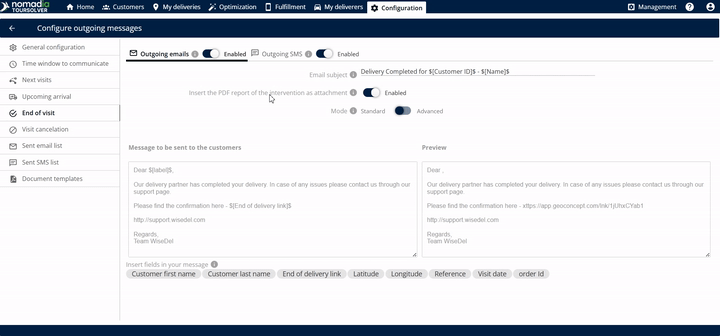
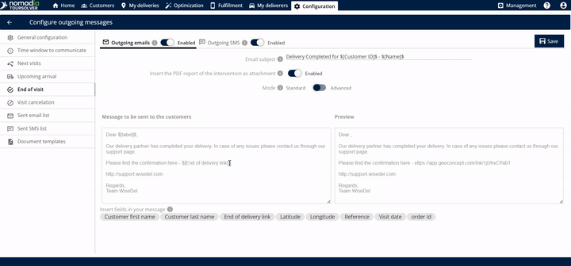
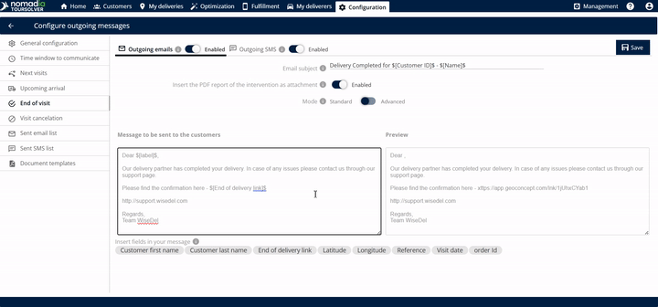
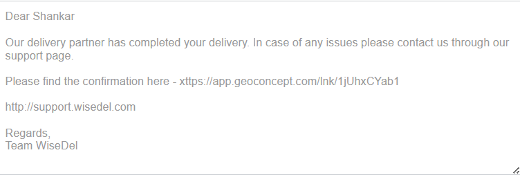

# End of Visit

Send your customer an email with a PDF proof of delivery (PoD) once the delivery is completed.

## Before you begin

* Sign in to **TourSolver**.
* Set up the outgoing email service. See [General Configuration](general-configuration.md).
* Click **End of Visit** to open the configuration screen.

## Feature overview

The **End of Visit** setting automates the follow-up messages sent to your customer. Once the delivery is completed, the customer automatically receives an email with an attached PDF file. This PDF is the official proof of delivery (PoD), and it confirms:

* The name of the customer.
* The address of the customer.
* The signatures collected during the visit.

| Feature | Description |
| ------- | ----------- |
| **ETA Link** | A link with the estimated time of arrival (ETA) is created automatically and sent once the delivery completes. |
| **Email Subject Editing** | Lets you customize the **email subject**, so customers know the purpose of the message at once. |
| **Message Body Editing** | Lets you **edit the message** sent to your customers, with personalized language and important details. |
| **Personalization Tags ($)** | Entering the **dollar symbol** ($) shows options that you can insert and edit in the body of the email. |
| **Preview Window** | Shows a **preview** of the exact message before you save, so that it looks professional and accurate. |
| **Live Location Tracking** | The link lets the customer track the live location of the delivery (or the deliverer). |
| **Outgoing Email** | Option to send the ETA link by email. |
| **Outgoing SMS** | Option to send the ETA link by text message. |

## Enable the outgoing channels

1. Enable the **outgoing emails** option.

2. Set the **email subject**.

3. Turn on the toggle to send the PoD as a PDF file.

4. Click **Save** to apply the changes to the modified template.

## Customize and review the message

1. Change the communication **mode** to **standard** or **advanced**, depending on the level of detail that you need.

2. Look at the section that shows the **message to be sent to the customer**.
3. Optional: To adjust the content, **edit the body of the email**.

4. Check the **preview** area to see how the final email looks to the customer.
5. Optional: To include dynamic information, such as the customer's name or specific appointment details, enter the **dollar symbol** ($). The options that you can use to edit the body of the email are displayed.

6. Click **Save**.

### Result

The customer receives the following email.

<figure><figcaption></figcaption></figure>

## Tips


**Check the PoD content**: The PDF attachment is crucial. The customer verifies their name, address, and signatures in the attachment.



**Use the preview**: Before you save any changes, use the preview to double-check the formatting and make sure that the message body reads correctly. It shows exactly what the customer sees.



**Use personalization tags**: Tags make the message feel more direct and professional.



**Verify the attachment**: Make sure that the option **Insert the PDF report of the intervention as attachment** is enabled. It guarantees that the proof of delivery is included.


## Related topics

* [General Configuration](general-configuration.md)
* [Next Visits](next-visits.md)
* [Visit Cancellation](visit-cancellation.md)
