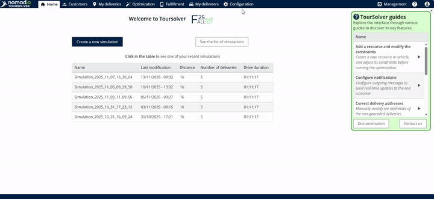
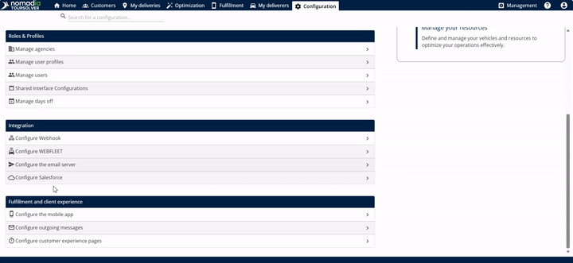
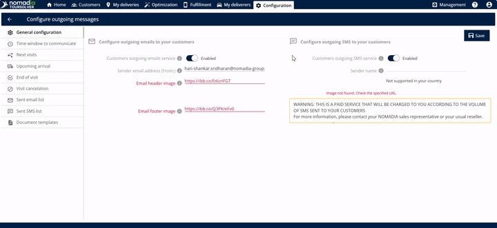
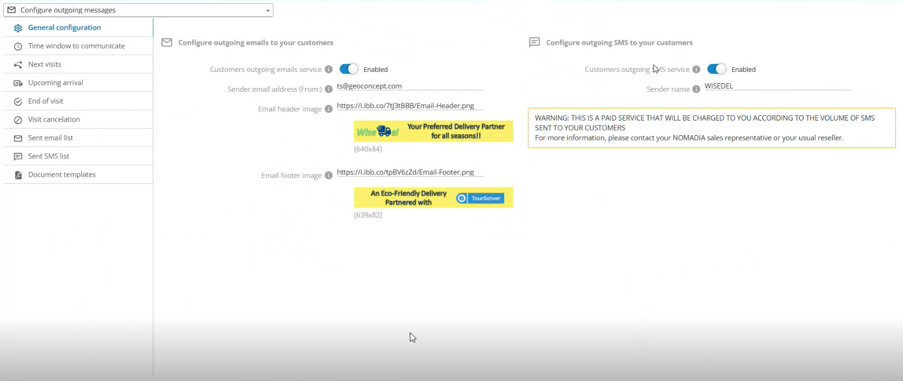
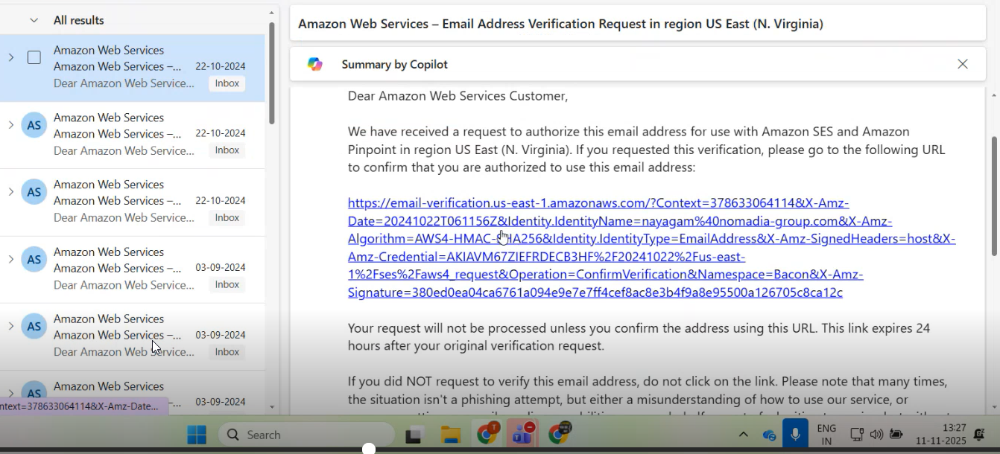
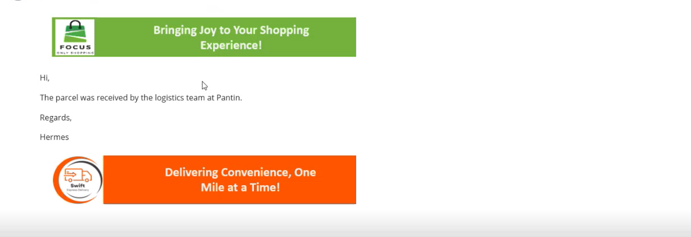

# General Configuration

Enable, disable, and customize the outgoing email and SMS services that send messages to your customers.

## Before you begin

* Sign in to **TourSolver**.
* Have a sender email address that you can open, because you must validate it.
* Know that the outgoing SMS service is a paid service.

## Feature overview

The **General configuration** screen manages two ways to reach your customers:

| Feature | Description and benefit |
| ------- | ----------------------- |
| **Customer Outgoing Email Service** | Lets the system send emails to customers on your behalf. You can customize the look of your emails with branding elements, such as header and footer images. |
| **Customer Outgoing SMS Service** | Lets the system send text messages (SMS) directly to customers. It provides fast, direct communication for urgent or important updates. |

For SMS:

* **Paid service**: Enabling the outgoing SMS service is a paid service. You are charged based on the volume of SMS messages sent to your customers.
* **Character limit**: A standard SMS message is **160 characters**. A longer message is automatically split into two SMS messages.

## Open the General configuration screen

1. From the **home page**, go to the customer communication settings.

2. Click **Configure Outgoing Message**.

3. The **General configuration** screen opens.

## Enable and customize the outgoing email

1. Enable the **customer outgoing email service**.
2. Enter the **sender email address**.

3. Optional: Enter the **header image link** and the **footer image link**. They often contain legal information or contact details.


If you do not enter a header image link and a footer image link, the email is sent without these visual elements.


## Enable the outgoing SMS

1. Locate the **customer outgoing SMS service** and enable it.

Your customers then start receiving SMS messages from the system.

## Save the changes and validate your email

To activate your communication setup, save your modifications and validate the sender email.

1. Click **Save**.
2. The system sends an email to the sender address that you provided. It includes a **link to validate the email**.

<figure><figcaption></figcaption></figure>

3. Open the validation email in your inbox and click the link.

<figure><figcaption></figcaption></figure>

### Result

The system is authorized to send emails to customers on your behalf.

<figure><figcaption></figcaption></figure>

## Tips


**Consistent branding**: Enter both the **header image link** and the **footer image link**, so that all emails sent to your customers keep a professional branding.



**Watch the character count**: SMS is a paid subscription, and each message is limited to **160 characters**. Keep your messages concise to avoid having them split into two chargeable messages.



**Validate immediately**: Complete the validation step right after you click **Save**. The validation link confirms that TourSolver has permission to send messages with your sender address.


## Related topics

* [Time Window to Communicate](time-window-to-communicate.md)
* [Upcoming Arrival](upcoming-arrival.md)
* [Next Visits](next-visits.md)
* [End of Visit](end-of-visit.md)
* [Visit Cancellation](visit-cancellation.md)
