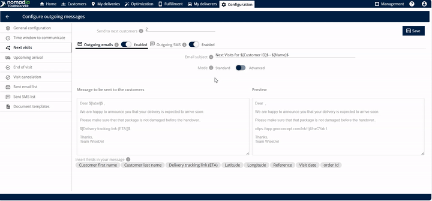
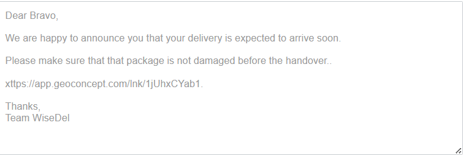

# Next Visits

Notify your upcoming customers automatically that you are on your way.

## Before you begin

* Sign in to **TourSolver**.
* Set up the outgoing email and SMS services. See [General Configuration](general-configuration.md).
* Click **Next visits** to open its configuration.

## Feature overview

The Next Visits feature automates notifications so that your upcoming customers know that you are on your way. It ensures smooth communication and a better preparation for your arrival. You choose how many upcoming customers receive the message, customize the content, and decide whether to send it by email or by SMS.

| Feature | Description |
| ------- | ----------- |
| **ETA Link** | A link with the estimated time of arrival (ETA) is created automatically and sent once the delivery completes. |
| **Email Subject Editing** | Lets you customize the **email subject**, so customers know the purpose of the message at once. |
| **Message Body Editing** | Lets you **edit the message** sent to your customers, with personalized language and important details. |
| **Personalization Tags ($)** | Entering the **dollar symbol** ($) shows options that you can insert and edit in the body of the email. |
| **Preview Window** | Shows a **preview** of the exact message before you save, so that it looks professional and accurate. |
| **Live Location Tracking** | The link lets the customer track the live location of the delivery (or the deliverer). |
| **Outgoing Email** | Option to send the ETA link by email. |
| **Outgoing SMS** | Option to send the ETA link by text message. |

## Define the number of customers to notify

Specify the number of upcoming customers that you want to notify. You can notify the next one, two, or three customers.

* If you enter **one**, the email is sent to the next customer.
* If you enter **two**, the email is sent to the next two customers.
* If you enter **three**, or any number you wish, the email is sent to that number of customers.

## Customize and save the settings

1. Enter the **email subject**, a clear and concise title.

2. Edit the **message content** that is sent to your customers.
3. Optional: To include dynamic information, such as the customer's name or specific appointment details, enter the **dollar symbol** ($). The options that you can use to edit the body of the email are displayed.

4. Check the **preview** area to see how the final email looks to the customer.
5. Click **Save**.

### Result

The customer receives the following email.

<figure><figcaption></figcaption></figure>

## Tips


**Maximize the customization**: Use the dollar symbol ($) when you edit the message body. It gives you the available fields for dynamic content, so you create professional and detailed messages without manual entry every time.



**Use personalization tags**: Tags make the message feel more direct and professional.


## Related topics

* [General Configuration](general-configuration.md)
* [Upcoming Arrival](upcoming-arrival.md)
* [End of Visit](end-of-visit.md)
