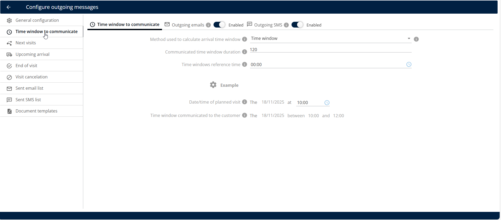
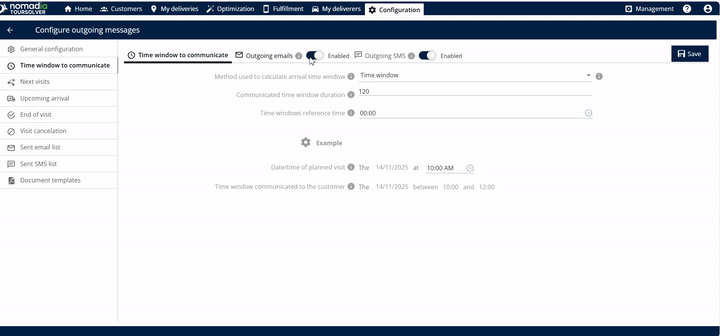
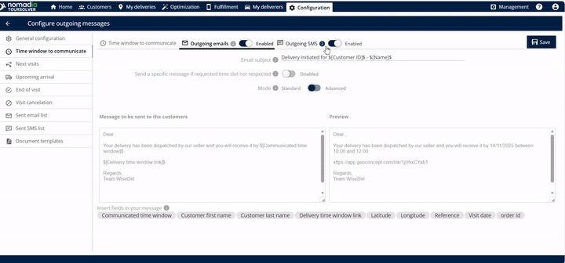
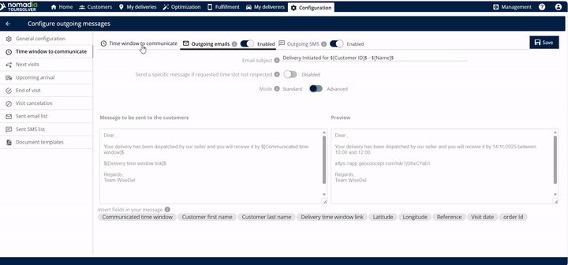
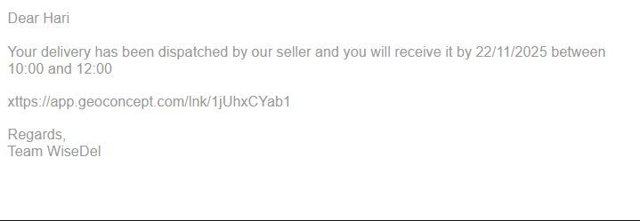

# Time Window to Communicate

Define the timeframe that you communicate to a customer for an upcoming visit, and manage the outgoing email and SMS.

## Before you begin

* Sign in to **TourSolver**.
* Set up the outgoing email and SMS services. See [General Configuration](general-configuration.md).
* Click **Time Window to communicate**.

<figure><figcaption></figcaption></figure>

## Feature overview

This feature controls how the arrival information is calculated and delivered.

| Feature | Description |
| ------- | ----------- |
| **ETA Link** | A link with the estimated time of arrival (ETA) is created automatically and sent once the delivery completes. |
| **Email Subject Editing** | Lets you customize the **email subject**, so customers know the purpose of the message at once. |
| **Message Body Editing** | Lets you **edit the message** sent to your customers, with personalized language and important details. |
| **Personalization Tags ($)** | Entering the **dollar symbol** ($) shows options that you can insert and edit in the body of the email. |
| **Preview Window** | Shows a **preview** of the exact message before you save, so that it looks professional and accurate. |
| **Live Location Tracking** | The link lets the customer track the live location of the delivery (or the deliverer). |
| **Outgoing Email** | Option to send the ETA link by email. |
| **Outgoing SMS** | Option to send the ETA link by text message. |

## Set up the time window and the notifications

1. Click **Time Window to communicate**.
2. Select the **time window method** that is used to calculate the arrival time window.

3. Enter the **duration** of the communicated time window.


Entering **120 minutes** results in a 2-hour window communicated to the customer, for example 10 a.m. to 12 p.m.


4. Select the **reference time**.

5. Find the **Date and time of planned visit** field and enter the planned visit details.

6. Review the calculated time window. The system displays the **time window communicated to the customer**. For example, with a duration of 2 hours, the window can be 10 a.m. to 12 p.m.
7. Enable the **outgoing emails** option.
   * Review the message that is sent to the customer, below this section.
   * Optional: To include dynamic information, such as the customer's name or specific appointment details, enter the **dollar symbol** ($). The options that you can use to edit the body of the email are displayed.

8. Optional: Enable the **outgoing SMS** option.
   * Optional: To include dynamic information, enter the **dollar symbol** ($). The options that you can use to edit the body of the message are displayed.

9. Save your settings.

### Result

The customer receives the following email.

<figure><figcaption></figcaption></figure>

## Tips


**Use personalization tags**: Tags make the message feel more direct and professional.



**Use the preview**: Use the message **preview** for both the outgoing email and the outgoing SMS. It confirms what the customer sees before you save your settings.



**Keep durations clear**: For the **Communicated Time Window Duration**, choose common increments, such as 60 or 120 minutes, that customers understand easily. A clear, defined window prevents confusion.


## Related topics

* [General Configuration](general-configuration.md)
* [Upcoming Arrival](upcoming-arrival.md)
* [Next Visits](next-visits.md)
