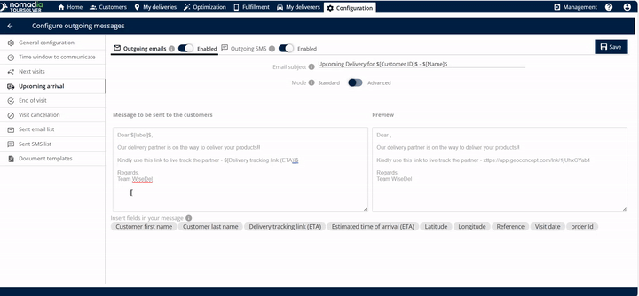
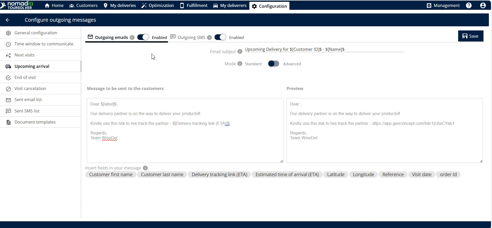
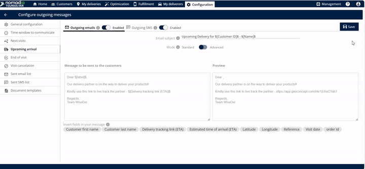
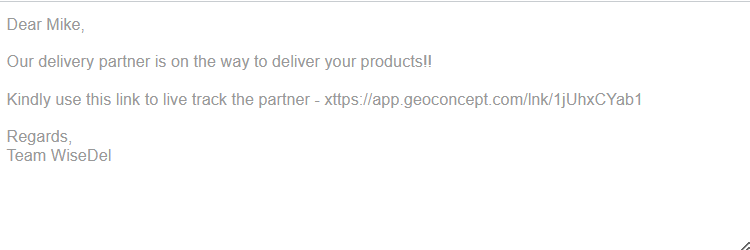

# Upcoming Arrival

Send your customer an estimated time of arrival (ETA) link when the delivery process begins, so that they can track the live location of the deliverer.

## Before you begin

* Sign in to **TourSolver**.
* Set up the outgoing email and SMS services. See [General Configuration](general-configuration.md).
* Click **Upcoming Arrival** to open its configuration.

## Feature overview

The Upcoming Arrival feature provides real-time delivery status updates and enables proactive communication, so that customers are ready to receive their items. Its core benefit is transparency: the customer clicks the link and tracks the live location of the deliverer.

| Feature | Description |
| ------- | ----------- |
| **ETA Link** | A link with the estimated time of arrival (ETA) is created automatically and sent once the delivery completes. |
| **Email Subject Editing** | Lets you customize the **email subject**, so customers know the purpose of the message at once. |
| **Message Body Editing** | Lets you **edit the message** sent to your customers, with personalized language and important details. |
| **Personalization Tags ($)** | Entering the **dollar symbol** ($) shows options that you can insert and edit in the body of the email. |
| **Preview Window** | Shows a **preview** of the exact message before you save, so that it looks professional and accurate. |
| **Live Location Tracking** | The link lets the customer track the live location of the delivery (or the deliverer). |
| **Outgoing Email** | Option to send the ETA link by email. |
| **Outgoing SMS** | Option to send the ETA link by text message. |

## Set up the customer notifications

Choose the communication channels for the ETA and the live location link.

1. Click **Upcoming Arrival**.
2. Enable the **outgoing emails** option.

3. Optional: Enable the **outgoing SMS** option.
4. Optional: To include dynamic information, such as the customer's name or specific appointment details, enter the **dollar symbol** ($). The options that you can use to edit the body of the email are displayed.

5. Recommended: Select the option to **see the preview of the email**, to confirm the customer experience.
6. Click **Save**.

### Result

The customer receives the following email.

<figure><figcaption></figcaption></figure>

## Tips


**Use both channels**: Enable both the outgoing emails and the outgoing SMS. The customer then receives the ETA information whether they check their inbox or their text messages first.



**Use personalization tags**: Tags make the message feel more direct and professional.



**Always preview**: Use the option to **see the preview of the email** before you save. It lets you verify that the message contains the live location link.



**Trigger point**: The ETA link is sent once the deliverer completes the delivery phase, which means that they are on their way to the customer. Make sure that this matches when you want the customer to start tracking the live location.


## Related topics

* [General Configuration](general-configuration.md)
* [Time Window to Communicate](time-window-to-communicate.md)
* [Next Visits](next-visits.md)
