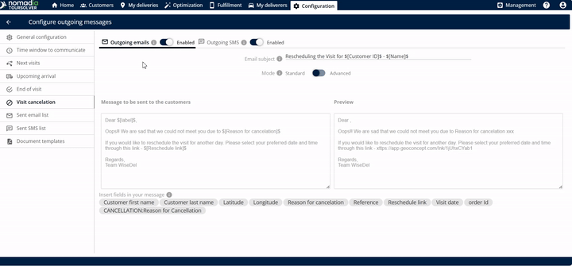
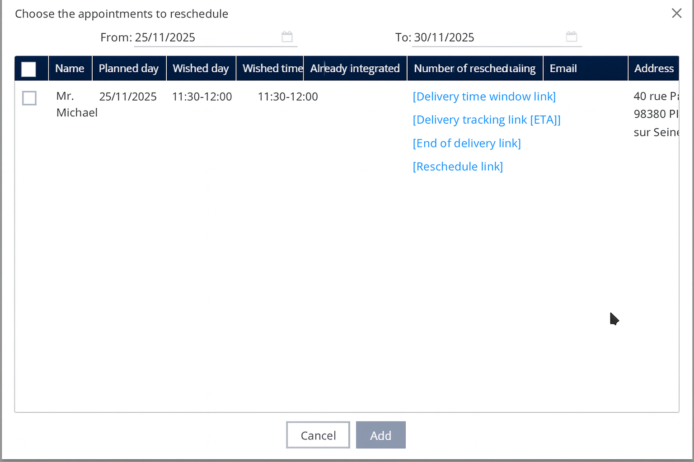

# Visit Cancellation

Mark a visit as cancelled and prompt the end customer to select a new date and time.

## Before you begin

* Sign in to **TourSolver**.
* Set up the outgoing email and SMS services. See [General Configuration](general-configuration.md).
* Make sure that the communication channels are active, so that the customer receives the rescheduling link.

## Feature overview

This feature streamlines the communication and the logistics when a delivery attempt fails because the customer is unavailable. You mark the visit as cancelled, and the system prompts the customer to select a new date and time.

| Feature | Description |
| ------- | ----------- |
| **ETA Link** | A link with the estimated time of arrival (ETA) is created automatically and sent once the delivery completes. |
| **Email Subject Editing** | Lets you customize the **email subject**, so customers know the purpose of the message at once. |
| **Message Body Editing** | Lets you **edit the message** sent to your customers, with personalized language and important details. |
| **Personalization Tags ($)** | Entering the **dollar symbol** ($) shows options that you can insert and edit in the body of the email. |
| **Preview Window** | Shows a **preview** of the exact message before you save, so that it looks professional and accurate. |
| **Live Location Tracking** | The link lets the customer track the live location of the delivery (or the deliverer). |
| **Outgoing Email** | Option to send the ETA link by email. |
| **Outgoing SMS** | Option to send the ETA link by text message. |

## Set up the cancellation message

1. Click **Visit cancellation**.
2. Turn on both outgoing communication types:
   * **Outgoing emails**
   * **Outgoing SMS**
3. Enter the **subject** that you want the customer to see, for the emails and the SMS.
4. Optional: To include dynamic information, such as the customer's name or specific appointment details, enter the **dollar symbol** ($). The options that you can use to edit the body of the email are displayed.


The body of the email automatically includes the **reason for cancellation** and the **rescheduling date** information.


## Find the visits to reschedule

After a visit is cancelled, the deliverer pulls the appointment back into the schedule once a new date is selected.

1. Go to the **Fulfillment** tab.
2. Click **to be rescheduled**.
3. Review the rescheduled data.

<figure><figcaption></figcaption></figure>

## Add the appointment back to the schedule

1. The deliverer clicks **my deliveries**.
2. Click **add appointments to reschedule**.
3. List the data and click **add**.

### Result

The rescheduled visits are added successfully to the next simulation or optimization.

<figure><figcaption></figcaption></figure>

## Tips


**Enable both channels**: Enable the outgoing emails and the outgoing SMS when you set up the cancellation. Customers can then access the rescheduling link even if one method is missed.



**Use personalization tags**: Tags make the message feel more direct and professional.



**Use the preview**: Before you click **Save**, use the option to **see the preview of the email**. It confirms that the cancellation reason and the rescheduling link are displayed correctly.



**Track the rescheduled items**: Check the **Fulfillment** tab under **to be rescheduled** regularly, so that no cancelled visit is missed.


## Related topics

* [General Configuration](general-configuration.md)
* [End of Visit](end-of-visit.md)
* [Add appointments to reschedule](../simulation/simulation-deliveries-add-appointments-to-reschedule.md)
