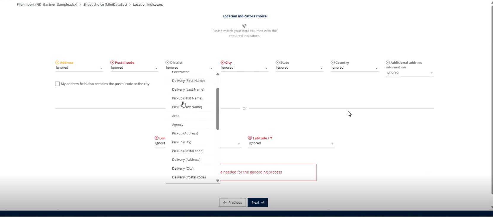

# How do I optimize geocoding in TourSolver?

Improve the geocoding quality of your addresses, so that your deliveries are located accurately.

## Before you begin

* Sign in to **TourSolver**.
* Prepare the address data that you import. See [Import of Deliveries](../importanddatasetup/importanddatasetup-importofdeliveries.md).

## Feature overview

* **Complete addresses**: Better data gives better geocoding results.
* **Consistent address format**: Structured columns or one combined field.
* **District column**: Helps the system locate the right area.
* **GPS coordinates**: Skip the address geocoding for the highest accuracy.
* **Geocoding quality indicators**: Show the points that need a correction.
* **Repositioning option in the mobile app**: Corrects a location from the field.

## Provide complete and accurate addresses

Make sure that each address includes the street name, the number, the postal code, the city, and the country. Clean and consistent data improves the geocoding results.

## Use one format for the address components

TourSolver supports two formats to enter address information:

1. **Structured columns**: Street, Postal Code, City, and Country entered separately.
2. **Single combined field**: The full address entered in one column.


**Be consistent**: To ensure accurate geocoding, choose one format and use it consistently. Do not mix structured columns with a combined field in the same dataset, because it can cause errors or inconsistencies in the address recognition.


## Verify the district information

To improve the geocoding accuracy, always specify the correct district when you enter address data. TourSolver includes a dedicated **District column**, which helps the system narrow down the search and locate the right area more effectively.

Using the district field consistently ensures that addresses are matched to the correct geographic zone and reduces errors in route planning.

<figure><figcaption></figcaption></figure>

## Use GPS coordinates when available

If you have latitude and longitude values, include them. TourSolver uses them directly and skips the address geocoding, which gives a higher accuracy.

## Review the geocoding quality after the import

Use the geocoding quality indicators to identify incorrect or low-quality points, and correct them in the data.

## Use the repositioning option in the mobile app

TourSolver provides a **Repositioning option** in the mobile application. It lets users update or adjust the location directly from their mobile device, so that the recorded position is accurate and aligned with the actual site.

Using the repositioning option helps correct minor discrepancies and improves the precision of the geocoded addresses in route planning.

## Related topics

* [Import of Deliveries](../importanddatasetup/importanddatasetup-importofdeliveries.md)
* [Modify Address of a Delivery](../importanddatasetup/modifyaddressofadelivery.md)
