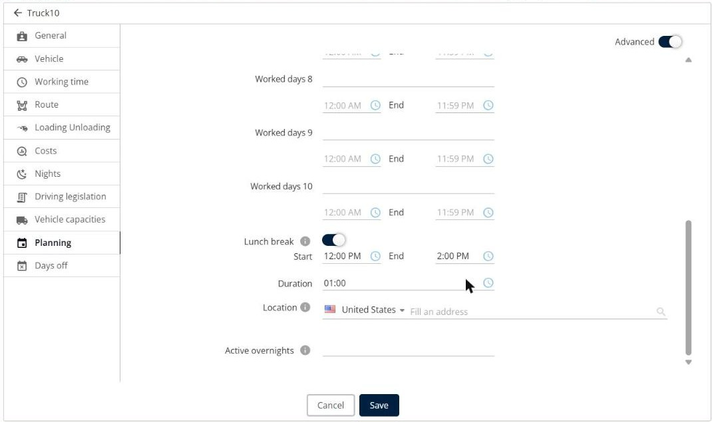
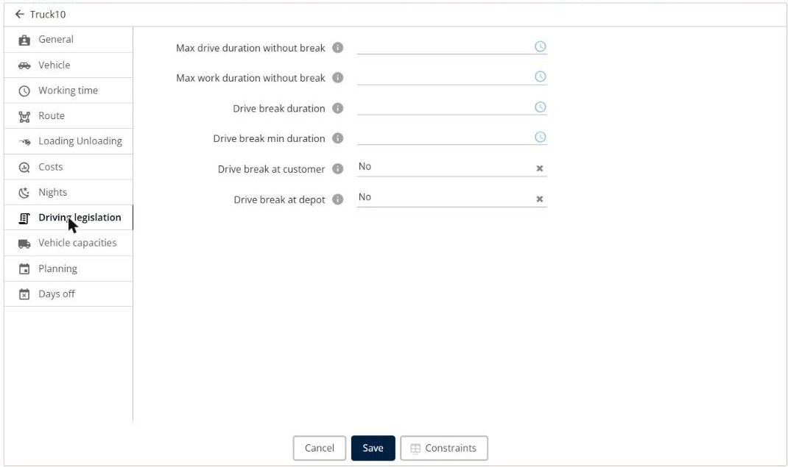
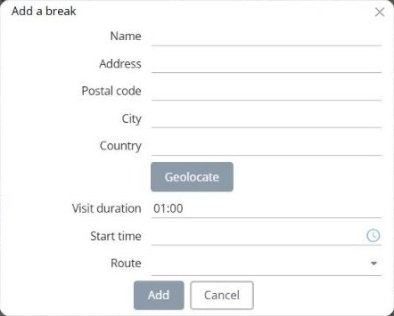

# How do I add lunch breaks and legal driving breaks?

Set the lunch break and the driving breaks of your resources, add a break to a route, and avoid the most common mistakes.

## Before you begin

* Sign in to **TourSolver** with a user profile that can modify the resources.

## Feature overview

* **Lunch break**: A break of each resource, with a start, an end, a duration, and an optional location. The optimization places it in the route.
* **Driving legislation**: The maximum drive and work durations without a break, and the duration of the drive breaks.
* **Add a break**: Adds a break to a route of a simulation.
* **Break visit**: A line of your import file that the driver validates in the mobile app like a visit.

## Set the lunch break of a resource

1. Go to **My deliverers**, and then click the **Edit** icon of the resource.
2. Click the **Planning** tab.
3. Turn on **Lunch break**.
4. Enter the **Start** and the **End** of the period in which the lunch break can take place, for example **12:00 PM** to **2:00 PM**.
5. Enter the **Duration** in the **HH:MM** format, for example **01:00** for one hour. Do not enter **60**.
6. Optionally, enter the **Location** of the lunch break.
7. Click **Save**.

<figure><figcaption></figcaption></figure>


**Fill in all the fields**: The lunch break is taken into account only if the start, the end, and the duration are filled in. The duration cannot be longer than the time between the start and the end.


## Set the legal driving breaks of a resource

1. Go to **My deliverers**, and then click the **Edit** icon of the resource.
2. Click the **Driving legislation** tab.
3. Fill in the fields, in the **HH:MM** format:
   * **Max drive duration without break**
   * **Max work duration without break**
   * **Drive break duration**
   * **Drive break min duration**
4. Select whether the drive break can take place at a customer (**Drive break at customer**) or at the depot (**Drive break at depot**).
5. Click **Save**.

<figure><figcaption></figcaption></figure>

## Choose how to add a break to a route

You can add a break in two ways:

* **In the simulation, on the Optimization page**: Click the **Deliveries** menu, and then click **Add a break**. Enter the name, the address, the **Visit duration** (for example **01:00**), the **Start time**, and the **Route**. See [Add a break](../simulation/simulation-deliveries-add-break.md).
* **In your import file**: Add a line for the break, for example with the name **Lunch break**, the address of the break, a **Visit duration** of **01:00**, and its time window. The break is then sent to the mobile app as a visit, and the driver validates it like the other visits.

<figure><figcaption></figcaption></figure>

## Tips


**Manual changes do not add the break**: When you assign a visit to a route manually, TourSolver does not add or move the lunch break. Re-optimize the route to place the break.



**Re-optimizing removes manual breaks**: The breaks that you added with **Add a break** are removed when you re-optimize the route. TourSolver shows the message "Some of the selected routes have manually added breaks. Re-optimizing will remove them."



**Split break not available**: A resource has a single lunch break slot, common to all days. You cannot split the lunch break into several parts. This feature is an enhancement request.


## Related topics

* [Add a break](../simulation/simulation-deliveries-add-break.md)
* [Creating a Resource](../resource-and-vehicle-management/creating-a-resource.md)
* [Why do I have waiting time in my route plan?](13.-why-do-i-have-waiting-time-in-my-route-plan.md)
