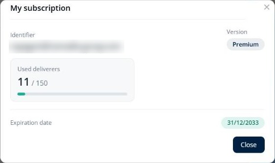
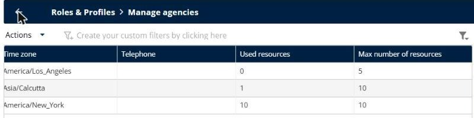
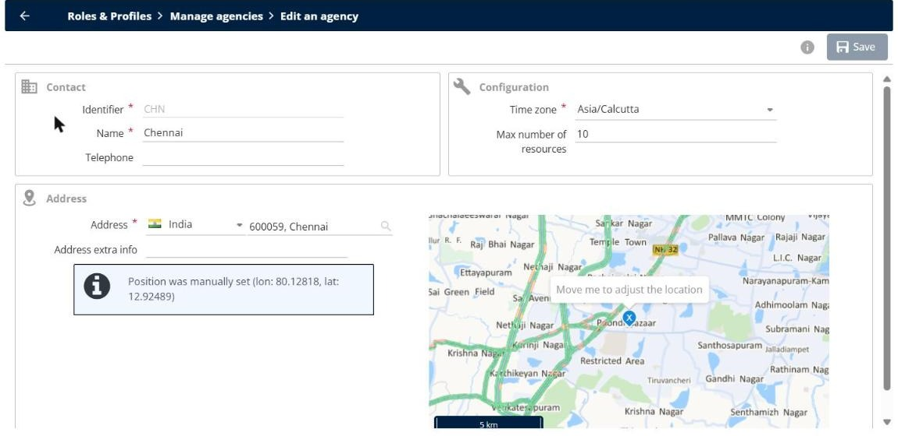

# How do I increase the number of resources, licences, or the SMS quota?

Check how many resources your subscription allows, share them between your agencies, and request more resources, licences, or SMS.

## Before you begin

* Sign in to **TourSolver** with a user profile that has access to the **Configuration** page.

## Feature overview

* **My subscription**: Shows your version, the number of used deliverers out of the number that your subscription allows, and the expiration date.
* **Max number of resources**: The number of resources that each agency can use. The total of all the agencies cannot exceed your subscription.
* **Account manager and Sales Admin**: The only contacts who can add resources, licences, or SMS to your subscription. Support cannot add them.

## Check your quota

1. Click the **user icon** at the top right of TourSolver.
2. Click **My subscription**.
3. Check the **Used deliverers** counter, for example **11 / 150**, and the **Expiration date**.

<figure><figcaption></figcaption></figure>

4. Click **Close**.

## Check the resources of each agency

1. Go to **Configuration**.
2. Under **Roles & Profiles**, click **Manage agencies**.
3. Scroll the list to the right, and then compare the **Used resources** and **Max number of resources** columns of each agency.

<figure><figcaption></figcaption></figure>

If an agency has reached its maximum, you cannot add a resource to it, and the message "resources limit of the following agencies would be exceeded" appears.

## Share the resources between your agencies

If your subscription still has free resources, or if another agency does not use all its resources, move them to the agency that needs them.

1. In **Manage agencies**, click the **Edit** icon of the agency that has free resources.
2. Decrease its **Max number of resources**, and then click **Save**.
3. Click the **Edit** icon of the agency that needs more resources.
4. Increase its **Max number of resources**, and then click **Save**.

<figure><figcaption></figcaption></figure>

## Request more resources, licences, or SMS

If all the resources of your subscription are used, contact your account manager or the Sales Admin team. Give them:

* The name of your company and the email address of your TourSolver administrator account.
* The number of resources, licences, or SMS that you need.
* The agencies that need the additional resources.

After your subscription is updated, log out and log in again to see the new quota.

## Tips


**Invalid code message**: The **Identifier** of an existing agency cannot be changed. If the message "Invalid code" appears when you save an agency, check the **Identifier** field. If the message persists, contact support.



**Transfer the rights of a user**: To give the rights and the data of a user to another user, see [Create and Modify a User](../importanddatasetup/importanddatasetup-createandmodifyauser.md).


## Related topics

* [How Many Resources Can I Create?](how-many-resources-can-i-create.md)
* [How to modify my subscription](16.-how-to-modify-my-subscription.md)
* [Creating a Resource](../resource-and-vehicle-management/creating-a-resource.md)
* [Create and Modify a User](../importanddatasetup/importanddatasetup-createandmodifyauser.md)
