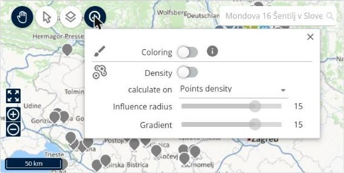
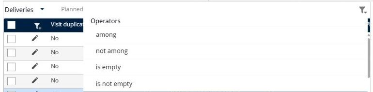
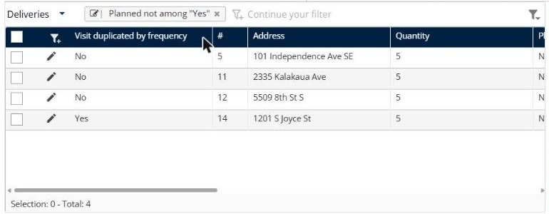
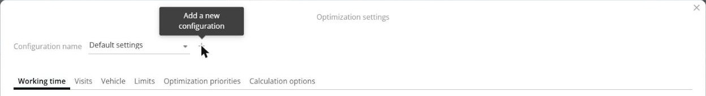

# How do I manage colors, filters, and displayed columns?

Restore the colors of the points on the map, understand the route colors, filter your lists, and save your optimization settings as a configuration.

## Before you begin

* Sign in to **TourSolver**, and then open a simulation.

## Feature overview

* **Graphical information > Coloring**: Colors the points of the map according to a rule. When it is on, the points no longer show the route colors.
* **Route colors**: Colors that TourSolver gives automatically to each route.
* **Custom filters**: Filters that you build in the bar above a list, with an operator such as **among** or **not among**.
* **Configuration name**: Saves your optimization settings under a name, so that you can use them again.

## Restore the colors of the points on the map

If all the points of the map have the same color, or not the color of their route, the **Coloring** of the map is probably turned on.

1. On the map, click **Graphical information**.
2. Turn off **Coloring**.

<figure><figcaption></figcaption></figure>

### Result

The points of the map show the colors of their routes again.

To color the deliveries with your own rules instead, see [Color the deliveries](../simulation/simulation-deliveries-coloring.md).

## Understand the route colors

* TourSolver gives a color to each route automatically.
* The colors can differ from one user to another, and from one simulation to another. Do not use a route color to identify a driver. Use the route name instead.
* To give fixed colors to your deliveries, create **Coloring** rules, for example one color for each deliverer. See [Color the deliveries](../simulation/simulation-deliveries-coloring.md).

## Filter a list

1. Click **Create your custom filters by clicking here** above the list.
2. Select a column, for example **Planned**.
3. Select an operator: **among**, **not among**, **is empty**, or **is not empty**.

<figure><figcaption></figcaption></figure>

4. Select the value, for example **Yes**, and then press **Enter**.

<figure><figcaption></figcaption></figure>

### Result

The list shows only the matching rows, for example **Planned not among "Yes"** shows the unplanned deliveries. To remove the filter, click the **x** of the filter.


**Hide the finished visits**: In **Fulfillment**, use the same method to build the filter **Status not among Finished**, so that the list shows only the visits that are not finished yet.


## Customize the displayed columns

To choose the columns of a list and their order, click the list menu, and then click **Customize the list**. See [Customize the deliveries list](../simulation/simulation-deliveries-customize-list.md) and [Customize the routes list](../simulation/simulation-routes-customize-list.md).


**Column width not remembered**: TourSolver keeps the columns that you choose and their order, but not the width of the columns. The width goes back to its default value when you open the page again.


## Save your optimization settings as a configuration

1. In the toolbar of the simulation, click the **See and modify the settings** icon.
2. Next to **Configuration name**, click **+** (**Add a new configuration**).

<figure><figcaption></figcaption></figure>

3. Enter a name, set the options on the tabs (**Working time**, **Visits**, **Vehicle**, **Limits**, **Optimization priorities**, **Calculation options**), and then click **Save**.
4. To edit a configuration, select it in **Configuration name**, change the options, and then click **Save**.

### Result

The configuration is available in **Optimization settings** when you define the scope of an optimization.

## Related topics

* [Use graphical information](../simulation/simulation-map-graphical-information.md)
* [Color the deliveries](../simulation/simulation-deliveries-coloring.md)
* [Customize the deliveries list](../simulation/simulation-deliveries-customize-list.md)
* [Diagnose Unplanned Visits and Inconsistent Routes](../operationsandroutemanagement/diagnose-unplanned-visits-and-inconsistent-routes.md)
