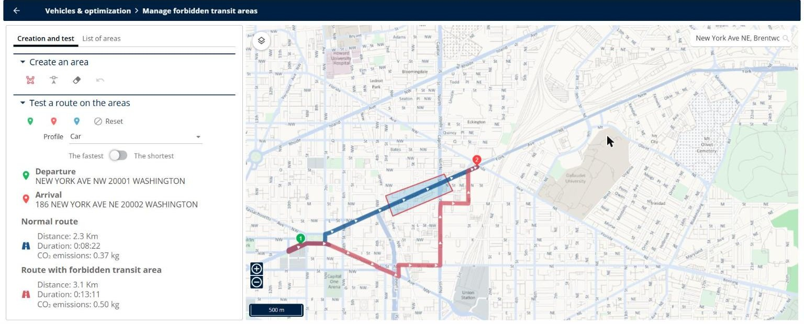

# How do I use forbidden transit areas?

Draw the areas that your vehicles must not drive through, for example roadworks or a city center, test a route on them, and use them in your optimizations.

## Before you begin

* Sign in to **TourSolver** with a user profile that has access to the **Configuration** page.

## Feature overview

* **Forbidden transit area**: An area drawn on the map that the routes go around.
* **Manage forbidden transit areas**: The page where you create, modify, delete, and test the areas.
* **Use forbidden transit areas**: The calculation option that takes the areas into account in the optimization.
* **useForbiddenTransitAreas**: The parameter that takes the areas into account in an optimization started with the API.

## Create a forbidden transit area

To create an area, go to **Configuration** > **Vehicles & optimization** > **Manage forbidden transit areas**, and then draw the area on the map. For the complete procedure, with an example of a road closure, see [Create and Use Forbidden Transit Areas](../importanddatasetup/create-and-use-forbidden-transit-areas.md).

<figure><figcaption></figcaption></figure>

## Use the areas in the optimization

1. Go to **Configuration** > **Vehicles & optimization** > **Calculation options**.
2. Turn on **Use forbidden transit areas**.

<figure><figcaption></figcaption></figure>

3. To turn the areas on or off for one optimization only, open the **Optimization settings** of your simulation, click the **Vehicle** tab, and then set **Use forbidden transit areas** to **Yes** or **No**.

### Result

The optimized routes go around the enabled areas. Only the areas whose **Usage** is **Enabled** in the **List of areas** are taken into account.

## Use the areas with the API

When you start an optimization with the TourSolver API, set the **useForbiddenTransitAreas** option to **true**. See the [TourSolver API documentation](https://toursolver.readme.io/reference/introduction).

## Tips


**One means of transportation per simulation**: The forbidden transit areas apply to only one means of transportation per simulation. If your resources use different vehicle profiles, optimize them in separate simulations.



**Delivery inside an area**: If a delivery is inside a forbidden transit area, TourSolver shows "This address is inside a forbidden transit zone", and the route cannot reach it. Check the address of the delivery, or change the area.


## Related topics

* [Create and Use Forbidden Transit Areas](../importanddatasetup/create-and-use-forbidden-transit-areas.md)
* [Why are distances and travel times different from Google Maps?](why-are-distances-and-travel-times-different-from-google-maps.md)
* [Where can I find my API key and the API documentation?](where-can-i-find-my-api-key-and-the-api-documentation.md)
* [Optimize your Deliveries](../operationsandroutemanagement/operationsandroutemanagement-optimizeyourdeliveries.md)
