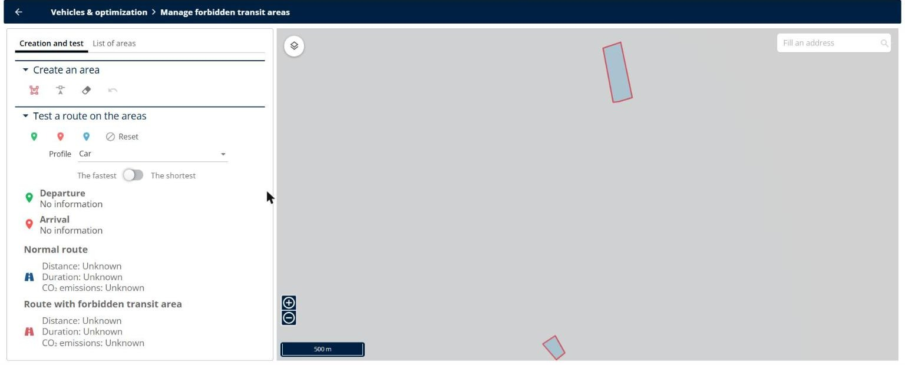
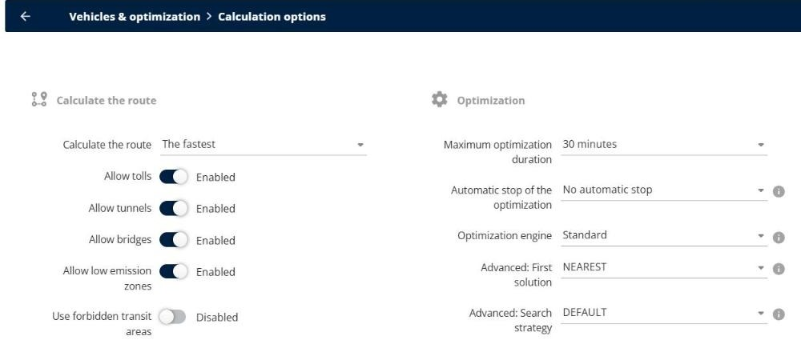

# How do I use forbidden transit areas?

Draw the areas that your vehicles must not drive through, for example roadworks or a city center, test a route on them, and use them in your optimizations.

## Before you begin

* Sign in to **TourSolver** with a user profile that has access to the **Configuration** page.

## Feature overview

* **Forbidden transit area**: An area drawn on the map that the routes go around.
* **Manage forbidden transit areas**: The page where you create, modify, delete, and test the areas.
* **Use forbidden transit areas**: The calculation option that takes the areas into account in the optimization.
* **useForbiddenTransitAreas**: The parameter that takes the areas into account in an optimization started with the API.

## Create a forbidden transit area

1. Go to **Configuration**.
2. Under **Vehicles & optimization**, click **Manage forbidden transit areas**.
3. On the **Creation and test** tab, under **Create an area**, click the first icon, and then click on the map to draw the area.
4. To change an area, click the second icon, and then click the area. To delete an area, click the third icon, and then click the area.

<figure><figcaption></figcaption></figure>

5. Click the **List of areas** tab to see the **Name** and the **Usage** of each area, for example **Enabled**.

## Test a route on the areas

1. On the **Creation and test** tab, under **Test a route on the areas**, select the **Profile**, for example **Car**, and choose **The fastest** or **The shortest** route.
2. Click the green icon, and then click on the map to place the **Departure**.
3. Click the red icon, and then click on the map to place the **Arrival**. To add a stop, click the blue icon, and then click on the map.
4. Compare the **Normal route** with the **Route with forbidden transit area**: their **Distance**, **Duration**, and **CO₂ emissions**.
5. Click **Reset** to start a new test.

## Use the areas in the optimization

1. Go to **Configuration** > **Vehicles & optimization** > **Calculation options**.
2. Turn on **Use forbidden transit areas**.

<figure><figcaption></figcaption></figure>

### Result

The next optimizations go around the enabled areas.

## Use the areas with the API

When you start an optimization with the TourSolver API, set the **useForbiddenTransitAreas** option to **true**. See the [TourSolver API documentation](https://toursolver.readme.io/reference/introduction).

## Tips


**One means of transportation per simulation**: The forbidden transit areas apply to only one means of transportation per simulation. If your resources use different vehicle profiles, optimize them in separate simulations.



**Delivery inside an area**: If a delivery is inside a forbidden transit area, TourSolver shows "This address is inside a forbidden transit zone", and the route cannot reach it. Check the address of the delivery, or change the area.


## Related topics

* [Why are distances and travel times different from Google Maps?](why-are-distances-and-travel-times-different-from-google-maps.md)
* [Where can I find my API key and the API documentation?](where-can-i-find-my-api-key-and-the-api-documentation.md)
* [Optimize your Deliveries](../operationsandroutemanagement/operationsandroutemanagement-optimizeyourdeliveries.md)
