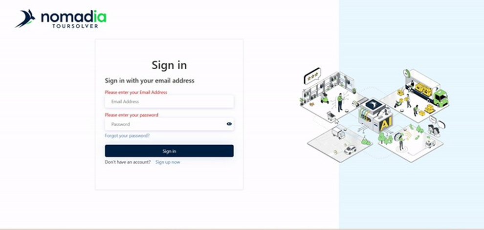
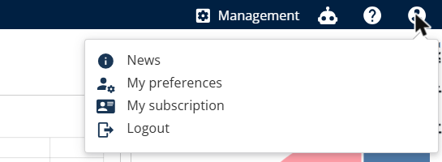

# I cannot log in to TourSolver (web)

Solve the most common sign-in problems yourself, and find out what to send to support if the problem persists.

## Before you begin

* Have the e-mail address of your TourSolver account.
* Use a supported browser. See [Which Browsers and Systems Are Compatible with TourSolver?](which-browsers-and-systems-are-compatible-with-toursolver.md).

## Feature overview

* **Sign-in page**: The only address to use to log in to TourSolver: [https://app.geoconcept.com/ToursolverCloud/ts/trsolver/home](https://app.geoconcept.com/ToursolverCloud/ts/trsolver/home). TourSolver is fully cloud-based, so there is nothing to install.
* **Forgot your password?**: Lets you reset your password yourself with a verification code sent by e-mail.
* **Browser cache and cookies**: Old data stored by the browser can cause a blank page, endless loading or a sign-in loop. Clearing them solves most temporary issues.
* **Platform incident**: A maintenance or incident page (for example **"Sorry. Maintenance in progress…"** with **Error 502**) affects every user, not only your account.

<figure><figcaption>
TourSolver sign-in page
</figcaption></figure>

## Check the sign-in address

1. Open [https://app.geoconcept.com/ToursolverCloud/ts/trsolver/home](https://app.geoconcept.com/ToursolverCloud/ts/trsolver/home).
2. Save this address in your browser favourites.
3. Do not use old bookmarks or links copied from old e-mails, as they can point to an outdated page.

## Reset a forgotten password

1. On the sign-in page, click **Forgot your password?**.
2. Enter the e-mail address of your TourSolver account and click **Send verification code**.
3. Copy the verification code that you receive by e-mail, paste it in the page and click **Verify code**.
4. Click **Continue**.
5. Enter your new password twice and confirm.
6. Log in with your new password.


**Password requirements**: Your password must contain at least one uppercase letter, one lowercase letter, one number and one special character.


If you do not receive the verification code:

* Wait a few minutes and check your **Spam / Junk** folder.
* Check that you entered the e-mail address of your TourSolver account.
* Ask your IT department whether e-mails from external senders are filtered.
* If the e-mail address is not recognised, contact your TourSolver administrator: your user may have been deleted or attached to another e-mail address.

## Clear the cache and cookies, or switch browser

1. Open a private window (**Ctrl+Shift+N** in Chrome and Edge, **Ctrl+Shift+P** in Firefox) or another supported browser, and log in.
2. If it works, go back to your usual browser and press **Ctrl+Shift+Delete** (Mac: **Cmd+Shift+Delete**).
3. Select **All time**.
4. Select **Cookies and other site data** and **Cached images and files**.
5. Click **Clear data**.
6. Close all the browser windows, open the browser again and log in.

## Log out and log in again

If you are logged in but TourSolver does not behave as expected (missing menus, access or subscription not updated):

1. Click the **user icon** at the top right of TourSolver.
2. Click **Logout**.
3. Close the tab, open the sign-in page again and log in.

<figure><figcaption>
User menu &gt; Logout
</figcaption></figure>

## Identify a platform incident or an account problem

| What you see | Likely cause | What to do |
| ------------ | ------------ | ---------- |
| **"Sorry. Maintenance in progress…"**, **Error 502 / 503**, or the page does not load | Platform incident or maintenance | Wait a few minutes and try again. Ask a colleague whether they can log in. If the problem lasts more than 15 minutes, report it to support. |
| Your colleagues cannot log in either | Platform incident | Report it to support. |
| Incorrect password, or the account is not found | Account problem | Reset your password, or contact your TourSolver administrator. |
| It works in a private window or another browser only | Local browser problem | Clear the cache and cookies. |
| You can log in, but you see **Subscription ended** or menus are missing | Subscription or user rights | Contact your account manager or your TourSolver administrator. |

<figure><figcaption>
Example of a platform incident
</figcaption></figure>

## Report the problem to support

Prepare this information before you contact support:

* The e-mail address that you use to log in.
* The date and time of the problem, and whether it happens every time.
* Your browser and its version, and whether another browser works.
* The exact error message, with a screenshot of the whole page (address bar included).
* Whether your colleagues are also affected.
* The browser console log.

To capture the browser console log:

1. On the page with the error, press **Ctrl+Shift+I** (Mac: **Cmd+Option+I**) or **F12**.
2. Open the **Console** tab.
3. Press **F5** to reload the page and reproduce the problem.
4. Take a screenshot of the red messages, or right-click in the console and select **Save as…**.
5. Attach the screenshot or the file to your message to support.

## Tips


**Test in a private window first**: It is the quickest way to know whether the problem comes from your browser or from your account.



**Never share your password**: Support never asks you for your password.


## Related topics

* [Signup Process](../getting-started/gettingstarted-signupprocess.md)
* [Which Browsers and Systems Are Compatible with TourSolver?](which-browsers-and-systems-are-compatible-with-toursolver.md)
* [How to modify my subscription?](16.-how-to-modify-my-subscription.md)
