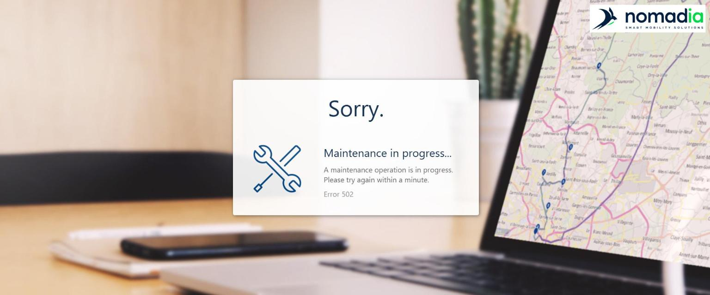

# Why can't I log in to TourSolver?

Solve the most common sign-in problems yourself, and find out what to send to support if the problem persists.

## Before you begin

* Have the email address of your TourSolver account.
* Use a supported browser. See [Which Browsers and Systems Are Compatible with TourSolver?](which-browsers-and-systems-are-compatible-with-toursolver.md).

## Feature overview

* **Sign-in page**: The only address to use to log in to TourSolver.
* **Forgot your password?**: Resets your password with a validation code sent by email.
* **Browser cache and cookies**: Old browser data can cause a blank page, endless loading, or a sign-in loop.
* **Platform incident**: A maintenance or incident page that affects every user, not only your account.
* **Browser console**: Shows the technical errors that support needs to analyze the problem.

## Check the sign-in address

1. Open [https://app-test.geoconcept.com/zToursolverNext/ts/trsolver/home](https://app-test.geoconcept.com/zToursolverNext/ts/trsolver/home).
2. Save this address in your browser favorites.
3. Do not use old bookmarks or links copied from old emails, because they can point to an outdated page.

<figure><figcaption></figcaption></figure>

## Reset a forgotten password

1. On the **Sign in to your account** page, click **Forgot your password?**.
2. On the **Reset your password** page, enter the **E-mail address** of your TourSolver account, and then click **Send the validation code**.

<figure><figcaption></figcaption></figure>

3. Type the validation code that you receive by email, and then click **Next**.
4. Enter your new password twice, and then confirm.
5. Log in with your new password.

If you do not receive the validation code:

* Wait a few minutes, and then check your **Spam** or **Junk** folder.
* Check that you entered the email address of your TourSolver account.
* Ask your IT department whether emails from external senders are filtered.
* If the email address is not recognized, contact your TourSolver administrator. Your user may have been deleted or attached to another email address.

## Clear the cache and cookies, or switch browser

1. Open a private window (**Ctrl+Shift+N** in Chrome and Edge, **Ctrl+Shift+P** in Firefox) or another supported browser, and then log in.
2. If it works, go back to your usual browser and press **Ctrl+Shift+Delete** (Mac: **Cmd+Shift+Delete**).
3. Select **All time**.
4. Select **Cookies and other site data** and **Cached images and files**.
5. Click **Clear data**.
6. Close all the browser windows, open the browser again, and then log in.

## Log out and log in again

If you are logged in but TourSolver does not behave as expected, for example menus are missing or your access or subscription is not updated:

1. Click the **user icon** at the top right of TourSolver.
2. Click **Logout**.
3. Close the tab, open the sign-in page again, and then log in.

<figure><figcaption></figcaption></figure>

## Identify a platform incident or an account problem

* **"Sorry. Maintenance in progress…", Error 502 or 503, or the page does not load**: This is a platform incident or a maintenance. Wait a few minutes and try again, and ask a colleague whether they can log in. If the problem lasts more than 15 minutes, report it to support.
* **Your colleagues cannot log in either**: This is a platform incident. Report it to support.
* **Incorrect password, or the account is not found**: This is an account problem. Reset your password, or contact your TourSolver administrator.
* **It works only in a private window or another browser**: This is a local browser problem. Clear the cache and cookies.
* **You can log in, but you see Subscription ended or menus are missing**: This is a subscription or user rights problem. Contact your account manager or your TourSolver administrator.

<figure><figcaption></figcaption></figure>

## Report the problem to support

1. Prepare the following information:
   * The email address that you use to log in.
   * The date and time of the problem, and whether it happens every time.
   * Your browser and its version, and whether another browser works.
   * The exact error message, with a screenshot of the whole page, address bar included.
   * Whether your colleagues are also affected.
2. On the page with the error, press **Ctrl+Shift+I** (Mac: **Cmd+Option+I**) or **F12** to open the browser console.
3. Open the **Console** tab.
4. Press **F5** to reload the page and reproduce the problem.
5. Take a screenshot of the red messages, or right-click in the console and select **Save as…**.
6. Send the information, the screenshots, and the console file to support.

## Tips


**Test in a private window first**: It is the quickest way to know whether the problem comes from your browser or from your account.



**Never share your password**: Support never asks you for your password.


## Related topics

* [Log in to TourSolver](../getting-started/log-in-to-toursolver.md)
* [Signup Process](../getting-started/gettingstarted-signupprocess.md)
* [Which Browsers and Systems Are Compatible with TourSolver?](which-browsers-and-systems-are-compatible-with-toursolver.md)
* [How to modify my subscription](16.-how-to-modify-my-subscription.md)
