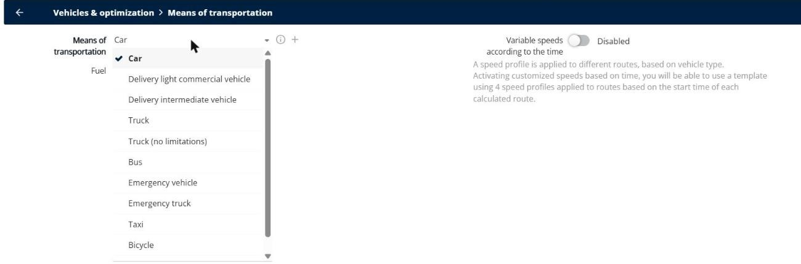
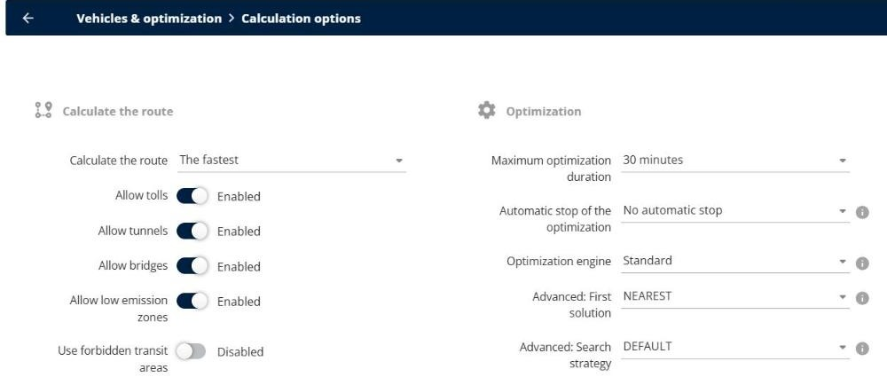
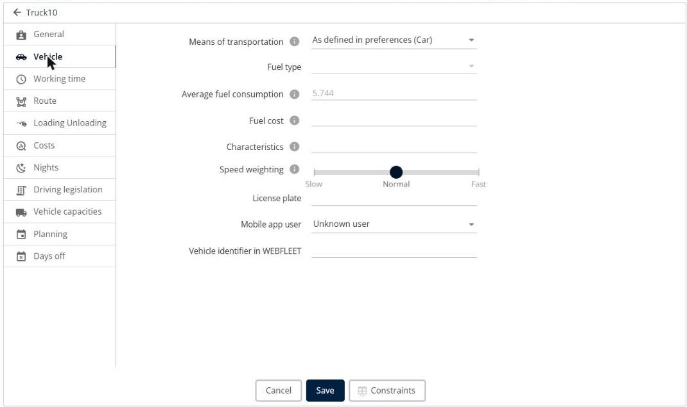

# Why are distances and travel times different from Google Maps?

Find out why the distances and travel times calculated by TourSolver can differ from Google Maps or from the kilometers that your drivers actually drive, and which settings to check.

## Before you begin

* Sign in to **TourSolver** with a user profile that has access to the **Configuration** page.

## Feature overview

* **Means of transportation**: The vehicle profile that TourSolver uses to calculate the routes, for example **Car** or **Truck**. Each profile has its own speeds and road restrictions.
* **Route options**: The roads that the vehicles can use, such as toll roads, tunnels, bridges, low emission zones, and ferries.
* **Variable speeds according to the time**: Speed profiles that change with the start time of the route, to take traffic into account.
* **Speed weighting**: Makes a resource drive slower or faster than the average speed.

## Check the vehicle profile

Google Maps calculates a route for a car. If your vehicles are trucks, TourSolver uses lower speeds and avoids the roads that trucks cannot use, so the distances and times are longer.

1. Go to **Configuration**.
2. Under **Vehicles & optimization**, click **Means of transportation**.
3. Check the **Means of transportation**, for example **Car**, **Delivery light commercial vehicle**, **Truck**, or **Truck (no limitations)**.

<figure><figcaption></figcaption></figure>

4. To use another profile for one resource, go to **My deliverers**, edit the resource, and then select the **Means of transportation** on the **Vehicle** tab.

## Check the route options

1. Go to **Configuration**.
2. Under **Vehicles & optimization**, click **Calculation options**.
3. In **Calculate the route**, check whether TourSolver calculates **The fastest** route.
4. Check the options **Allow tolls**, **Allow tunnels**, **Allow bridges**, **Allow low emission zones**, and, when available, **Allow ferry boats**. A disabled option makes the vehicles drive around these roads, which increases the distance.

<figure><figcaption></figcaption></figure>

## Take traffic into account

By default, TourSolver uses the same speeds all day. Google Maps uses the traffic at the time of your search.

1. Go to **Configuration** > **Vehicles & optimization** > **Means of transportation**.
2. Turn on **Variable speeds according to the time**. TourSolver then applies four speed profiles, based on the start time of each route.


**Evaluation mode**: Variable speeds can prevent the evaluation routes from loading. See [Evaluate your Existing Routes](../operationsandroutemanagement/evaluate-your-existing-routes.md).


## Adjust the speed of a resource

On mountain roads, narrow streets, or in dense city centers, your drivers can be slower than the average speed. On fast roads, they can be faster.

1. Go to **My deliverers**, and then click the **Edit** icon of the resource.
2. On the **Vehicle** tab, move the **Speed weighting** slider toward **Slow** or **Fast**.
3. Click **Save**.

<figure><figcaption></figcaption></figure>

## Understand the gap between real and computed kilometers

The kilometers that your drivers actually drive can differ from the computed kilometers because:

* The drivers do not follow the planned order of the visits, or take another road.
* The drivers make stops that are not in the route, for example for fuel or lunch.
* The address of a delivery is not geocoded precisely. See [Fix Addresses That Are Not Geocoded](../importanddatasetup/fix-addresses-that-are-not-geocoded.md).
* The roads are closed or under construction.

To measure the real gap, compare the planned routes with the routes that your drivers followed. See [Evaluate your Existing Routes](../operationsandroutemanagement/evaluate-your-existing-routes.md).

## Tips


**Compare the same route**: To compare with Google Maps, use the same start point, the same order of visits, the same vehicle type, and the same departure time.


## Related topics

* [Optimize your Deliveries](../operationsandroutemanagement/operationsandroutemanagement-optimizeyourdeliveries.md)
* [Why is my optimization slow, stuck, or interrupted?](why-is-my-optimization-slow-stuck-or-interrupted.md)
* [How to Prioritize the Fewest Possible km / the Most Planned Customers?](how-to-prioritize-the-fewest-possible-km-the-most-planned-customers.md)
