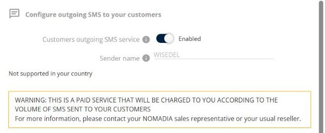
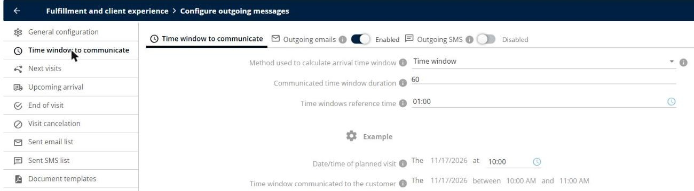

# Why are my customer SMS or emails not sent?

Find out why your customers do not receive the SMS or the emails of TourSolver, and check the settings, the phone numbers, and the SMS quota.

## Before you begin

* Sign in to **TourSolver** with a user profile that has access to the **Configuration** page.
* Set up your messages. See [How to send an SMS and an Email?](11.-how-to-send-an-sms-and-an-email.md).

## Feature overview

* **Customers outgoing SMS service** and **Customers outgoing emails service**: Turn on the sending of all the messages.
* **Outgoing SMS** and **Outgoing emails** of each message: Turn on the sending of one message, for example **Time window to communicate** or **Upcoming arrival**.
* **Mobile phone**: The import field that contains the phone number of the customer.
* **SMS consumed**: The number of SMS sent compared to your SMS quota.
* **Sent SMS list** and **Sent email list**: The messages sent, with their status.

## Check that the messages are turned on

1. Go to **Configuration** > **Fulfillment and client experience** > **Configure outgoing messages**.
2. On **General configuration**, check that **Customers outgoing SMS service** and **Customers outgoing emails service** are **Enabled**.

<figure><figcaption></figcaption></figure>

3. Click each message, for example **Time window to communicate**, and check that **Outgoing SMS** or **Outgoing emails** is **Enabled** for this message. A message can be enabled for emails and disabled for SMS.

<figure><figcaption></figcaption></figure>


**Not supported in your country**: If **Sender name** shows "Not supported in your country", the SMS service is not available for your country. Use the emails instead, or contact your account manager.


## Check the phone numbers

* **Map the phone column before optimizing**: At the import, map the phone column of your file to the **Mobile phone** field. If you map it after the optimization, optimize again: the messages use the data of the optimized simulation.
* **Use the international format**: Enter the numbers with the country code, for example **+33 6 12 34 56 78** or **+1 202 555 0123**.
* **Check the invalid numbers**: In the **Sent SMS list**, a number that the SMS gateway refuses shows the status **Rejected**. Correct the number in your file, and then import it again.

## Check the SMS quota

1. Click **Sent SMS list**.
2. Check **SMS consumed**, for example **0 / 50**.

When more than 95% of your quota is used, TourSolver shows "More than 95% of your SMS quota has been used. It will be reset on the {DATE}." When the quota is reached, TourSolver shows "The limit of your SMS quota has been reached, no SMS was sent." To increase your quota, see [How do I increase the number of resources, licences, or the SMS quota?](how-do-i-increase-the-number-of-resources-licences-or-the-sms-quota.md).

## Check the time window to communicate

The **Time window to communicate** message is sent according to its settings: **Method used to calculate arrival time window**, **Communicated time window duration**, and **Time windows reference time**. Check these settings if the message is sent at an unexpected time, or not at all. See [Time Window to Communicate](../customer-communication/time-window-to-communicate.md).

## Read the status of the messages

In the **Sent SMS list**, each SMS has a status: **Submitted**, **Sent**, **Delivered**, **Rejected**, or **Not found**. Use the time span filter to see the messages of a period, and check the status of the messages that the customer did not receive.

## Tips


**Platform incident**: If no message is sent for all your customers, and your settings are correct, it can be a temporary incident of the sending service. Wait a few minutes, check the **Sent SMS list** again, and then contact support with the date, the time, and the customers concerned.


## Related topics

* [What is the Sent SMS List?](what-is-the-sent-sms-list.md)
* [What is the Sent Email List?](what-is-the-sent-email-list.md)
* [How to send an SMS and an Email?](11.-how-to-send-an-sms-and-an-email.md)
* [General Configuration](../customer-communication/general-configuration.md)
