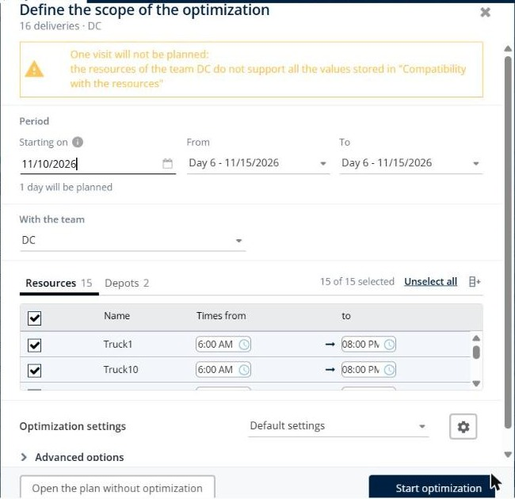
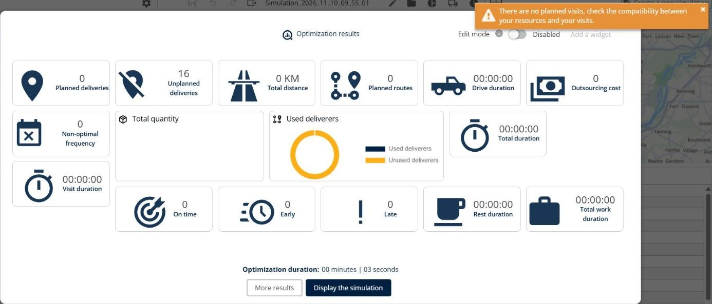
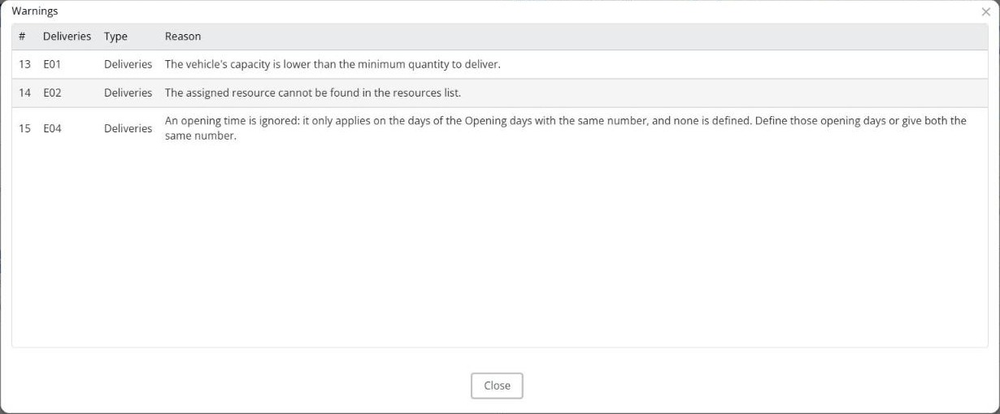
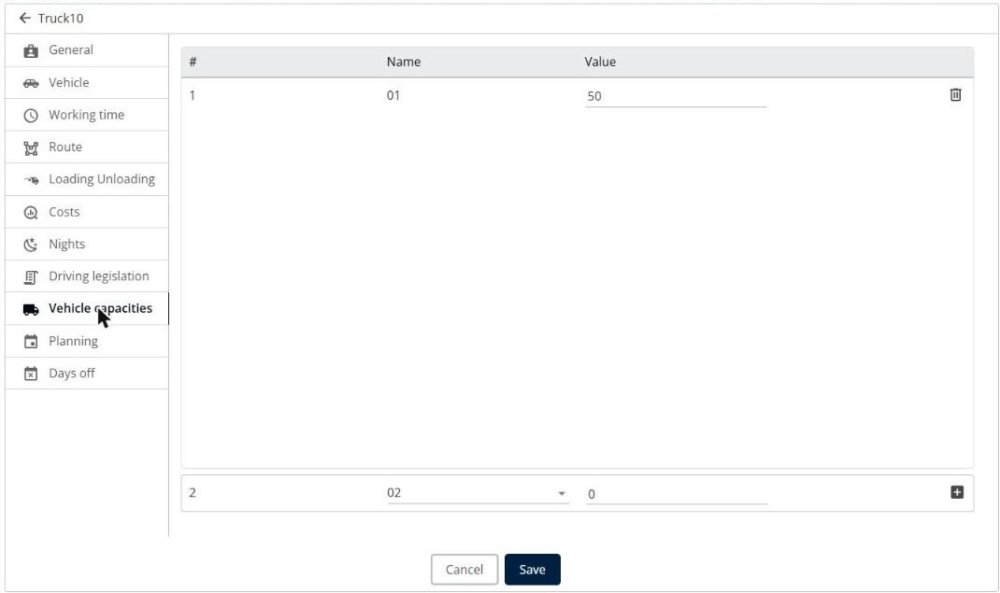
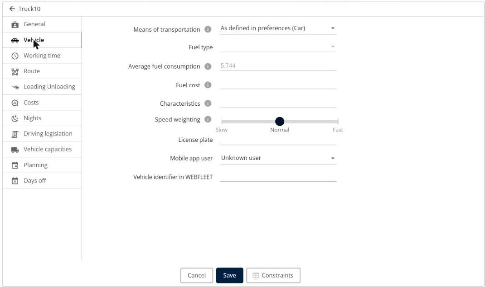
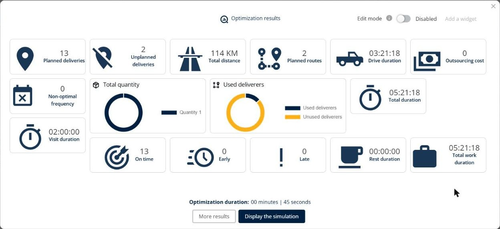

# Why are no visits planned after the optimization?

Find out why TourSolver shows the message "There are no planned visits, check the compatibility between your resources and your visits.", or leaves some visits unplanned, and how to solve the most common errors.

## Before you begin

* Sign in to **TourSolver**.
* Import your deliveries and create your resources. See [Import of Deliveries](../importanddatasetup/importanddatasetup-importofdeliveries.md).

## Feature overview

* **Scope warning**: Before the optimization, **Define the scope of the optimization** warns you about the visits that cannot be planned.
* **Unplanned deliveries**: The number of visits that the optimization could not plan, in the **Optimization results**.
* **Warnings**: The list of the problems found for each visit, with the reason.

## Read the warnings

1. Before you start the optimization, read the message at the top of **Define the scope of the optimization**, for example "One visit will not be planned: the resources of the team DC do not support all the values stored in "Compatibility with the resources"".

<figure><figcaption></figcaption></figure>

2. After the optimization, check the **Unplanned deliveries** in the **Optimization results**.

<figure><figcaption></figcaption></figure>

3. Click **Display the simulation**.
4. In the toolbar, click the **More information** icon. Its tooltip shows the number of warnings.
5. In the **Warnings** window, read the **Reason** of each delivery, and then click **Close**.

<figure><figcaption></figcaption></figure>

## Solve the most common errors

### The quantity is larger than the vehicle capacity

**Reason**: "The vehicle's capacity is lower than the minimum quantity to deliver."

1. Go to **My deliverers**, and then edit the resource.
2. Click **Vehicle capacities**, and then check the capacity, for example **50**.
3. Increase the capacity if the vehicle can carry more, or split the delivery into several visits.

<figure><figcaption></figcaption></figure>

### No resource has the required skill

**Reason**: "No resource can be found with required skills.", or "The assigned resource cannot be found in the resources list."

1. Check the **Compatibility with the resources** column of the visit, for example **AC** for a visit that needs an air-conditioning technician.
2. Go to **My deliverers**, edit a resource that can perform the visit, and then click **Vehicle**.
3. Enter the same value in **Characteristics**.

<figure><figcaption></figcaption></figure>

### No resource works on the day of the visit

**Reason**: "No resource can be found working the required day."

* Check the **Opening day** of the visit and the **Worked days** of the resources in **My deliverers** > **Planning**.
* Check the **From** and **To** days in **Define the scope of the optimization**. If a visit has an opening day that no resource works, the period can be limited to this day, and then no visit is planned.

### The time window is not valid

**Reason**: "The time window end time is earlier than the start time.", "An opening time is ignored: it only applies on the days of the Opening days with the same number, and none is defined.", or "No resource can be found with enough work time."

* Check that the closing time is later than the opening time.
* For a time window that crosses midnight, enter the closing time after 24:00, for example 23:00 to 26:00.
* Check that each **Opening time** has an **Opening day** with the same number.
* Check that the visit duration fits in the time window and in the working time of the resources.

### There are not enough resources

If the visits are compatible but some are still unplanned:

* Add vehicles to the optimization. In **Define the scope of the optimization**, select more resources, or create new resources.
* If your vehicles drive faster than the average speed, move the **Speed weighting** slider of the resource toward **Fast**.

## Use case: visits that cannot be planned

Download the sample file [UseCase\_UnplannedVisits.xlsx](../.gitbook/assets/UseCase_UnplannedVisits.xlsx). It contains 16 deliveries around Washington, DC, for resources with a capacity of 50 that work days 1 to 5. The **Use cases** sheet describes each row.

* **D01 to D12**: Valid deliveries, which can be planned.
* **E01**: Quantity **80**, larger than the vehicle capacity of **50**. Reason: "The vehicle's capacity is lower than the minimum quantity to deliver."
* **E02**: Requires the **AC** characteristic, which no vehicle has. The scope warning appears before the optimization.
* **E03**: Opening day **6**, but the resources work days 1 to 5. The period of the optimization is limited to day 6, and the message "There are no planned visits, check the compatibility between your resources and your visits." appears.
* **E04**: Opening time 2:00 PM and closing time 10:00 AM. Reason: "An opening time is ignored…".

When you remove row E03 and optimize days 1 to 5 again, 13 deliveries are planned, and only E01 and E02 are unplanned.

<figure><figcaption></figcaption></figure>

## Tips


**Start with a few visits**: To find the cause quickly, optimize a few visits with one resource, and then add the other visits.



**Check the mapping**: A column mapped to the wrong field, or an empty column mapped to a constraint, can make all your visits incompatible. See [Why do I get an error when I import my file?](why-do-i-get-an-error-when-i-import-my-file.md).


## Related topics

* [Optimize your Deliveries](../operationsandroutemanagement/operationsandroutemanagement-optimizeyourdeliveries.md)
* [Modifying a Resource and Associated Constraints](../resource-and-vehicle-management/modifying-a-resource-and-associated-constraints.md)
* [Why do I have waiting time in my route plan?](13.-why-do-i-have-waiting-time-in-my-route-plan.md)
