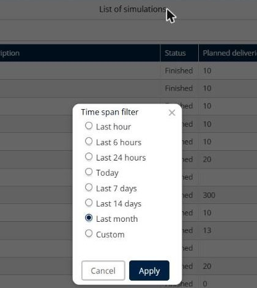
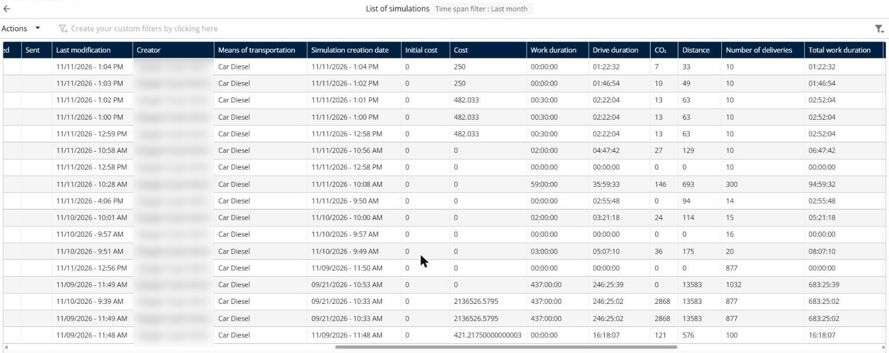
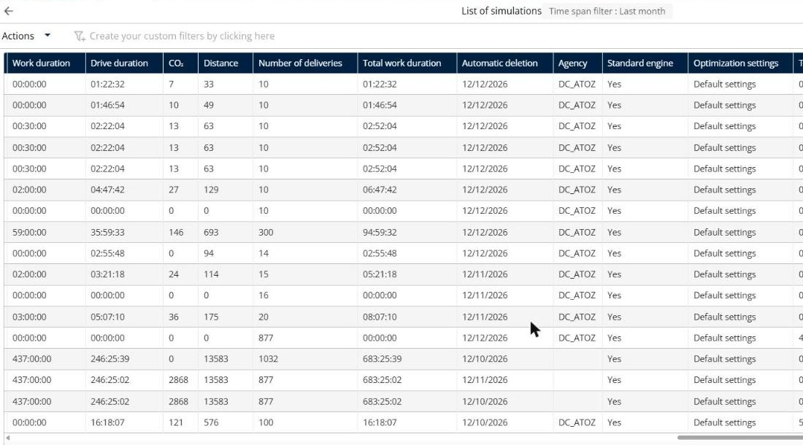
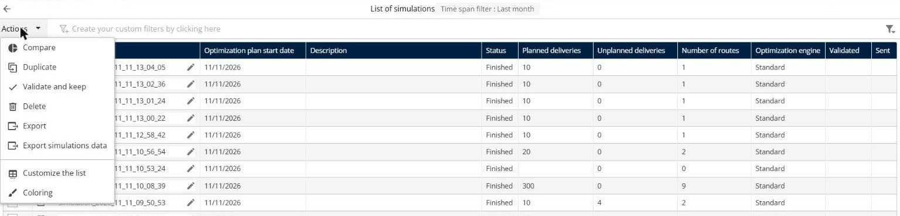

# Why can't I find a simulation or an old optimization?

Find a simulation that seems lost, understand the dates of the list of simulations, keep the simulations that you need, and see the simulations of other users.

## Before you begin

* Sign in to **TourSolver**.
* On the **Home** page, click **See the list of simulations**.

## Feature overview

* **Time span filter**: Shows only the simulations of a period, for example **Last month**.
* **Dates of a simulation**: The **Optimization plan start date**, the **Simulation creation date**, and the **Last modification**.
* **Automatic deletion**: The date on which TourSolver deletes the simulation automatically.
* **Validate and keep**: Keeps a simulation longer. See [How long are my Route optimizations kept?](how-long-are-my-route-optimizations-kept.md).
* **Delete**: Deletes a simulation. The deletion is final.

## Check the time span filter

1. In the **List of simulations**, click the **Time span filter**, for example **Time span filter : Last month**.
2. Select a longer period, or select **Custom** and enter the dates.
3. Click **Apply**.

<figure><figcaption></figcaption></figure>

## Understand the dates of a simulation

A simulation has several dates. Check the right column when you look for a simulation:

* **Optimization plan start date**: The first day of the routes.
* **Simulation creation date**: The date when the simulation was created.
* **Last modification**: The date of the last change. The **Home** page sorts the recent simulations by this date.

<figure><figcaption></figcaption></figure>

For example, a simulation created on 09/21/2026 can have routes that start on 08/24/2026, and a last modification on 11/09/2026.

## Keep a simulation before its automatic deletion

1. In the **List of simulations**, scroll to the **Automatic deletion** column to see when each simulation is deleted.

<figure><figcaption></figcaption></figure>

2. Select the check boxes of the simulations that you want to keep.
3. Click **Actions**, and then click **Validate and keep**.

<figure><figcaption></figcaption></figure>


**Deletion is final**: When you click **Actions** > **Delete**, TourSolver asks "Do you want to delete the simulation?". A deleted simulation, manually or automatically, cannot be restored, even by support. If the routes were sent to the mobile app, you can no longer export them from **Fulfillment**.


## See the simulations of other users

* A user sees the simulations of other users only with the **See other people's simulations** right, and can change them only with the **Edit other people's simulations** right. Ask your administrator to check your rights. See [Set the rights of a sub-user](../importanddatasetup/importanddatasetup-createandmodifyauser.md#set-the-rights-of-a-sub-user).
* Use the **Creator** column of the list to see who created each simulation.
* A colleague can also send you a share link of a simulation. The link is valid until a given date. After this date, ask for a new link.

## Tips


**Name your simulations**: Click the pencil icon next to the name of a simulation to give it a meaningful name, so that you find it easily.



**Folders**: Grouping simulations in folders is not available yet. This feature is an enhancement request.


## Related topics

* [How long are my Route optimizations kept?](how-long-are-my-route-optimizations-kept.md)
* [Create and Modify a User](../importanddatasetup/importanddatasetup-createandmodifyauser.md)
* [Simulation](../simulation/simulation.md)
