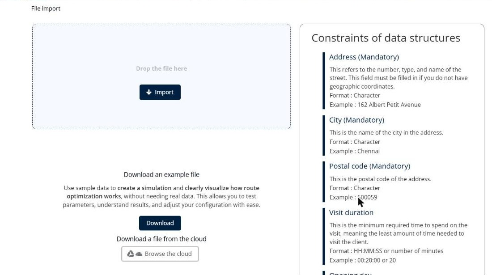
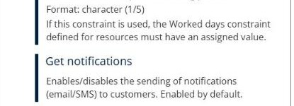
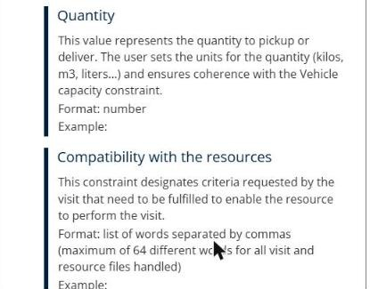

# Why do I get an error when I import my file?

Check the format of your import file, so that TourSolver imports your deliveries without an error or a blockage.

## Before you begin

* Sign in to **TourSolver**.
* Have your import file ready. See [Import of Deliveries](../importanddatasetup/importanddatasetup-importofdeliveries.md).

## Feature overview

* **Constraints of data structures**: The list on the **File import** page that gives the format and an example for each field.
* **Example file**: A sample file in the expected format.
* **Compatibility with the resources**: A field that often blocks the import when it is badly filled in.

## Check the format of each field

1. Go to **My deliveries**.
2. On the **File import** page, read the **Constraints of data structures** list. It gives the format and an example for each field, for example:
   * **Address**, **City**, and **Postal code**: Mandatory, in character format.
   * **Visit duration**: **HH:MM:SS** or a number of minutes, for example **00:20:00** or **20**.
   * **Opening day**: **1, 2, 5**, **1-4**, a date (**dd/mm/yyyy**), or an interval (**14/05/2016 => 18/05/2016**).
3. Click **See all constraints** to see the format of all the fields.
4. If you are unsure of the format, click **Download** to get the example file, and then copy your data into it.

<figure><figcaption></figcaption></figure>

## Check the values against the expected format

Most import errors come from a value that does not match the format of its field. Compare your values with these examples:

* **Number**: Write a number only, without a unit. For example, write **20** in **Visit duration** for 20 minutes, not **20 min**. For a **Quantity**, write **2.5**, not **2,5 kg**.
* **Date**: Write the date as **dd/mm/yyyy**, for example **10/11/2026**. For a period, write **14/05/2016 => 18/05/2016**.
* **Binary value**: Write **0** or **1**. For example, in **Require all skills to be compatible**, **0** means that one characteristic is enough.
* **Default value**: If you leave a cell empty, TourSolver uses the default value of the field. For example, **Get notifications** is enabled by default, so the customer receives the notifications unless you disable them.

<figure><figcaption></figcaption></figure>

## Prepare the file

* **Use the .xlsx format**: Prefer Excel (.xlsx) files. The .ods format has a known import problem.
* **Keep one sheet per file**: Put all your deliveries in one sheet, and remove the other sheets.
* **Remove the unused columns**: Delete the empty or unused columns that are mapped to a constraint, for example the evaluation fields when you do not use the evaluation mode.
* **Use a dot for decimals**: Write **2.5**, not **2,5**.
* **Avoid apostrophes in resource names**: An apostrophe in a resource name can block the import.
* **Check the dates**: If all the dates are shifted by about four years, your Excel file uses the 1904 date system. In Excel, clear the **Use 1904 date system** option, and then check the dates again.

## Fill in the Compatibility with the resources column

The **Compatibility with the resources** field lists the criteria that a resource needs to perform the visit.

* Separate the words with commas, for example **Fridge,Tailgate**.
* Use exactly the same words as in the resources.
* Do not use more than 64 different words in all your visit and resource files.

<figure><figcaption></figcaption></figure>

## Tips


**Start from the example file**: Copy your data into the example file. Its columns already have the expected format.



**Still blocked?**: Send your import file and a screenshot of the error message to support.


## Related topics

* [Import of Deliveries](../importanddatasetup/importanddatasetup-importofdeliveries.md)
* [How do I optimize geocoding in TourSolver?](12.-how-do-i-optimize-geocoding-in-toursolver.md)
* [Evaluate your Existing Routes](../operationsandroutemanagement/evaluate-your-existing-routes.md)
