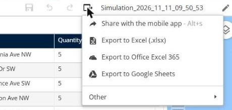
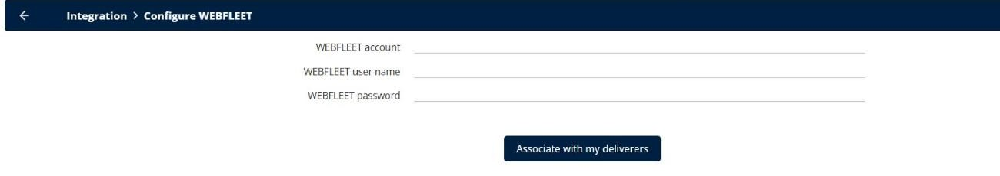

# Why does my export to WEBFLEET, Google Calendar, or Google Sheets fail?

Solve the most common errors when you export your routes to WEBFLEET, Google Calendar, or Google Sheets.

## Before you begin

* Sign in to **TourSolver**, and then open a simulation.
* In the toolbar of the simulation, click **Export**. **Export to Google Sheets** is in the main list. **Export to WEBFLEET** and **Export to Google Calendar** are under **Other**.

<figure><figcaption></figcaption></figure>

## Feature overview

* **Export to WEBFLEET**: Sends the routes as orders to the vehicles in WEBFLEET.
* **Export to Google Calendar**: Adds the visits to the Google calendars of your deliverers.
* **Export to Google Sheets**: Creates a Google Sheets file with your routes.

## Solve "WEBFLEET export error" or "order already exists"

WEBFLEET refuses an order that already exists, for example when you export the same route twice.

1. In WEBFLEET, delete the orders of your previous export.
2. In TourSolver, export the routes one by one: select one route in the **Routes** panel, and then click **Export** > **Other** > **Export to WEBFLEET**.

Also check that each resource is linked to its WEBFLEET vehicle:

1. Go to **Configuration** > **Integration** > **Configure WEBFLEET**.
2. Check the **WEBFLEET account**, **WEBFLEET user name**, and **WEBFLEET password**.
3. Click **Associate with my deliverers**.

<figure><figcaption></figcaption></figure>

4. For each resource, check the **Vehicle identifier in WEBFLEET** on the **Vehicle** tab in **My deliverers**.

## Solve "Google Calendar export error"

1. If TourSolver shows "Failed to login to Google, check that popups are not blocked", allow the pop-ups for TourSolver in your browser.
2. Authorize Geoconcept again to access your Google account, and then export again.

## Solve "Google Sheets" error 403

An error 403 means that Google refuses the access.

* Check that you are signed in with a Google account that can create and share files in Google Drive.
* Check the sharing permissions of the Google Sheets file and of the Google Drive folder.
* If your company uses Google Workspace, ask your administrator whether the access of external applications to Gmail and Google Drive is allowed.

## Tips


**Distances in meters**: In the Excel export, the distances are in meters, for example **Distance (m)**. An export in kilometers is an enhancement request. To convert, divide the values by 1,000 in Excel.


## Related topics

* [Export my Routes](../operationsandroutemanagement/operationsandroutemanagement-exportmyroutes.md)
* [Why is my Excel export empty, incomplete, or failed?](why-is-my-excel-export-empty-incomplete-or-failed.md)
