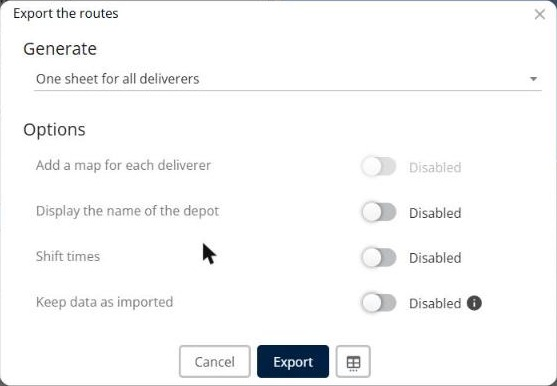
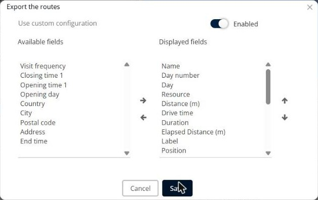

# Why is my Excel export empty, incomplete, or failed?

Solve the most common problems with the Excel export of your routes: empty columns, missing fields, wrong dates, and the message "Export failed".

## Before you begin

* Sign in to **TourSolver**, and then open a simulation.
* To export only some routes, select them in the **Routes** panel. Otherwise, TourSolver asks "Do you want to export all routes?".

## Feature overview

* **Export to Excel (.xlsx)**: Exports the routes of the simulation.
* **Generate**: One sheet for all deliverers, or one sheet per deliverer.
* **Keep data as imported**: Exports the opening days and the Boolean constraints as you imported them.
* **Use custom configuration**: Lets you choose the **Displayed fields** of the export.

## Export the routes to Excel

1. In the toolbar of the simulation, click **Export**, and then click **Export to Excel (.xlsx)**.
2. In **Export the routes**, select what to **Generate**, for example **One sheet for all deliverers**.
3. Set the **Options**: **Add a map for each deliverer**, **Display the name of the depot**, **Shift times**, and **Keep data as imported**.
4. Click **Export**.

<figure><figcaption></figcaption></figure>

See [Export my Routes](../operationsandroutemanagement/operationsandroutemanagement-exportmyroutes.md).

## Keep the data as you imported it

When **Keep data as imported** is disabled, TourSolver normalizes some constraints in the export:

* The opening days are exported as a number of days from the start date of the simulation.
* The Boolean constraints are exported as **0** or **1**.

To export the data as you imported it, turn on **Keep data as imported**. If you made big manual changes in the simulation, for example if you deleted visits, turn it off again: the data cannot be guaranteed.

## Choose the fields of the export

1. In **Export the routes**, click the fields icon next to **Export**.
2. Turn on **Use custom configuration**.
3. Move the fields between **Available fields** and **Displayed fields** with the arrows, and change their order with the up and down arrows.
4. Click **Save**.

<figure><figcaption></figcaption></figure>

If a column is empty or missing, check that its field is in **Displayed fields**.

## Solve "Export failed" (error 500)

An error 500 usually means that one of the displayed fields breaks the export.

1. Open the field list of the export.
2. Remove all the fields that you added to **Displayed fields**, and then export again.
3. Add the fields back one by one, and export after each one, to find the field that breaks the export.
4. Remove this field from **Displayed fields**, and then report it to support.

## Check the other causes

* **Route date**: The route date is available only in an export from the **Optimization** page.
* **One sheet per resource**: When you generate one sheet per deliverer, an apostrophe or a special character in a resource name can block the export. Rename the resource without the apostrophe.
* **Missing planned days**: Visits without a planned day can block the export. Check that all the exported visits are planned, or select only the planned routes.
* **Dates shifted by four years**: If all the dates are shifted by about four years (1,462 days) when you open the file, your Excel uses the 1904 date system. In Excel, clear the **Use 1904 date system** option.

## Related topics

* [Export my Routes](../operationsandroutemanagement/operationsandroutemanagement-exportmyroutes.md)
* [Why do I get an error when I import my file?](why-do-i-get-an-error-when-i-import-my-file.md)
* [How do I manage colors, filters, and displayed columns?](how-do-i-manage-colors-filters-and-displayed-columns.md)
