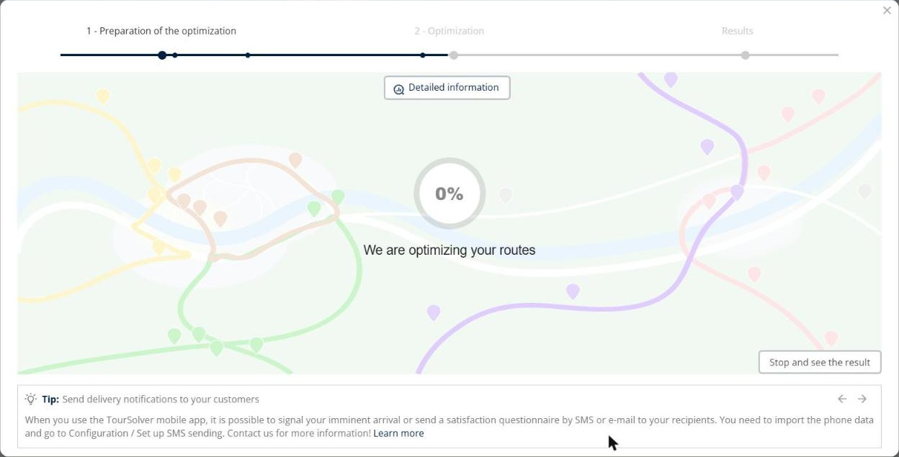
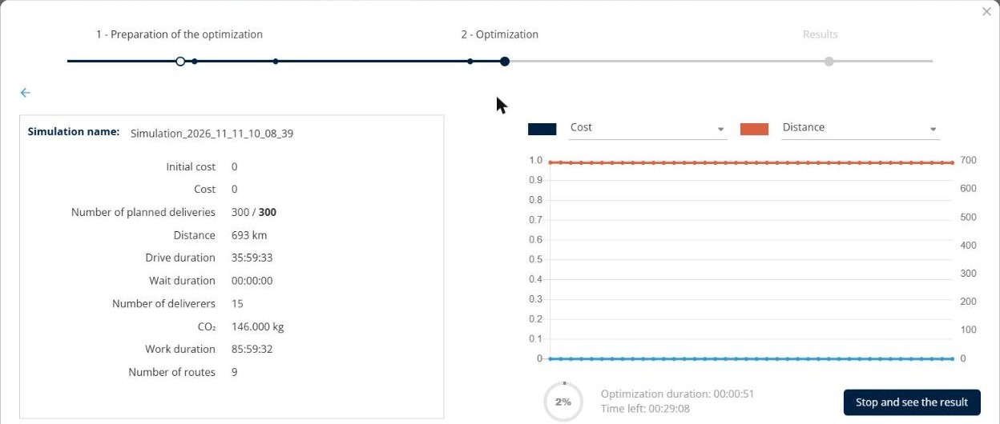
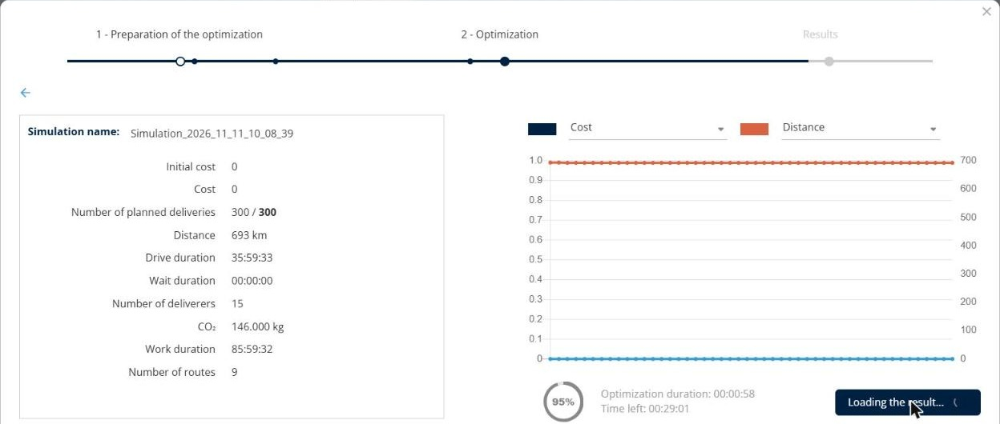
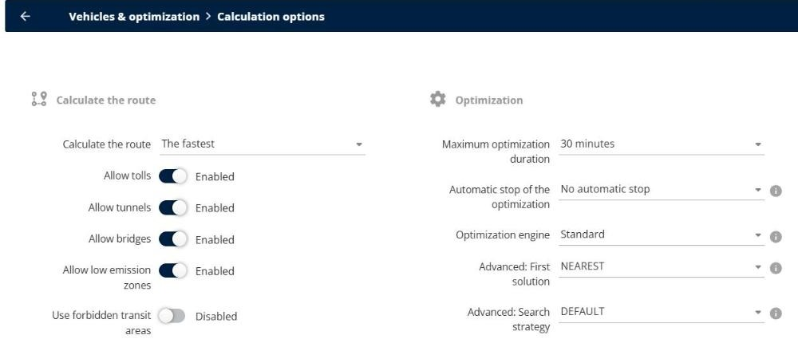

# Why is my optimization slow, stuck, or interrupted?

Find out why an optimization takes a long time, seems stuck, or shows the message "The simulation was interrupted", and how to get a result faster.

## Before you begin

* Sign in to **TourSolver** with a user profile that has access to the **Configuration** page.

## Feature overview

* **Maximum optimization duration**: The maximum time of an optimization, for example **30 minutes**. The optimization keeps improving the routes until this time.
* **Automatic stop of the optimization**: Stops the optimization when there is no improvement after the defined time.
* **Advanced: First solution**: The method that builds the first routes. **NEAREST** adds the closest visit at each step and is the fastest.
* **Stop and see the result**: Stops the optimization and loads the last result calculated by the engine.
* **Detailed information**: Shows the progress of the optimization, the planned deliveries, and the time left.

## Follow the progress of the optimization

1. During the optimization, click **Detailed information**.

<figure><figcaption></figcaption></figure>

2. Check the **Number of planned deliveries**, the **Optimization duration**, and the **Time left**.

<figure><figcaption></figcaption></figure>

3. If the first result is good enough, click **Stop and see the result**. TourSolver loads the last result calculated by the engine.

<figure><figcaption></figcaption></figure>

## Speed up the optimization of large volumes

1. Go to **Configuration**.
2. Under **Vehicles & optimization**, click **Calculation options**.
3. In the **Optimization** section, check the settings:
   * **Maximum optimization duration**: Reduce it to get a result sooner.
   * **Automatic stop of the optimization**: Select a duration, for example **1 minute**, to stop when the routes no longer improve. The options are **No automatic stop**, **5 seconds**, **10 seconds**, **30 seconds**, **1 minute**, **2 minutes**, **5 minutes**, and **10 minutes**.
   * **Advanced: First solution**: Select **NEAREST** for large volumes. **CLUSTERING** is the slowest.

<figure><figcaption></figcaption></figure>


**Automatic stop too short**: A very short automatic stop can stop the optimization before a good first result. If the routes are not good enough, select a longer duration.


## Avoid simultaneous optimizations

Several optimizations that run at the same time, in several browser tabs or by several users of your account, share the same resources and are slower.

* Wait for an optimization to finish before you start another one.
* Close the browser tabs that you do not use.

## Solve "The simulation was interrupted"

1. Close the optimization window, and then start the optimization again from **My deliveries**.
2. Ask a colleague whether their optimizations also stop. If they do, it can be a platform incident. Wait a few minutes, and then try again.
3. If the problem persists, open the browser console with **Ctrl+Shift+I** (Mac: **Cmd+Option+I**), and then take a screenshot of the red messages in the **Console** tab.
4. Send the simulation name, the date and time, and the screenshot to support. See [Report the problem to support](i-cannot-log-in-to-toursolver-web.md#report-the-problem-to-support).

## Use case: optimize a large volume

Download the sample file [UseCase\_LargeVolume.xlsx](../.gitbook/assets/UseCase_LargeVolume.xlsx). It contains 300 deliveries positioned with GPS coordinates around Washington, DC.

1. Import the file in **My deliveries**, and then start the optimization with 15 resources over 5 days.
2. Click **Detailed information**. After about 20 seconds, the first result already plans the 300 deliveries, with a **Time left** of 29 minutes.
3. Click **Stop and see the result**. TourSolver loads the routes after about one minute, instead of 30 minutes.

To get this result automatically, select an **Automatic stop of the optimization** in the **Calculation options**.

## Tips


**Split very large files**: For thousands of visits, optimize one area or one week at a time. See [What is the maximum number of visits that can be imported or optimized?](what-is-the-maximum-number-of-visits-that-can-be-imported-or-optimized.md).


## Related topics

* [Optimize your Deliveries](../operationsandroutemanagement/operationsandroutemanagement-optimizeyourdeliveries.md)
* [Diagnose Unplanned Visits and Inconsistent Routes](../operationsandroutemanagement/diagnose-unplanned-visits-and-inconsistent-routes.md)
* [Why can't I log in to TourSolver?](i-cannot-log-in-to-toursolver-web.md)
