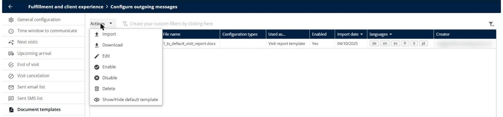
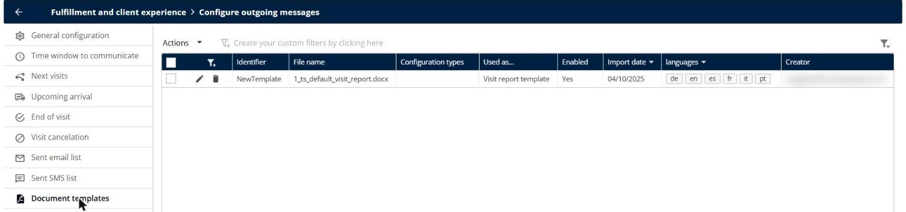
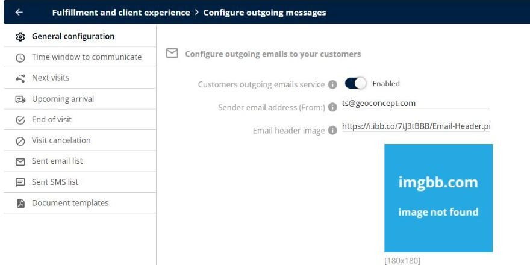

# Why is my PDF document missing its logo or empty?

Create a document template from a Word file, show your logo in the documents, and solve the most common problems with the generated PDF documents.

## Before you begin

* Sign in to **TourSolver** with a user profile that has access to the **Configuration** page.
* Read [What are Document Templates in TourSolver?](10.-what-are-document-templates-in-toursolver.md).

## Feature overview

* **Document templates**: The Word (.docx) files that TourSolver uses to generate the PDF documents, for example the **Visit report template**.
* **Variables**: The fields of a template that TourSolver replaces with the data of the visit.
* **Default template**: The template provided by TourSolver. You can download it and use it as a model.

## Create a template from a Word file

The **Create** button is no longer available. Create your template in Word, and then import it.

1. Go to **Configuration** > **Fulfillment and client experience** > **Configure outgoing messages**.
2. Click **Document templates**.
3. Click **Actions**, and then click **Show/Hide default template**. Select the default template, and then click **Actions** > **Download**.

<figure><figcaption></figcaption></figure>

4. Open the .docx file in Word, change the layout, and keep or add the variables that you need.
5. Click **Actions** > **Import**, and then select your .docx file.
6. Select what the template is used as, for example **Visit report template**, and then enable it.

<figure><figcaption></figcaption></figure>

### Result

The template is listed with its **Used as...**, **Enabled**, and **languages** columns, and TourSolver uses it to generate the documents.

## Show your logo

The logo of a document or an email must be an image that anyone can open, without signing in.

* Use a public link to the image, for example on your company website.
* Do not use a link that needs a password, a private sharing link, or a link to an image that was deleted.
* Open the link in a private window of your browser to check that the image appears.

If the image cannot be reached, TourSolver shows the image of the hosting service instead of your logo, for example **image not found**.

<figure><figcaption></figcaption></figure>

## Solve an empty download

* **Old template**: The older templates, made with graphic constructions, give an empty file. TourSolver also shows "Older models (graphic constructions) cannot be exported. Only models based on a Word document can be." Create a new template from a Word file.
* **Disabled template**: Check that the template is **Enabled**, and that it has a usage in **Used as...**. A template without a usage cannot be enabled.

## Fill in the default values

When a variable has no value for a visit, the document shows the default value of the field, or nothing. Fill in the fields of your visits, or add a default text next to the variable in your Word template.

## Related topics

* [What are Document Templates in TourSolver?](10.-what-are-document-templates-in-toursolver.md)
* [End of Visit](../customer-communication/end-of-visit.md)
* [General Configuration](../customer-communication/general-configuration.md)
