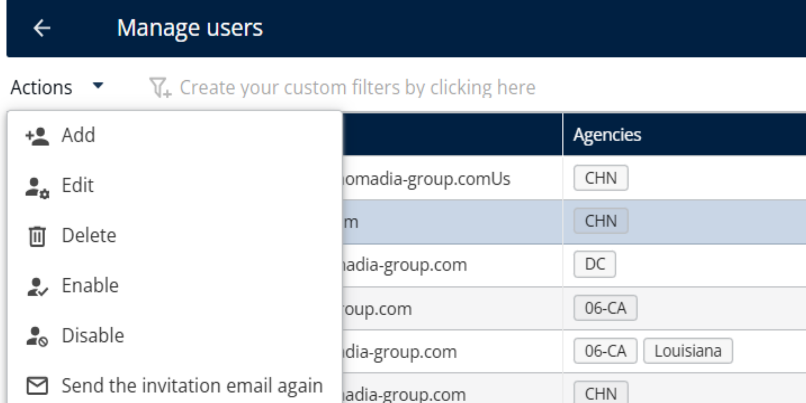

# Signup Process

Create your TourSolver account: verify your email, set your profile, complete the onboarding page, and log in for the first time.

## Before you begin

* Use a supported browser. TourSolver is tested and validated with:
  * Google Chrome: version 142 and above
  * Mozilla Firefox: version 145 and above
  * Microsoft Edge: version 142 and above
  * Apple Safari: version 26 and above
* Have access to the email address that you will use to sign up. TourSolver sends a verification code to it.
* No installation is needed. TourSolver is a fully cloud-based solution hosted on Microsoft Azure.

## Feature overview

* **Verify your email address**: Confirms your identity and secures your new account.
* **Set your profile details**: Sets your name, country, and password.
* **Complete the onboarding page**: Enters your company name, departure address, and activity.
* **Sample data and automatic resources**: Creates five resources (vehicles) and lets you download sample deliveries.
* **Trial account**: Lets you test the platform immediately, with up to 5 drivers, up to 5 route optimizations per day, and up to 250 deliveries per optimization.

## Verify your email address

1. Open [Access/TourSolver](https://cloud.nomadia-app.com/ToursolverCloud).
2. If you already have credentials, log in and skip this topic. If you do not have an account, click **Sign up now**.

<figure><figcaption></figcaption></figure>

<figure><figcaption></figcaption></figure>

3. Enter a **valid email address**.
4. Click **Send Verification code**.
5. Type the **Verification code** that you received in your email.
6. Click **Verify code**.

<figure><figcaption></figcaption></figure>

<figure><figcaption></figcaption></figure>

### Result

A confirmation message appears: _**"Your email has been verified."**_

<figure><figcaption></figcaption></figure>

## Set your profile details

1. Fill in your basic profile details: **Name**, **Country**, and **Password**.
2. Enter your chosen password. It must contain at least one uppercase letter, one lowercase letter, one number, and one special character.
3. Click **Create**.

<figure><figcaption></figcaption></figure>

<figure><figcaption></figcaption></figure>


**Password requirements**: Your password must include all the requirements listed in step 2.


## Resend the user account invitation email

If you do not receive the invitation email immediately after the account is created, delivery can take a few minutes. First, check your **Spam** or **Junk** folder. If the email is still not received after **5 minutes**, resend it.

1. Log in to **TourSolver**.
2. Go to **Configuration** > **Manage Users**.
3. Locate and select the newly created user.
4. Click **Actions** > **Send Invitation Email Again**.

<figure><figcaption></figcaption></figure>

### Result

A new invitation email is sent to the selected user.

## Complete the onboarding page

After you create your profile, you reach the Onboarding page automatically.

1. Enter the **Company name**, **Departure address**, and **Activity**.

<figure><figcaption></figcaption></figure>

<figure><figcaption></figcaption></figure>

2. Review the **End user agreement** and select the check box.

<figure><figcaption></figcaption></figure>

3. Click **Let's Go**.

### Result

Your TourSolver account is ready. The trial account lets you explore the platform with up to 5 drivers, up to 5 route optimizations per day, and up to 250 deliveries per optimization.

## Use the sample data and the automatic resources

During onboarding, TourSolver automatically creates **five resources (vehicles)** based on the address that you provided during setup.

TourSolver also provides a **Sample Data Download** option. It generates a set of sample deliveries located in and around the address that you specified. You can:

* Import the downloaded file directly to create deliveries.
* Use the file as a template to build your own dataset for testing.

## Log in for the first time

To check that your new credentials work, log out and log back in.

1. Log out of the system.
2. Log in again with the email and password that you just created.


**Tip**: Logging in again right after the signup confirms that your credentials are functional.


## Related topics

* [Create and Modify a User](../importanddatasetup/importanddatasetup-createandmodifyauser.md)
* [Create a Depot](../importanddatasetup/importanddatasetup-createadepot.md)
* [Import of Deliveries](../importanddatasetup/importanddatasetup-importofdeliveries.md)
* [Which Browsers and Systems Are Compatible with TourSolver?](../faq/which-browsers-and-systems-are-compatible-with-toursolver.md)
