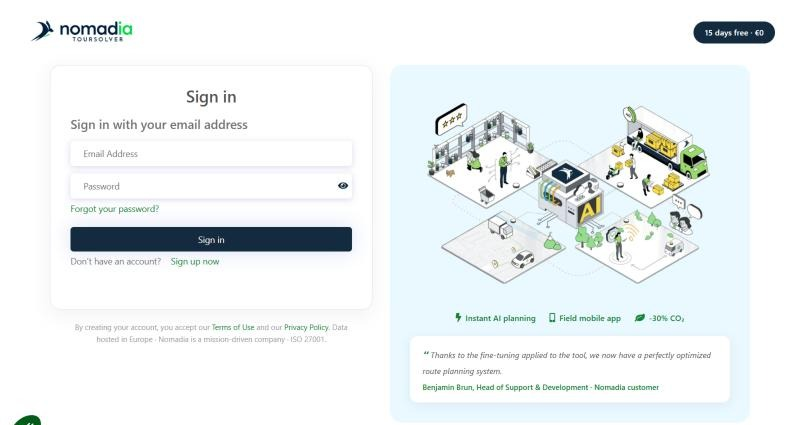
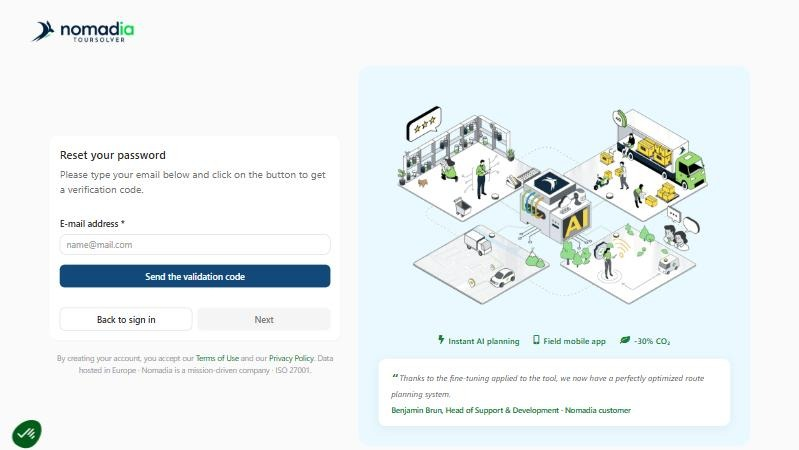
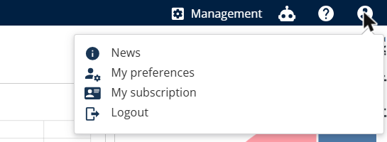

# Log in to TourSolver

Log in to TourSolver, reset a forgotten password, and log out at the end of your session.

## Before you begin

* Have a TourSolver account. See [Signup Process](gettingstarted-signupprocess.md).
* Use a supported browser. See [Which Browsers and Systems Are Compatible with TourSolver?](../faq/which-browsers-and-systems-are-compatible-with-toursolver.md).

## Feature overview

* **Sign in to your account**: Logs you in to TourSolver with your username, which is your email address, and your password.
* **Forgot your password?**: Resets your password with a validation code sent by email.
* **Logout**: Ends your session from the user menu.

## Log in

1. Open [https://app.geoconcept.com/ToursolverCloud/ts/trsolver/home](https://app.geoconcept.com/ToursolverCloud/ts/trsolver/home).
2. On the **Sign in to your account** page, enter your **Username**, which is the email address of your TourSolver account.
3. Enter your **Password**.
4. Click **Sign in**.

<figure><figcaption></figcaption></figure>

### Result

The TourSolver **Home** page opens.

## Reset a forgotten password

1. On the sign-in page, click **Forgot your password?**.
2. On the **Reset your password** page, enter the **E-mail address** of your TourSolver account.
3. Click **Send the validation code**.

<figure><figcaption></figcaption></figure>

4. Type the validation code that you received by email, and then click **Next**.
5. Enter your new password twice, and then confirm.

Click **Back to sign in** to return to the sign-in page without changing your password.


**Password requirements**: Your password must contain at least one uppercase letter, one lowercase letter, one number, and one special character.


### Result

Your password is changed. You can log in with your new password.

## Log out

1. Click the **user icon** at the top right of TourSolver.
2. Click **Logout**.

<figure><figcaption></figcaption></figure>

### Result

The sign-in page opens.

## Tips


**Cannot log in?**: See [Why can't I log in to TourSolver?](../faq/i-cannot-log-in-to-toursolver-web.md) to solve the most common sign-in problems.


## Related topics

* [Signup Process](gettingstarted-signupprocess.md)
* [Why can't I log in to TourSolver?](../faq/i-cannot-log-in-to-toursolver-web.md)
* [Create and Modify a User](../importanddatasetup/importanddatasetup-createandmodifyauser.md)
