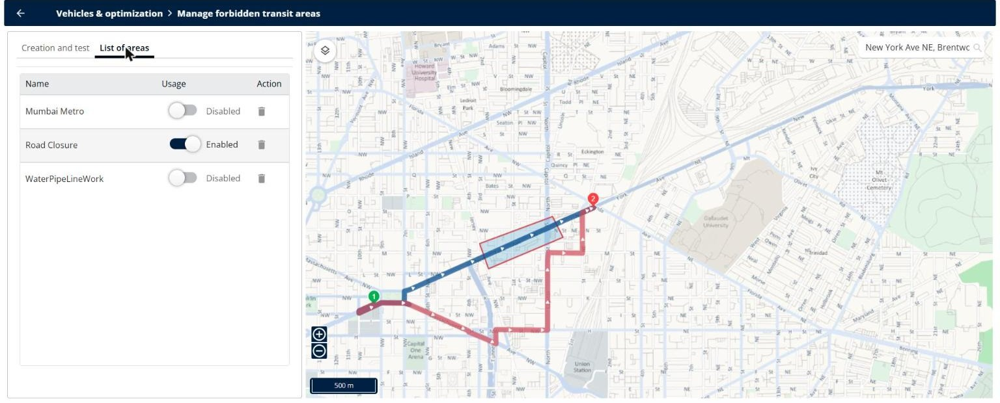
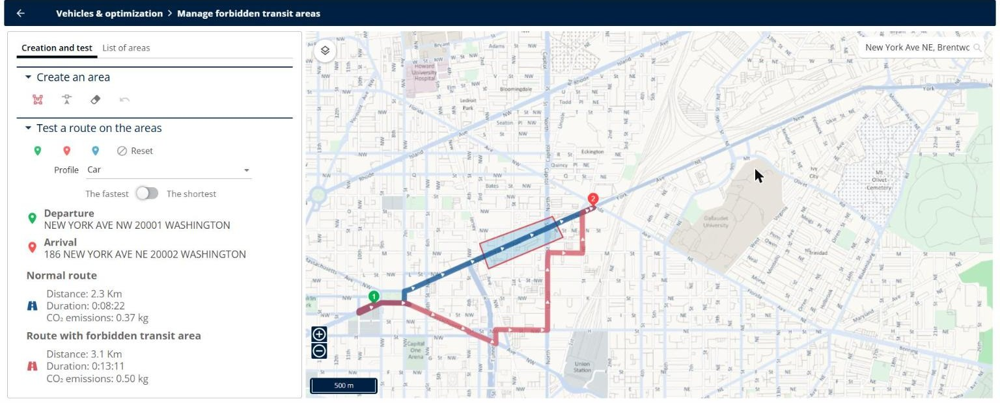
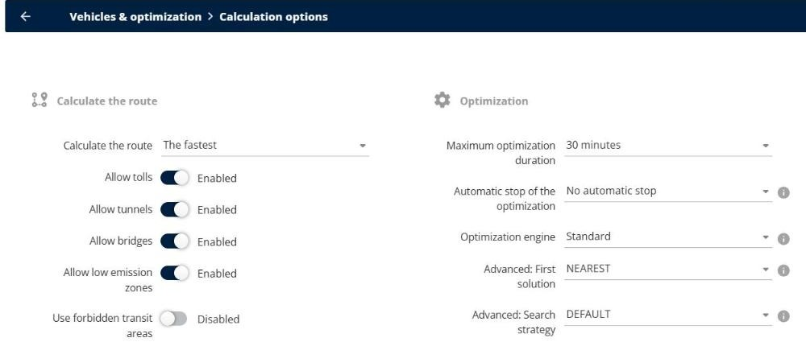
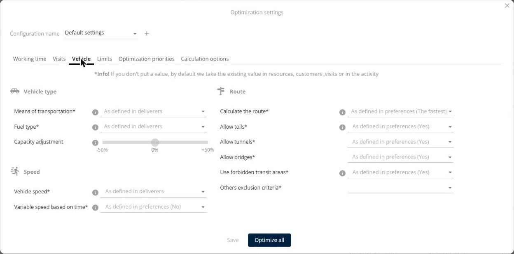

# Create and Use Forbidden Transit Areas

Draw the areas that your vehicles must not drive through, for example a road closure, roadworks, or a city center, check their effect on a test route, and take them into account in your optimizations.

## Before you begin

* Sign in to **TourSolver** with a user profile that has access to the **Configuration** page.
* Check that your subscription includes the forbidden transit areas. They are available only with the **PREMIUM** version.

## Feature overview

* **Forbidden transit area**: An area drawn on the map that the routes go around.
* **Manage forbidden transit areas**: The page where you create, change, delete, and test the areas.
* **Usage**: Each area is **Enabled** or **Disabled**. Only the enabled areas are taken into account.
* **Test a route on the areas**: Compares the **Normal route** with the **Route with forbidden transit area**.
* **Use forbidden transit areas**: The option that takes the enabled areas into account in the optimization.

## Create a forbidden transit area

1. Go to **Configuration**.
2. Under **Vehicles & optimization**, click **Manage forbidden transit areas**.
3. In the address field at the top right of the map, enter the place where you want to create the area, for example the closed street.
4. On the **Creation and test** tab, under **Create an area**, click the first icon, and then click on the map to draw the area around the roads to avoid.
5. To change an area, click the second icon, and then click the area. To delete an area, click the third icon, and then click the area. To undo your last change, click the fourth icon.
6. Click the **List of areas** tab, and then check that the **Usage** of the area is **Enabled**. To stop using an area without deleting it, turn off its **Usage**.

<figure><figcaption></figcaption></figure>

### Result

The area appears on the map and in the **List of areas**.

## Test a route on the areas

1. On the **Creation and test** tab, under **Test a route on the areas**, select the **Profile**, for example **Car**, and choose **The fastest** or **The shortest** route.
2. Click the green icon, and then click on the map to place the **Departure**.
3. Click the red icon, and then click on the map to place the **Arrival**. To add a stop, click the blue icon, and then click on the map.
4. Compare the two routes on the map and in the panel.
5. Click **Reset** to start a new test.

<figure><figcaption></figcaption></figure>

### Example: a road closure in Washington, DC

A section of **New York Ave** is closed. The **Road Closure** area is drawn around this section and is **Enabled**.

* The **Normal route** (blue) goes through the closed section: **2.3 km** and **8 minutes**.
* The **Route with forbidden transit area** (red) goes around it: **3.1 km** and **13 minutes**.

The detour adds 800 meters. Your optimized routes take this detour into account, so the planned times stay realistic.

## Use the areas in the optimization

To take the enabled areas into account in all your optimizations:

1. Go to **Configuration** > **Vehicles & optimization** > **Calculation options**.
2. Turn on **Use forbidden transit areas**.

<figure><figcaption></figcaption></figure>

To turn the areas on or off for one optimization only:

1. In your simulation, open the **Optimization settings**.
2. Click the **Vehicle** tab.
3. Under **Route**, set **Use forbidden transit areas** to **Yes** or **No**.

<figure><figcaption></figcaption></figure>

4. Click **Optimize all**.

### Result

The optimized routes go around the enabled areas. On the map of the simulation, no route crosses an enabled area.

## Use the areas with the API

When you start an optimization with the TourSolver API, set the **useForbiddenTransitAreas** option to **true**. See the [TourSolver API documentation](https://toursolver.readme.io/reference/introduction).

## Tips


**One means of transportation per simulation**: The forbidden transit areas apply to only one means of transportation per simulation. If your resources use different vehicle profiles, optimize them in separate simulations.



**Delivery inside an area**: If a delivery is inside a forbidden transit area, TourSolver shows "This address is inside a forbidden transit zone", and the route cannot reach it. Check the address of the delivery, or change the area.



**Temporary closures**: When the roadworks are finished, turn off the **Usage** of the area instead of deleting it. You can turn it on again the next time.


## Related topics

* [How do I use forbidden transit areas?](../faq/how-do-i-use-forbidden-transit-areas.md)
* [Configure the optimization settings](../simulation/simulation-optimization-settings.md)
* [Optimize your Deliveries](../operationsandroutemanagement/operationsandroutemanagement-optimizeyourdeliveries.md)
