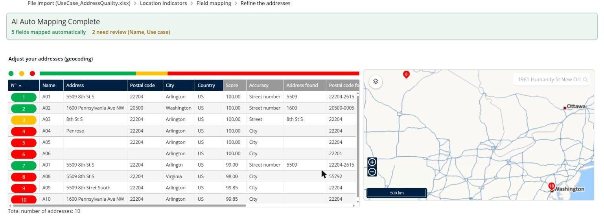
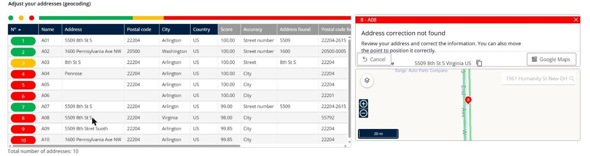

# Fix Addresses That Are Not Geocoded

Check how precisely TourSolver located each address of your import, and correct the addresses that are not found or wrongly positioned.

## Before you begin

* Sign in to **TourSolver**.
* Prepare your import file. See [Import of Deliveries](importanddatasetup-importofdeliveries.md).

## Feature overview

* **Geocoding**: TourSolver turns each address into a position on the map.
* **Adjust your addresses (geocoding)**: The import step that shows, for each address, the score, the accuracy, and the address that TourSolver found.
* **Color**: **Green** for a precise position, **yellow** for a position at the street level, and **red** for an imprecise position that you must check.
* **Accuracy**: The level at which the address was found, from the most precise to the least precise: building (street number), street, locality, postal code, and city.
* **Address correction**: The panel where you correct an address or move its point on the map.

## Prepare complete addresses

Before you import, check that each address has:

* The street number and the street name, in the **Address** column.
* The **Postal code**.
* The **City**, not a region or a state.
* The **Country**.

You can use separate columns or one combined field. See [How do I optimize geocoding in TourSolver?](../faq/12.-how-do-i-optimize-geocoding-in-toursolver.md).

## Check the geocoding results

1. Go to **My deliveries** and import your file.
2. Map the fields, and then click **Next**.
3. On the **Adjust your addresses (geocoding)** step, check the color bar above the list. It shows the share of green, yellow, and red addresses.
4. For each red or yellow address, compare the columns:
   * **Score**: How well the address matches the address that TourSolver found.
   * **Accuracy**: For example **Street number**, **Street**, or **City**.
   * **Address found**, **Postal code found**, **City found**, and **Country found**: The address that TourSolver used.
5. Check the map. A point far away from the others is often wrongly positioned.

<figure><figcaption></figcaption></figure>

## Correct an address

1. On the **Adjust your addresses (geocoding)** step, click the address.
2. In the address correction panel, read the **Address in file**.
3. Enter the correct address in **New address**, or drag the point to the right position on the map.
4. To check the place, click **Google Maps**.

<figure><figcaption></figcaption></figure>

5. When all the addresses are correct, click **Create the tour plan**.

### Result

Your deliveries are positioned correctly, and the optimization uses the right travel times.

## Use case: good and bad addresses

Download the sample file [UseCase\_AddressQuality.xlsx](../.gitbook/assets/UseCase_AddressQuality.xlsx), and then import it in **My deliveries**. It contains ten addresses near Arlington, Virginia. The **Use case** column describes each row, and TourSolver ignores it at the import.

| Row | Address in the file | Result |
| --- | ------------------- | ------ |
| **A01** | 5509 8th St S, 22204 Arlington | Green, accuracy **Street number**. |
| **A02** | 1600 Pennsylvania Ave NW, 20500 Washington | Green, accuracy **Street number**. |
| **A03** | 8th St S, 22204 Arlington (no street number) | Yellow, accuracy **Street**. |
| **A04** | Penrose, 22204 Arlington (neighborhood instead of a street) | Red, accuracy **City**. |
| **A05** | 22204 Arlington (no street) | Red, accuracy **City**. |
| **A06** | Arlington (city only) | Red, accuracy **City**. |
| **A07** | 5509 8th St S, 22204 Arlingtn (misspelled city) | Green: TourSolver corrected the city, with a score of 99. |
| **A08** | 5509 8th St S, 22204 Virginia (state instead of the city) | Red and **wrongly positioned**: TourSolver found the city of Virginia, Minnesota, postal code 55792. |
| **A09** | 5509 8th Stret Suoth, 22204 Arlington (misspelled street) | Red, accuracy **City**. |
| **A10** | 1600 Pennsylvania Ave NW, 22204 Arlington (address and city do not match) | Red, accuracy **City**. |

Correct the red addresses in the address correction panel, or correct the file and import it again.

## Tips


**Region instead of the city**: A region or a state in the **City** column can position the delivery in another place with the same name, as in row A08. Always enter the city.



**Address missing on the map**: If a new street is not found, use the GPS coordinates of the delivery, and report the street to HERE with [HERE Map Creator](https://mapcreator.here.com).



**Geocoding error 502**: The geocoding service is temporarily unavailable. Wait a few minutes, and then import the file again. If the error persists, contact support.


## Related topics

* [Import of Deliveries](importanddatasetup-importofdeliveries.md)
* [Modify Address of a Delivery](modifyaddressofadelivery.md)
* [How do I optimize geocoding in TourSolver?](../faq/12.-how-do-i-optimize-geocoding-in-toursolver.md)
