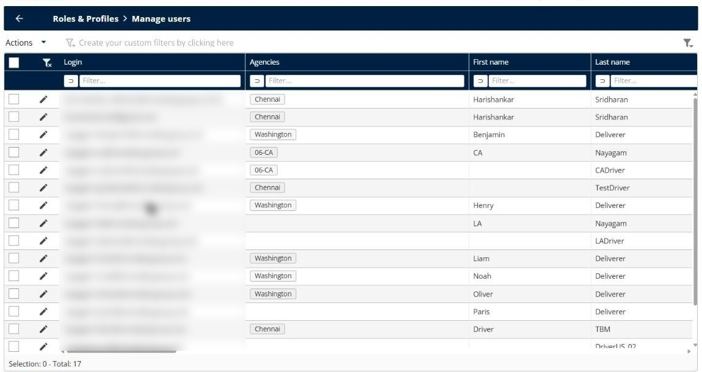
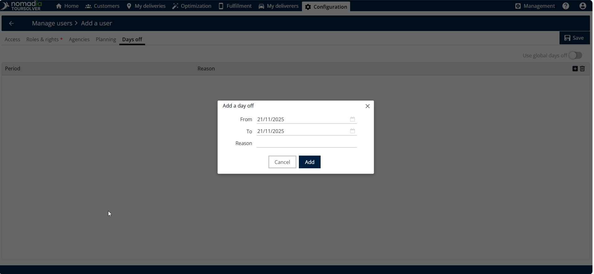
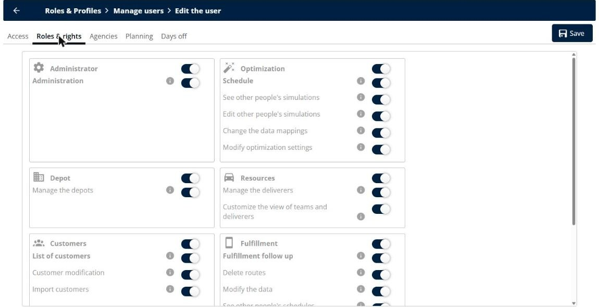
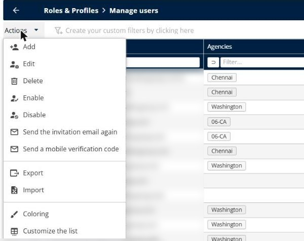
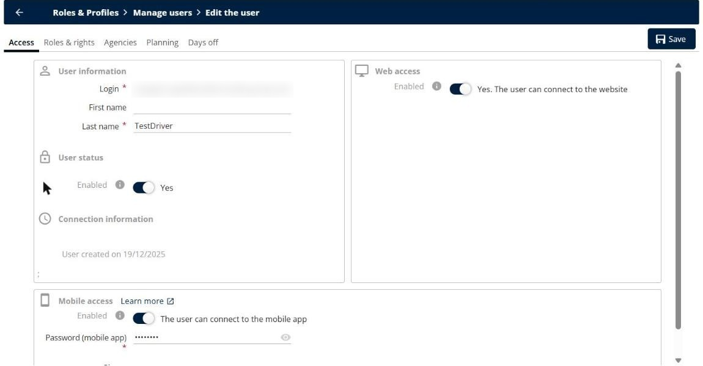

# Create and Modify a User

Create, modify, disable, delete, or replace the users of your account, and keep the data of a user who leaves.

## Before you begin

* Sign in to **TourSolver** with a user profile that has the **Administration** right.
* Go to **Configuration** > **Roles & Profiles** > **Manage users**.

## Feature overview

* **Manage users**: Lists the users of your account with their login, agencies, roles, status, and access.
* **Actions menu**: Adds, edits, deletes, enables, or disables users, and sends the invitation email again.
* **User status**: The **Enabled** switch of a user. A disabled user can no longer log in, but their data is kept.
* **Roles & rights**: Sets what a user can see and do, for example manage the depots or see the route plans of colleagues.

<figure><figcaption></figcaption></figure>

When you create or modify a user, you work in these sections:

| Section | Purpose | Key actions |
| ------- | ------- | ----------- |
| **Access** | Defines the basic identity and the login permissions (web and mobile) of the user. | Enter the login ID and the names, and set the initial password for a mobile user. |
| **Roles & rights** | Determines what the user can see and do in the application, for example administrator or optimization. | Enable the necessary roles and rights, such as **Administrator** or **Optimization**. |
| **Agencies** | Assigns the agencies that the user is responsible for or needs access to. | Select the required agencies and use the **right arrow** to assign them. |
| **Planning** | Plans the slot time of the user. | Select the day and the timing to set the slot time, then click **Update**. |
| **Days off** | Records the days off that the user plans to take. | Enter the **from date** and the **to date** of the planned time off. |


**Note**: **Planning** and **Days off** are available only for a mobile user. **Roles & rights** is available only for a web user.


## Open the Add screen

1. From the **homepage**, go to **Configuration**.
2. Under **Roles & Profiles**, click **Manage users**.

<figure><figcaption></figcaption></figure>

<figure><figcaption></figcaption></figure>

3. Click **Actions**.
4. Click **Add**.

<figure><figcaption></figcaption></figure>

## Create a user from scratch

Use this option to onboard a new employee who needs a unique login ID and defined roles.

1. On the **Add** screen, confirm that you are creating a user from scratch.
2. Click **OK** to begin the new user creation.

<figure><figcaption></figcaption></figure>

<figure><figcaption></figcaption></figure>

3. In the **Access** section, enter the **Login ID**, **First Name**, and **Last Name**.
4. Set the **Access Type**. For web access, turn on **Web Access**. For mobile access, turn on **Mobile Access**.
5. Enter the **password**.

<figure><figcaption></figcaption></figure>

<figure><figcaption></figcaption></figure>

6. In the **Roles and Rights** section, enable all the necessary roles, such as administrator, optimization, or depot.
7. In the **Agencies** section, click the agencies that you need to assign, then click the right arrow to move them into the assigned list.

<figure><figcaption></figcaption></figure>

<figure><figcaption></figcaption></figure>

8. In the **Planning** section, click the day and the timing to set the slot time, then click **Update**.

<figure><figcaption></figcaption></figure>

<figure><figcaption></figcaption></figure>

9. Optional: In the **Days Off** section, click the **plus** icon on the right side.
10. Enter the **from date** and the **to date** of the day off.
11. Click **Add**.

<figure><figcaption></figcaption></figure>

<figure><figcaption></figcaption></figure>

12. Click **Save**.

<figure><figcaption></figcaption></figure>

<figure><figcaption></figcaption></figure>

### Result

The user is created successfully.

<figure><figcaption></figcaption></figure>

## Modify an existing user

Update the roles, agencies, or schedule of an existing user without starting over.

1. On the **Add** screen, turn on **Yes** in the **Create from an existing user** section.
2. Select the user that you want to modify.
3. Click **OK**.

<figure><figcaption></figcaption></figure>

4. Review the information, which is copied automatically from the selected user. Go through the sections (**Access**, **Roles & rights**, **Planning**, and so on), and modify the information as needed.
5. Click **Save**.

<figure><figcaption></figcaption></figure>

<figure><figcaption></figcaption></figure>

## Set the rights of a sub-user

Give each user only the rights they need. For example, a planner may need to manage the depots, or to see the route plans of colleagues without changing them.

1. In **Manage users**, click the **pencil** icon next to the user.
2. Click the **Roles & rights** tab.
3. Turn on the rights that the user needs, for example:
   * **Depot** > **Manage the depots**: Manages the depots where the parcels are loaded at the start of the route and unloaded at the end. It always comes with the **Schedule** right.
   * **Optimization** > **See other people's simulations**: Sees and opens the simulations of colleagues, without modifying them.
   * **Optimization** > **Edit other people's simulations**: Modifies the simulations of colleagues.
   * **Fulfillment** > **See other people's schedules**: Sees the route plans of colleagues in the fulfillment follow-up.
4. Click **Save**.

<figure><figcaption></figcaption></figure>

### Result

The user sees and does only what their rights allow. Click the information icon next to a right to see what it allows.

## Resend the invitation email

When you create a user, TourSolver sends them an invitation email with a validation link. The link is valid for **24 hours**.

1. Ask the user to wait a few minutes and to check their **Spam** or **Junk** folder.
2. If the email is still not received, or if the link has expired, go to **Manage users** and select the check box of the user.
3. Click **Actions** > **Send the invitation email again**.

<figure><figcaption></figcaption></figure>

### Result

The user receives a new invitation email with a new validation link.

## Disable or delete a user

1. In **Manage users**, select the check box of the user.
2. Click **Actions**, and then click one of the following:
   * **Disable**: The user can no longer log in. Their data and their history are kept. Click **Enable** to give the access back.
   * **Delete**: Removes the user.

You can also turn the **Enabled** switch off under **User status** on the **Access** tab of the user.

<figure><figcaption></figcaption></figure>


**Disable rather than delete**: Disable a user who leaves, so that their history is kept. Delete a user only when you no longer need their data.


## Replace a user and keep their data

When an employee leaves and a new employee takes over their work, keep the history of the first user.

1. Create the new user. To give them the same roles and agencies, use **Create from an existing user**. See [Modify an existing user](#modify-an-existing-user).
2. Disable the user who leaves. See [Disable or delete a user](#disable-or-delete-a-user).
3. Contact support and ask them to transfer the history of the user who leaves to the new user. Give the login of both users.

### Result

The new user logs in with their own login and finds the history of the user they replace.

## Use an email address that is already in use

Each login must be unique. If you enter an email address that is already used by another user, the message "the email id is already used" appears.

1. In **Manage users**, type the email address in the **Login** filter to find the user who uses it.
2. If this user is no longer needed, delete them. See [Disable or delete a user](#disable-or-delete-a-user).
3. Create the new user with the email address.

If you cannot find the user, the email address may be used in another TourSolver account. Contact support to release it.

## Tips


**Dual access**: You can turn on both **Web Access** and **Mobile Access** for a user, so they can use the system in both ways.



**Password requirement**: The password must be **8 characters** long and include at least **one numeric** character and **one special character**.


## Related topics

* [Signup Process](../getting-started/gettingstarted-signupprocess.md)
* [Log in to TourSolver](../getting-started/log-in-to-toursolver.md)
* [Create a Depot](importanddatasetup-createadepot.md)
* [Creating a Resource](../resource-and-vehicle-management/creating-a-resource.md)
