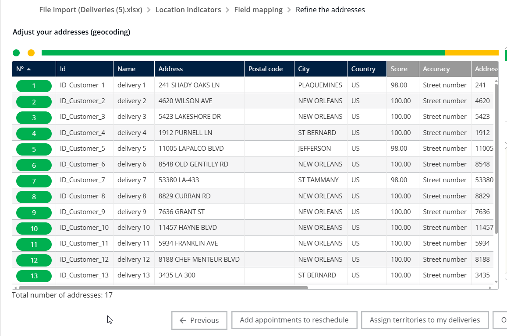

# Import of Deliveries

Upload a list of addresses and customer information, match your spreadsheet columns to the TourSolver fields, review the geocoding results on the map, and start optimizing your routes.

## Before you begin

* Sign in to **TourSolver**.
* Prepare an Excel file with your deliveries. If you are unsure how to format it, download the sample file. See [Download the sample data](#download-the-sample-data).

## Feature overview

| Feature | Context and benefit |
| ------- | ------------------- |
| **Data Mapping** | Matches the column headings in your spreadsheet (like "Cust ID" or "Client Name") to the fields the server uses. A precise match is crucial for accurate routing. |
| **Geocoding Colors** | After the import, the system tries to find the precise location (geocode) of each delivery address. Colors indicate success or failure, so you can spot and correct errors quickly. |
| **Route Optimization** | Calculates the most efficient order and path for your imported deliveries. |

## Open My Deliveries

1. From the main menu, click **My Deliveries**.
2. You are now ready to import your data.

## Download the sample data

The sample file shows the expected format and makes your file ready for import immediately.

1. Click **Download**.
2. The Excel file that contains sample data is downloaded.

<figure><figcaption></figcaption></figure>

<figure><figcaption></figcaption></figure>

## Import data and map the fields

Tell the system which columns of your spreadsheet correspond to the system fields, such as Customer ID or Name.

1. Click **Import** to begin importing your delivery data into the server.

<figure><figcaption></figcaption></figure>

2. In the mapping window, match your Excel fields with the required server fields.
3. If a field is already matched correctly, as happens when you use the template, skip the mapping for that field.

To reset or adjust a field mapping, for example **Customer ID** and **Name**:

4. If a field is mapped, you can choose to ignore it.
5. Click _ignored_ to map the field to a different constraint of TourSolver.

<figure><figcaption></figcaption></figure>

<figure><figcaption></figcaption></figure>

6. Click **show all** to view all the possible field options.

<figure><figcaption></figcaption></figure>

7. Click the **Customer ID** option to map it.

<figure><figcaption></figcaption></figure>

8. To change the **Name** field, click **ignore** under the current name mapping.

<figure><figcaption></figcaption></figure>

9. Click **Name** to complete the mapping of the name field.

<figure><figcaption></figcaption></figure>

## Review the geocoding results and optimize the routes

1. Click **Next** once the mapping is complete.

<figure><figcaption></figcaption></figure>

2. The map view appears and displays your locations with geocoding colors.

<figure><figcaption></figcaption></figure>

3. Review the **locations** and their **colors**.
4. If you see gray locations, the system did not find those addresses. Review and correct them in your original data before you optimize the routes.

<figure><figcaption></figcaption></figure>

5. Click **Optimize my routes** to begin the route calculation.

<figure><figcaption></figcaption></figure>

6. The system starts the calculation.

<figure><figcaption></figcaption></figure>

## Understand the geocoding status

On the map view, the colors tell you whether your addresses were located (geocoded) successfully:

* **Yellow** indicates that the location was geocoded at the street level.

<figure><figcaption></figcaption></figure>

* **Green** indicates that the location was geocoded at the building level.

<figure><figcaption></figcaption></figure>

<figure><figcaption></figcaption></figure>

* **Gray** indicates that the location was not geocoded.

<figure><figcaption></figcaption></figure>

<figure><figcaption></figcaption></figure>

## Tips


**Use the sample data**: If you are new to the system structure, use the sample data provided. It often reduces mapping errors later.



**Prioritize yellow**: Yellow locations are reliable because they are geocoded at the street level. Focus your attention on the locations marked gray.



**Change a mapping quickly**: Choose to **ignore** the current mapping, then select the correct field name immediately. This is quicker than correcting the data in your spreadsheet outside of the system.


## Related topics

* [Modify Address of a Delivery](modifyaddressofadelivery.md)
* [Optimize your Deliveries](../operationsandroutemanagement/operationsandroutemanagement-optimizeyourdeliveries.md)
* [How do I optimize geocoding in TourSolver?](../faq/12.-how-do-i-optimize-geocoding-in-toursolver.md)
