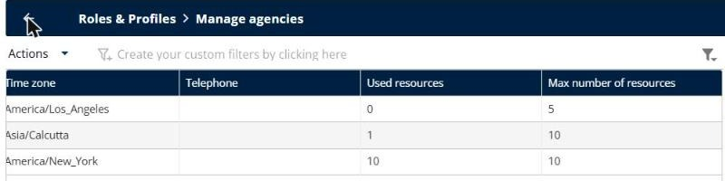
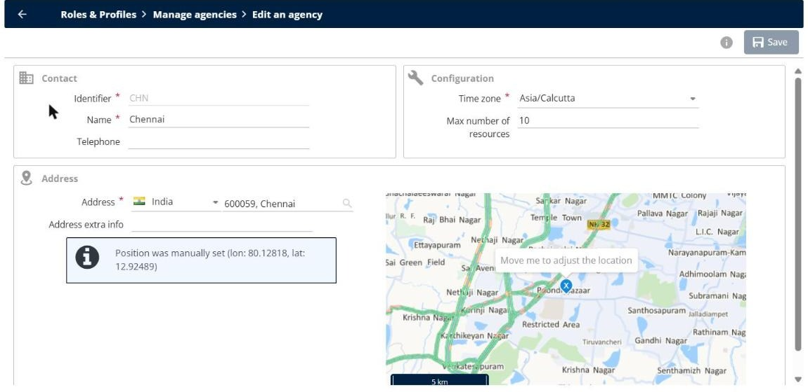
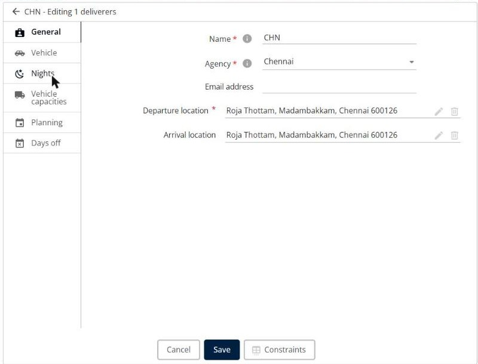
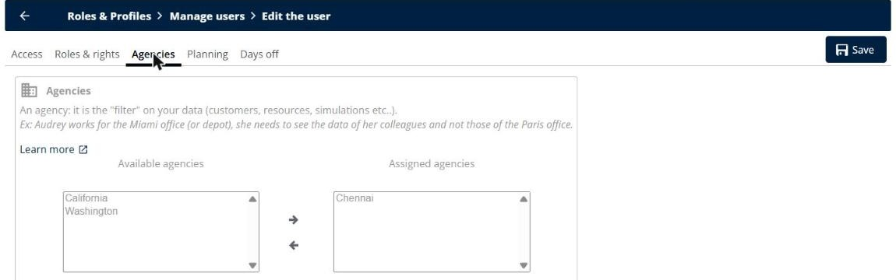

# Manage Agencies

Share your resources between your agencies, move users and deliverers from one agency to another, and transfer the rights of a user to another user.

## Before you begin

* Sign in to **TourSolver** with a user profile that has access to the **Configuration** page.
* Create your agencies and users. See [Create and Modify a User](importanddatasetup-createandmodifyauser.md).

## Feature overview

* **Agency**: A filter on your data (customers, resources, simulations). For example, a user of the Miami office sees the data of the Miami office, not the data of the Paris office.
* **Max number of resources**: The number of resources that an agency can use. The total of all the agencies cannot exceed your subscription.
* **Assigned agencies**: The agencies whose data a user can see.
* **Agency of a deliverer**: The agency that a deliverer belongs to.

## Share the resources between your agencies

1. Go to **Configuration**.
2. Under **Roles & Profiles**, click **Manage agencies**.
3. Scroll the list to the right, and then compare the **Used resources** and **Max number of resources** columns of each agency.

<figure><figcaption></figcaption></figure>

4. Click the **Edit** icon of the agency that has free resources, decrease its **Max number of resources**, and then click **Save**.
5. Click the **Edit** icon of the agency that needs more resources, increase its **Max number of resources**, and then click **Save**.

<figure><figcaption></figcaption></figure>

### Result

The agency can use more resources, without changing the total number of resources of your subscription.

## Move a deliverer to another agency

1. Go to **My deliverers**.
2. Click the **Edit** icon of the deliverer.
3. On the **General** tab, select the new **Agency**.
4. Click **Save**.

<figure><figcaption></figcaption></figure>

### Result

The deliverer belongs to the new agency and counts in its **Used resources**.

## Move a user to another agency

1. Go to **Configuration**.
2. Under **Roles & Profiles**, click **Manage users**.
3. Click the **Edit** icon of the user.
4. Click the **Agencies** tab.
5. Select the new agency in **Available agencies**, and then click the **right arrow** to move it to **Assigned agencies**.
6. Select the old agency in **Assigned agencies**, and then click the **left arrow** to remove it.
7. Click **Save**.

<figure><figcaption></figcaption></figure>

### Result

The user sees the data of the new agency. A user can also keep several assigned agencies to see the data of each of them.

## Transfer the rights of a user to another user

1. Create the new user from the existing user, so that the new user gets the same **Roles & rights** and **Agencies**. See [Modify an existing user](importanddatasetup-createandmodifyauser.md#modify-an-existing-user).
2. To also transfer the data of the user, such as the optimizations, contact support. See [Replace a user and keep their data](importanddatasetup-createandmodifyauser.md#replace-a-user-and-keep-their-data).

## Tips


**Resources limit exceeded**: If the message "resources limit of the following agencies would be exceeded" appears, increase the **Max number of resources** of the agency, or move a deliverer to another agency.



**Need more resources?**: If all the resources of your subscription are used, see [How do I increase the number of resources, licences, or the SMS quota?](../faq/how-do-i-increase-the-number-of-resources-licences-or-the-sms-quota.md).


## Related topics

* [Create and Modify a User](importanddatasetup-createandmodifyauser.md)
* [Creating a Resource](../resource-and-vehicle-management/creating-a-resource.md)
* [How do I increase the number of resources, licences, or the SMS quota?](../faq/how-do-i-increase-the-number-of-resources-licences-or-the-sms-quota.md)
