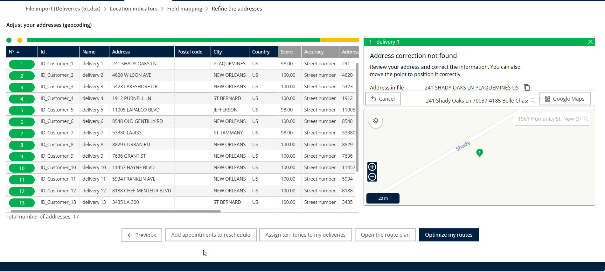

# Modify Address of a Delivery

Update the address of an existing delivery and recalculate your routes.

## Before you begin

* Sign in to **TourSolver**.
* To let customers receive an SMS or an email when an address is changed, turn on the **notification toggle**.
* Enter customer phone numbers in **international format**, and use the **District column** to improve the geocoding precision after modifications.

## Feature overview

| Feature | Context and benefit |
| ------- | ------------------- |
| **Address Modification** | Corrects or updates the location of a specific delivery with the **Address** field. |
| **Re-optimization** | After you save the new address, the system recalculates the optimal route. The new distance and the travel time are recalculated right after the re-optimization. |

## Update the address of a delivery and recalculate the route

1. From the **home page**, click **Optimization**.

<figure><figcaption></figcaption></figure>

2. Select a delivery.
3. Click **Edit**.

<figure><figcaption></figcaption></figure>

4. Enter the **new address** in the **Address** field.
5. Scroll down.
6. Click **Locate**.

<figure><figcaption></figcaption></figure>

7. Select the new address that you entered from the suggested options.

<figure><figcaption></figcaption></figure>

8. Click **Edit** to save the address change.

<figure><figcaption></figcaption></figure>

9. Click **Deliveries**.
10. Click **Optimize** to start the route re-optimization.

<figure><figcaption></figcaption></figure>

### Result

* The new route and details are displayed on the map.
* The system has recalculated the new distance and travel time.

<figure><figcaption></figcaption></figure>

## Modify several addresses from the My Deliveries page

1. Go to **My Deliveries**.
2. Select **Deliveries** to view your list of orders.
3. Open the **Address Adjustment** option on the map.
4. Modify the addresses as needed.

<figure><figcaption></figcaption></figure>

## Related topics

* [Import of Deliveries](importanddatasetup-importofdeliveries.md)
* [Optimize your Deliveries](../operationsandroutemanagement/operationsandroutemanagement-optimizeyourdeliveries.md)
* [Change a delivery](../simulation/simulation-deliveries-change-delivery.md)
