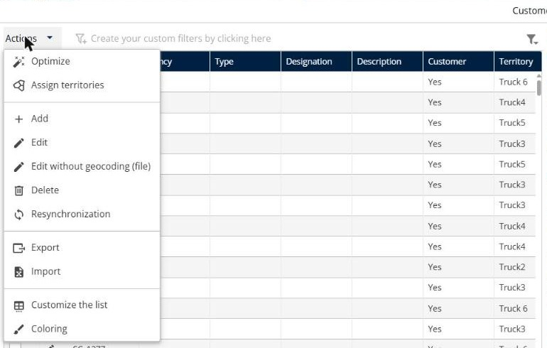
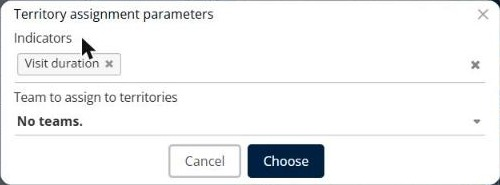
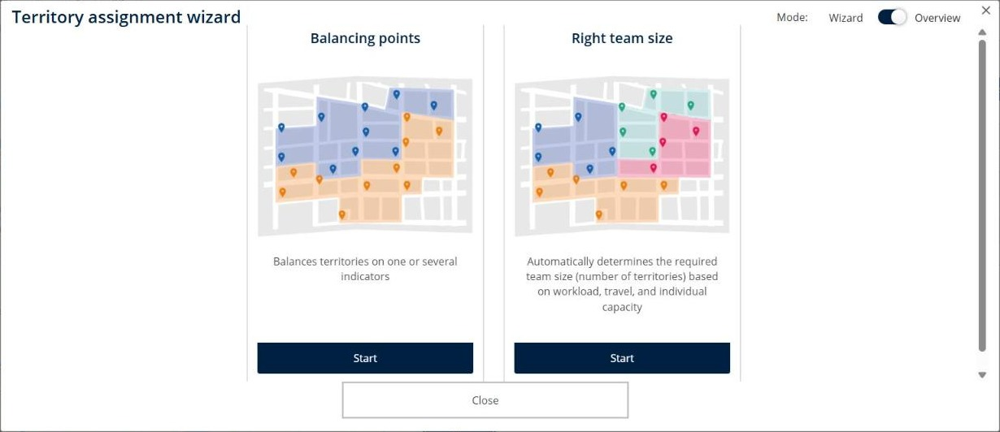
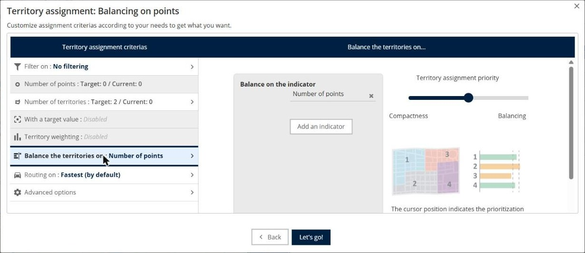
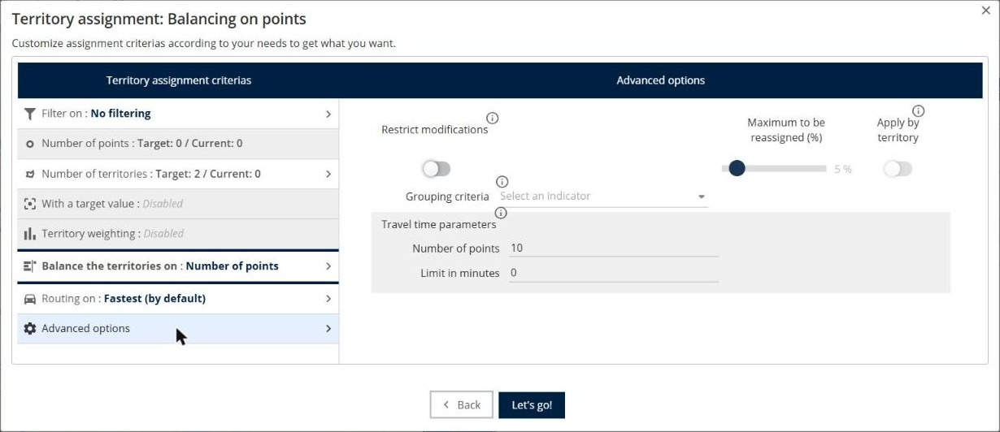
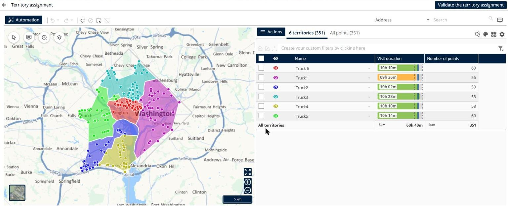
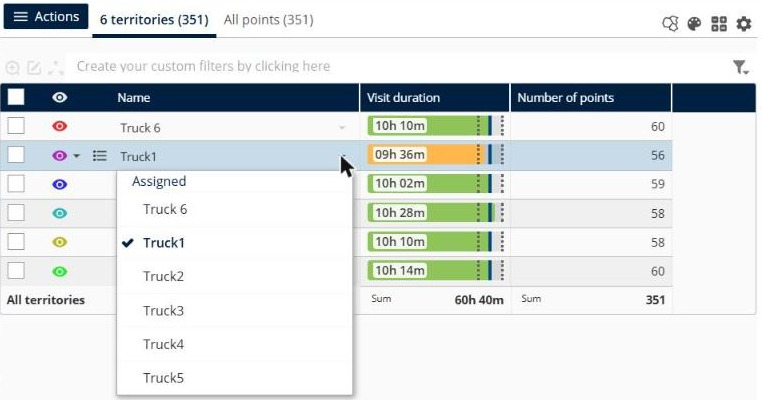

# Assign Territories (Sectorization)

Divide your customers into balanced territories, assign a resource to each territory, and make sure that the optimization respects the territories.

## Before you begin

* Sign in to **TourSolver**. Territory assignment is a **Premium** feature. See [Which countries are covered by TourSolver?](../faq/17.-which-countries-are-covered-by-toursolver.md).
* Import your customers on the **Customers** page.

## Feature overview

* **Assign territories**: Opens the territory assignment page for the selected customers.
* **Indicators**: The numeric values that the territories are balanced on, for example **Visit duration**, the number of points, or the frequency.
* **Territory assignment wizard**: Creates the territories automatically, with **Balancing points** or **Right team size**.
* **Assigned**: The resource of each territory.
* **Validate the territory assignment**: Saves the territories on the customers.

## Open the territory assignment

1. Go to **Customers**.
2. Select the check boxes of the customers, or select them all.
3. Click **Actions**, and then click **Assign territories**.

<figure><figcaption></figcaption></figure>

4. In **Territory assignment parameters**, select one or several **Indicators**, for example **Visit duration**, and the **Team to assign to territories**.
5. Click **Choose**.

<figure><figcaption></figcaption></figure>

You can also assign territories when you import your deliveries: on the **Adjust your addresses (geocoding)** step, click **Assign territories to my deliveries**.

## Create balanced territories

1. On the **Territory assignment** page, click **Automation**.
2. In the **Territory assignment wizard**, choose a mode:
   * **Balancing points**: Balances territories on one or several indicators.
   * **Right team size**: Determines the required number of territories based on the workload, the travel, and the individual capacity.

<figure><figcaption></figcaption></figure>

3. Set the criteria, for example the **Number of territories** and **Balance the territories on**. Click **Add an indicator** to balance on several indicators, for example the number of pickups, the visit duration, or the frequency.
4. Move the **Territory assignment priority** slider between **Compactness** and **Balancing**.

<figure><figcaption></figcaption></figure>

5. If needed, open **Advanced options**: **Restrict modifications**, **Maximum to be reassigned (%)**, **Grouping criteria**, and **Travel time parameters**.

<figure><figcaption></figcaption></figure>

6. Click **Let's go!**.

### Result

The territories appear on the map and in the list, with a bar for each indicator. A green bar is balanced, and an orange bar is out of balance.

<figure><figcaption></figcaption></figure>

## Assign a resource to each territory

After the territory assignment, assign the resources manually before you optimize. Otherwise, the optimization does not know which resource serves which territory, and the territories are not respected.

1. In the list of territories, click the arrow next to the name of a territory.
2. Under **Assigned**, select the resource that serves this territory.
3. Do the same for each territory.

<figure><figcaption></figcaption></figure>

4. Click **Validate the territory assignment**.

### Result

The **Territory** column of the customers shows their territory. When you optimize, each resource visits the customers of its territory.

## Tips


**Indicators must be numeric**: If an indicator has no valid numeric value for all the points, TourSolver shows "Some indicators do not have a valid numeric value for all points." Remove it from the territory assignment settings, or fill in the values.



**Points at the same address**: Use the aggregation radius to keep the points that are very close to each other, for example at the same address, in the same territory.



**Limit**: You can assign territories to up to 50,000 customers. See [What is the maximum number of visits that can be imported or optimized?](../faq/what-is-the-maximum-number-of-visits-that-can-be-imported-or-optimized.md).


## Related topics

* [Optimize your Deliveries](operationsandroutemanagement-optimizeyourdeliveries.md)
* [Optimize over Several Weeks with Frequencies](optimize-over-several-weeks-with-frequencies.md)
* [Which countries are covered by TourSolver?](../faq/17.-which-countries-are-covered-by-toursolver.md)
