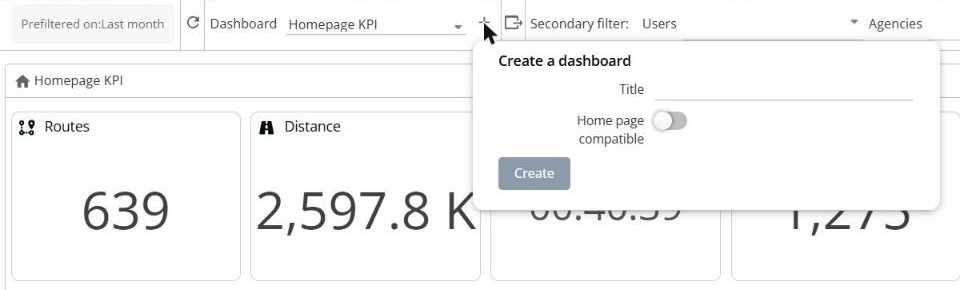
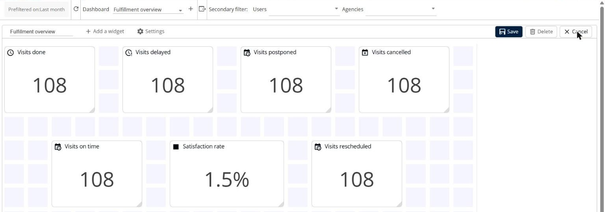
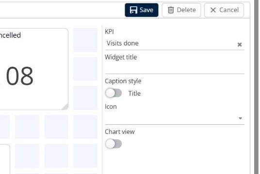
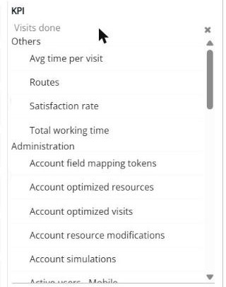
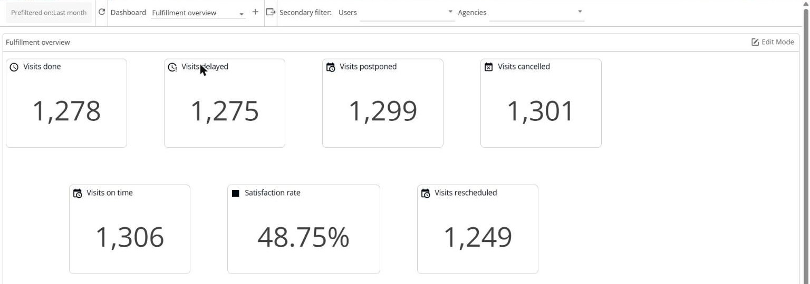

# Create a Monitoring Dashboard

Create a dashboard with the indicators that you want to follow, for example the visits done, delayed, or cancelled, and use the predefined dashboards as examples.

## Before you begin

* Sign in to **TourSolver**.
* Optimize your routes and share them with the mobile app, so that the dashboards have data. See [Share a Tour with the Mobile App](operationsandroutemanagement-shareatourwiththemobileapp.md).

## Feature overview

* **Dashboard**: A page of widgets. Each widget shows one indicator (KPI).
* **Predefined dashboards**: **Homepage KPI**, **Administration overview**, **Fulfillment overview**, and **Sustainability overview**.
* **Filters**: The period, for example **Last month**, and the **Secondary filter** on the **Users** and the **Agencies**.
* **Edit Mode**: Adds, moves, resizes, and configures the widgets of a dashboard.
* **Home page compatible**: Makes the dashboard available on the **Home** page.

## Create a dashboard

1. Click the **Dashboard** tab.
2. Next to the **Dashboard** list, click **+** (**Create a dashboard**).
3. Enter the **Title** of the dashboard.
4. To show the dashboard on the **Home** page, turn on **Home page compatible**.
5. Click **Create**.

<figure><figcaption></figcaption></figure>

## Add the indicators

1. Select the dashboard in the **Dashboard** list, and then click **Edit Mode**.
2. Click **Add a widget**. A new widget appears on the grid.

<figure><figcaption></figcaption></figure>

3. Click the widget, and then set it in the panel on the right:
   * **KPI**: The indicator that the widget shows.
   * **Widget title**, **Caption style**, and **Icon**.
   * **Chart view**: Shows the indicator as a chart.

<figure><figcaption></figcaption></figure>

4. Drag the widget to place it, and drag its corner to resize it. To remove a widget, click its trash icon.
5. Click **Save**. To leave without saving, click **Cancel**.

### Result

The dashboard shows your indicators for the selected period. Use the **Secondary filter** to show the data of some users or agencies only.

## Choose the indicators

The **KPI** list groups the indicators by theme:

<figure><figcaption></figcaption></figure>

* **Fulfillment**: Distance, Actual drive duration, Planned drive duration, On time, Visit duration, Visits, Visits cancelled, Visits delayed, Visits done, Visits on time, Visits postponed, Visits refused, and Visits rescheduled.
* **Administration**: Account field mapping tokens, Account optimized resources, Account optimized visits, Account resource modifications, Account simulations, Active users - Mobile, Active users - Planners, Resources available, Resources number, Savings, SMS quota, SMS used, User connections, User imported visits, User simulations, Users active, and Users inactive.
* **Consumption**: Co2, Electricity, and Fuel.
* **Others**: Avg time per visit, Routes, Satisfaction rate, and Total working time.

## Example: the Fulfillment overview dashboard

Select **Fulfillment overview** in the **Dashboard** list. It follows the execution of your routes with **Visits done**, **Visits delayed**, **Visits postponed**, **Visits cancelled**, **Visits on time**, **Satisfaction rate**, and **Visits rescheduled**.

<figure><figcaption></figcaption></figure>

To build your own version, create a dashboard, and then add the same **Fulfillment** indicators.

## Tips


**Rebuild an old dashboard**: The older dashboards cannot be edited in the same way. Create a new dashboard, and then add the indicators that you used.



**One dashboard per audience**: Create a dashboard for the planners with the **Fulfillment** indicators, and another one for the administrators with the **Administration** indicators.


## Related topics

* [How do I Geolocate my Delivery People](how-do-i-geolocate-my-delivery-people.md)
* [Share a Tour with the Mobile App](operationsandroutemanagement-shareatourwiththemobileapp.md)
