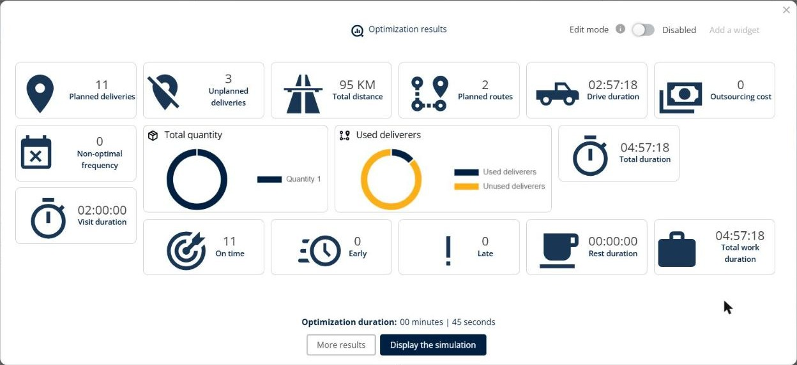
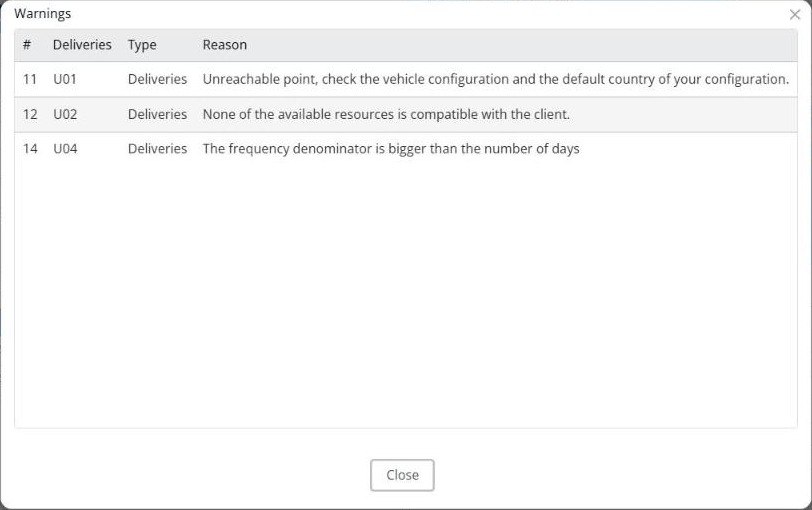
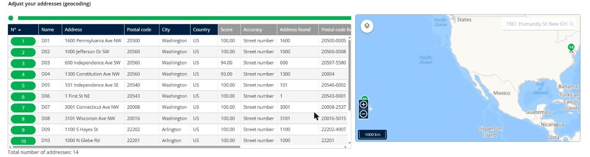
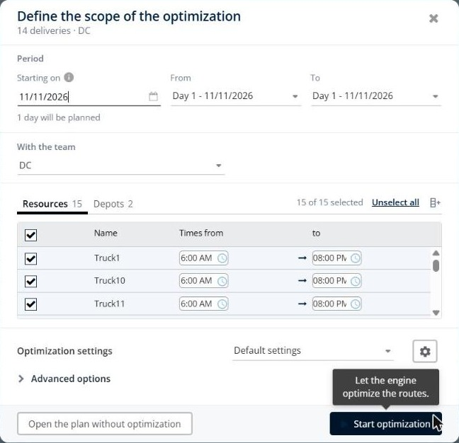
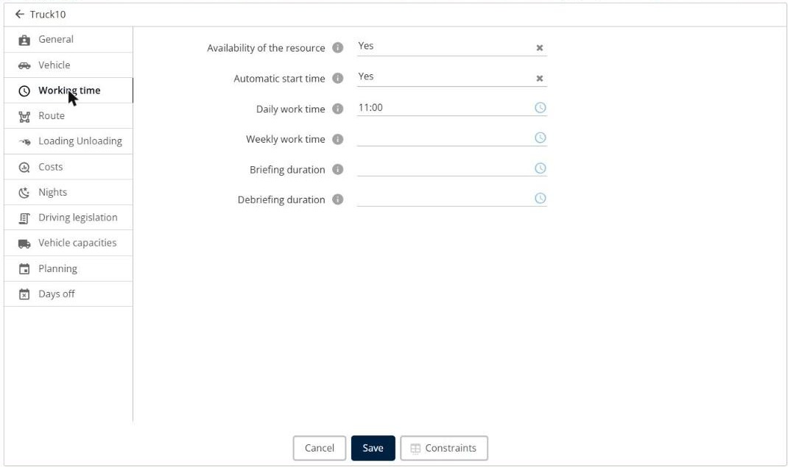
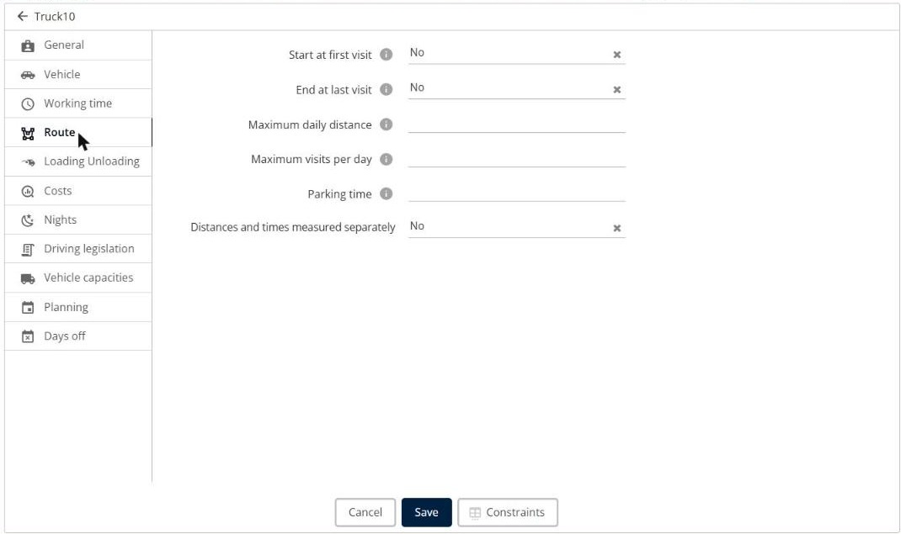
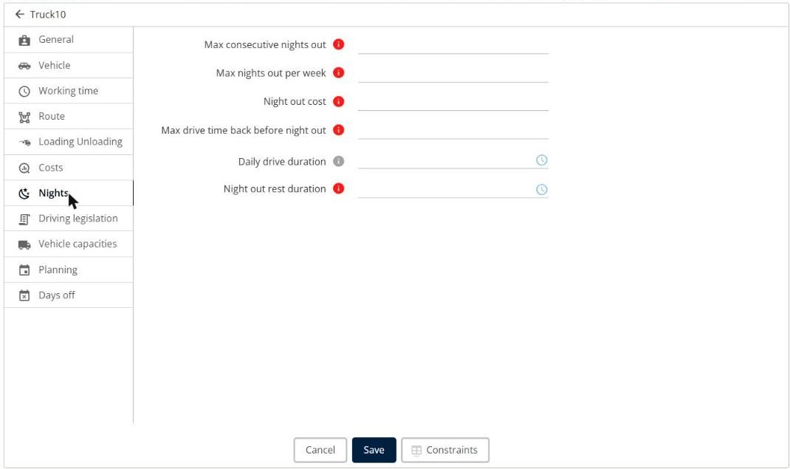
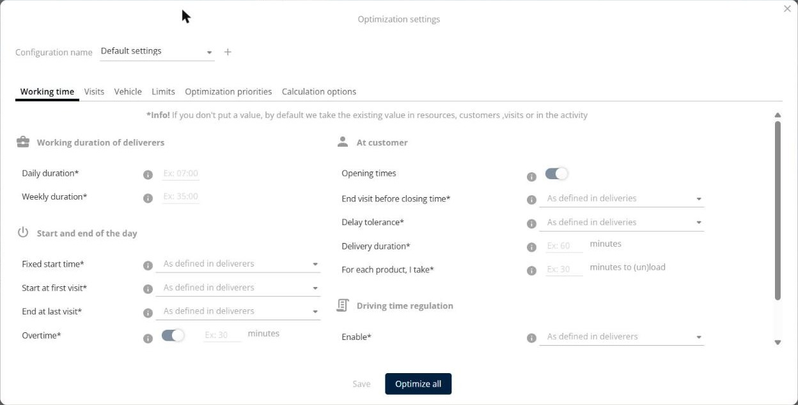

# Diagnose Unplanned Visits and Inconsistent Routes

Find out why some visits are not planned or why the routes look inconsistent, and check the visit and resource constraints that cause the most common problems.

## Before you begin

* Sign in to **TourSolver**.
* Import your deliveries and optimize them. See [Optimize your Deliveries](operationsandroutemanagement-optimizeyourdeliveries.md).

## Feature overview

* **Warnings**: The list of the problems found for each visit, with the reason.
* **Inaccessible point**: A visit that the vehicles cannot reach by road.
* **Time window**: The opening and closing times of a visit.
* **Resource constraints**: The working time, the worked days, the maximum visits per day, and the nights out of each resource.
* **Visit frequency**: A visit that must be performed several times over a period.
* **Optimization settings**: The settings of the optimization, saved under a configuration name.

## Read the warnings

1. In the **Optimization results**, check the number of **Unplanned deliveries**.

<figure><figcaption></figcaption></figure>

2. Click **Display the simulation**.
3. In the toolbar, click the **More information** icon.
4. In the **Warnings** window, read the **Reason** of each unplanned delivery, and then follow the section below that matches the reason.

<figure><figcaption></figcaption></figure>

For the messages about capacities, skills, and working days, see [Why are no visits planned after the optimization?](../faq/why-are-no-visits-planned-after-the-optimization.md).

## Fix an inaccessible point

**Reason**: "Unreachable point, check the vehicle configuration and the default country of your configuration."

1. On the **Adjust your addresses (geocoding)** step of the import, or on the map of the simulation, find the point. An inaccessible point is often far from the other visits, for example on an island or in another country.

<figure><figcaption></figcaption></figure>

2. Correct the address or the coordinates of the visit. See [Fix Addresses That Are Not Geocoded](../importanddatasetup/fix-addresses-that-are-not-geocoded.md).
3. If the address is correct, check that the means of transportation of the resources can reach it, and that the country of the visit is covered by your configuration.

## Fix the time windows

**Reasons**: "None of the available resources is compatible with the client.", "The time window end time is earlier than the start time.", or "The time window seems extremely short."

* **End before the start**: Check that the closing time is later than the opening time.
* **Window that crosses midnight**: Enter the closing time after 24:00. For example, for a visit from 11:00 PM to 2:00 AM, enter **23:00** to **26:00**. If you enter 11:00 PM to 2:00 AM, the closing time is earlier than the opening time, and the visit is not planned.
* **Short window**: Check that the visit duration fits in the time window.
* **Opening days**: Give each **Opening time** an **Opening day** with the same number. The opening days of the visits also limit the days that you can select in **Define the scope of the optimization**.

<figure><figcaption></figcaption></figure>

## Check the resource constraints

Fill in the constraints of the resources before the first optimization. A missing or wrong value can leave visits unplanned or create unexpected routes.

1. Go to **My deliverers**, and then click the **Edit** icon of the resource.
2. On the **Working time** tab, check **Availability of the resource**, **Automatic start time**, and **Daily work time**.

<figure><figcaption></figcaption></figure>

3. On the **Route** tab, check **Maximum daily distance** and **Maximum visits per day**. A low maximum leaves the other visits unplanned.

<figure><figcaption></figcaption></figure>

4. On the **Nights** tab, check **Max consecutive nights out**, **Max nights out per week**, and **Max drive time back before night out**. Without nights out, a resource must come back to the depot every evening, and the visits that are too far away stay unplanned.

<figure><figcaption></figcaption></figure>

5. On the **Planning** tab, check the **Worked days** and the working hours.
6. On the **Vehicle capacities** tab, check the capacities.
7. Click **Save**.

## Fix the visit frequencies

**Reason**: "The frequency denominator is bigger than the number of days"

* A frequency such as **2/5** means two visits over five days. Select a period of at least five days in **Define the scope of the optimization**.
* Check that the resources have **Worked days** on these days.
* Check that the frequency does not conflict with the **Maximum visits per day** and the nights out of the resources.

## Re-run the optimization after a change

A change to the resources or to the configuration does not change the simulations that already exist. When you see "Your activity has changed since you created this simulation. To use the new activity with the same data, click on the "My deliveries" tab and start a new optimization.":

1. Go to **My deliveries**.
2. Start a new optimization.

## Compare the results of two users

Two users get different routes when they do not optimize the same data with the same settings. Before you compare two results, check that both users use:

* The same deliveries, period, team, and selected resources in **Define the scope of the optimization**.
* The same **Configuration name** in the **Optimization settings**. To open them, click the **See and modify the settings** icon in the toolbar of the simulation.
* The same optimization duration: a result obtained with **Stop and see the result** can differ from a complete optimization.

<figure><figcaption></figcaption></figure>

## Use case: diagnose unplanned visits

Download the sample file [UseCase\_RouteDiagnosis.xlsx](../.gitbook/assets/UseCase_RouteDiagnosis.xlsx). It contains 14 deliveries around Washington, DC, for resources that leave from Maryland. The **Use cases** sheet describes each row.

| Row | Use case | Result in the Warnings window |
| --- | -------- | ----------------------------- |
| **D01 to D10** | Valid deliveries. | Planned. |
| **U01** | Address in Honolulu, Hawaii: an island that the vehicles cannot reach. | "Unreachable point, check the vehicle configuration and the default country of your configuration." |
| **U02** | Time window from 11:00 PM to 2:00 AM, entered without crossing midnight. | "None of the available resources is compatible with the client." |
| **U03** | Time window of 5 minutes, from 9:00 AM to 9:05 AM. | Planned, because the visit starts within the window. |
| **U04** | Visit frequency **2/5**, but the opening days of U02 and U03 limit the period to one day. | "The frequency denominator is bigger than the number of days" |

In this use case, 11 deliveries are planned and 3 are unplanned. To plan them, remove U01, enter the time window of U02 as 23:00 to 26:00, and optimize a period of at least five days for U04.

## Tips


**Test with a small file**: To find a cause quickly, optimize a few visits with one resource, and then add the other visits.



**Save the settings**: Save your optimization settings under a configuration name, so that all the users of your company optimize with the same settings.


## Related topics

* [Optimize your Deliveries](operationsandroutemanagement-optimizeyourdeliveries.md)
* [Why are no visits planned after the optimization?](../faq/why-are-no-visits-planned-after-the-optimization.md)
* [How to Prioritize the Fewest Possible km / the Most Planned Customers?](../faq/how-to-prioritize-the-fewest-possible-km-the-most-planned-customers.md)
* [Modifying a Resource and Associated Constraints](../resource-and-vehicle-management/modifying-a-resource-and-associated-constraints.md)
