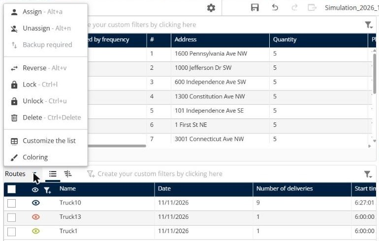
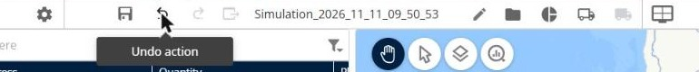
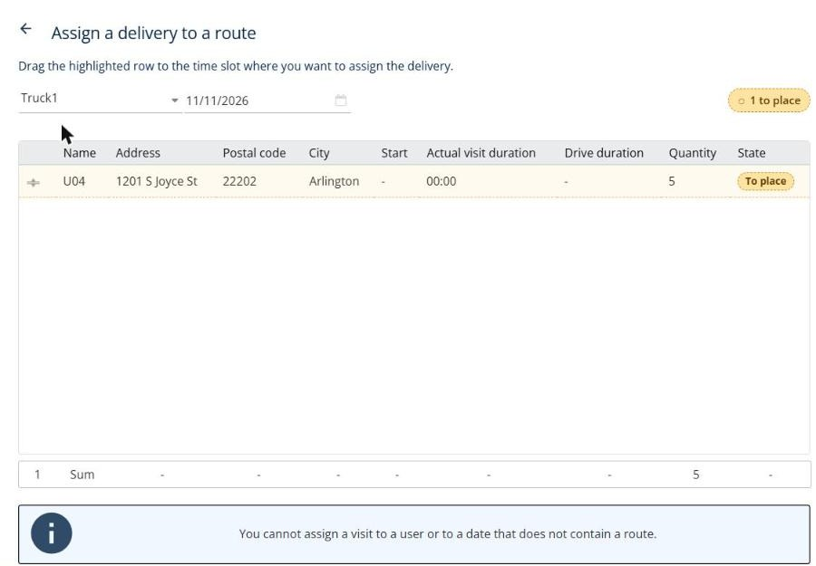
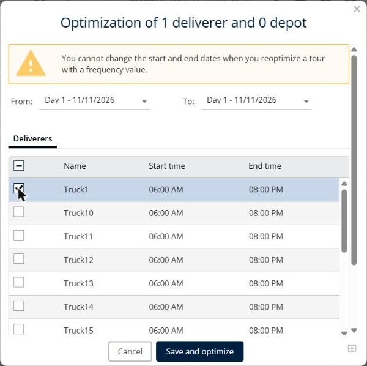
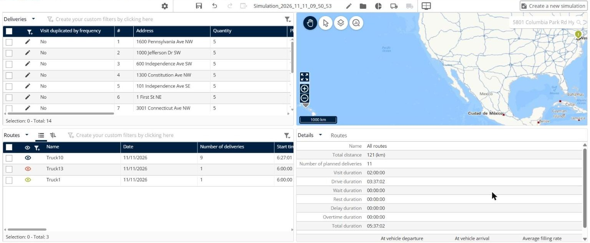

# Edit Routes Manually: Reorder, Lock, and Undo

Change your routes after the optimization: reorder or lock a route, undo a manual change, assign a visit by hand, and assign a visit to a resource that has no route yet.

## Before you begin

* Sign in to **TourSolver**.
* Optimize your deliveries and open the simulation. See [Optimize your Deliveries](operationsandroutemanagement-optimizeyourdeliveries.md).

## Feature overview

* **Reorder**: Re-optimizes the selected routes. The order of the visits can change, and some visits can become unplanned.
* **Lock**: Keeps a route as it is when you re-optimize or reorder the other routes.
* **Undo action**: Cancels your last change in the simulation.
* **Assign deliveries**: Places one visit by hand in the route and the time slot that you choose.
* **Optimize the selected deliveries**: Plans the selected visits on the resources that you select, for example a resource that has no route yet.

<figure><figcaption></figcaption></figure>

## Reorder a route

1. In the **Routes** panel, select the check boxes of the routes.
2. Click the **Routes** menu, and then click **Reorder**. You can also press **Alt+r**.


**Reorder re-runs an optimization**: TourSolver re-optimizes the assigned routes. The order of the visits can change, and some visits can become unplanned. Lock the routes that you want to keep before you reorder the others. See [Reorder routes](../simulation/simulation-routes-reorder.md).



**Backup required**: If **Reorder** is greyed out and shows **Backup required**, save the simulation first with the **Save** icon in the toolbar.


## Lock a route

1. In the **Routes** panel, select the check boxes of the routes.
2. Click the **Routes** menu, and then click **Lock**. You can also press **Ctrl+l**.

To unlock the routes, click **Unlock**, or press **Ctrl+u**. See [Lock and unlock routes](../simulation/simulation-routes-lock-unlock.md).

## Undo a manual change

In the toolbar of the simulation, click the **Undo action** arrow.

<figure><figcaption></figcaption></figure>

If the undo arrow is not available, for example after you left the simulation, re-run the optimization from **My deliveries**.

## Assign a single visit by hand

1. In the **Deliveries** panel, select the check box of the visit.
2. Click the **Deliveries** menu, and then click **Assign deliveries**.
3. Select the resource and the day.
4. Drag the highlighted row to the time slot where you want the visit in the route.
5. Click the back arrow to return to the simulation.

See [Assign deliveries to a route](../simulation/simulation-deliveries-assign.md).


**Rows above the departure**: The visits left above the route departure are not assigned. They stay unplanned.


## Assign a visit to a resource that has no route

You can assign a visit only to a resource and a day that already have a route. If you select a resource that is not in the **Routes** panel, **Assign deliveries** shows "You cannot assign a visit to a user or to a date that does not contain a route."

<figure><figcaption></figcaption></figure>

To create a route for this resource:

1. In the **Deliveries** panel, select the check box of the visit.
2. If the visit is planned on another route, click the **Deliveries** menu, and then click **Unassign**. Its **Reason** becomes **Manual unassignment**.
3. Click the **Deliveries** menu, and then click **Optimize**.
4. Clear the check boxes of all the deliverers, and then select only the resource that must perform the visit, for example **Truck1**.
5. Click **Save and optimize**.

<figure><figcaption></figcaption></figure>

### Result

The resource appears in the **Routes** panel with the visit. You can now add other visits to its route with **Assign deliveries**.

<figure><figcaption></figcaption></figure>

## Use case: move a visit to a resource without a route

In a simulation with two routes, **Truck10** and **Truck13**, the visit **D05** must be performed by **Truck1**, which has no route:

1. **Assign deliveries** with **Truck1** shows "You cannot assign a visit to a user or to a date that does not contain a route."
2. **Unassign** D05, and then **Optimize** it with only **Truck1** selected.
3. The **Routes** panel now shows three routes: **Truck10**, **Truck13**, and **Truck1** with D05.

## Tips


**Save before big changes**: Save the simulation before you reorder or re-optimize, so that you can go back to it.



**Manual breaks**: Re-optimizing a route removes the breaks that you added by hand. See [How do I add lunch breaks and legal driving breaks?](../faq/how-do-i-add-lunch-breaks-and-legal-driving-breaks.md).


## Related topics

* [Reorder routes](../simulation/simulation-routes-reorder.md)
* [Lock and unlock routes](../simulation/simulation-routes-lock-unlock.md)
* [Assign deliveries to a route](../simulation/simulation-deliveries-assign.md)
* [Unassign deliveries](../simulation/simulation-deliveries-unassign.md)
