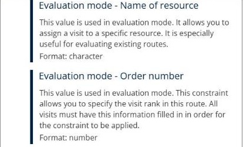
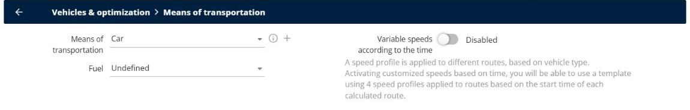

# Evaluate your Existing Routes

Import your current routes, compare them with the optimized routes, and solve the issues when **Load evaluation routes** is greyed out or gives wrong results.

## Before you begin

* Sign in to **TourSolver**.
* Prepare an import file with your current routes: for each delivery, the resource that delivers it, the day of the delivery, and its position in the route. See [Import of Deliveries](../importanddatasetup/importanddatasetup-importofdeliveries.md).

## Feature overview

* **Evaluation mode**: Calculates your current routes as they are, so that you can compare them with the optimized routes.
* **Evaluation fields**: The three fields of the import file that describe your current routes.
* **Load evaluation routes**: The button of the optimization results that shows your current routes.
* **Variable speeds according to the time**: A speed setting that must be disabled to load the evaluation routes.

## Map the evaluation fields at the import

1. Go to **My deliveries** and import your file.
2. In the field mapping, map the three fields of the **Evaluation** category:
   * **Evaluation mode - Name of resource**: The resource that delivers the visit. Use the same name as the resource in **My deliverers**.
   * **Evaluation mode - Day of visit**: The day of the visit in the route. Enter it as a date, for example **10/11/2026**, not as a day number such as **1** or **2**.
   * **Evaluation mode - Order number**: The position of the visit in the route. Each number must be unique for a resource on a given day.
3. Finish the import.

<figure><figcaption></figcaption></figure>


**All three fields are mandatory**: Fill in the three fields for every visit. If one of them is missing, the evaluation routes cannot be loaded.


## Disable the variable speeds

1. Go to **Configuration** > **Vehicles & optimization** > **Means of transportation**.
2. Turn off **Variable speeds according to the time**.

<figure><figcaption></figcaption></figure>

3. Refresh the page in your browser (**F5**).

## Run the optimization and load the evaluation routes

1. Optimize your deliveries. See [Optimize your Deliveries](operationsandroutemanagement-optimizeyourdeliveries.md).
2. In the optimization results, click **Load evaluation routes**.

### Result

TourSolver shows your current routes, so that you can compare them with the optimized routes.

## Tips


**Load evaluation routes is greyed out**: Check that the three evaluation fields are mapped and filled in for every visit, that the day of visit is a date, that each order number is unique for each resource, and that the variable speeds are disabled. Then optimize again.



**Locked routes**: If some routes are locked, the message "Impossible to load evaluation routes as some routes are locked." appears. Unlock the routes, and then load the evaluation routes again.


## Related topics

* [Import of Deliveries](../importanddatasetup/importanddatasetup-importofdeliveries.md)
* [Optimize your Deliveries](operationsandroutemanagement-optimizeyourdeliveries.md)
* [Lock and unlock routes](../simulation/simulation-routes-lock-unlock.md)
