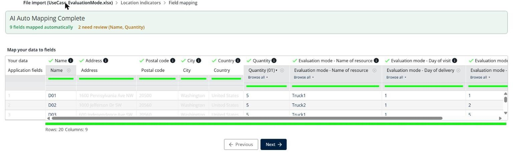
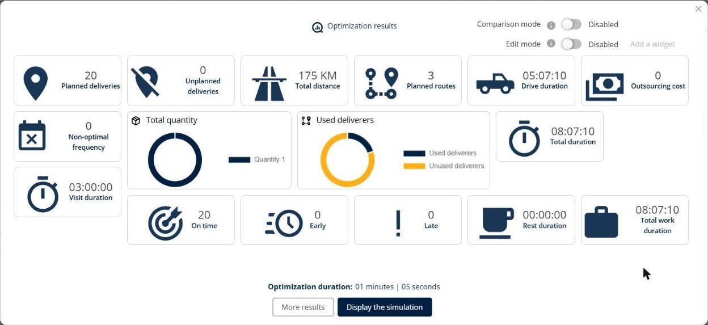
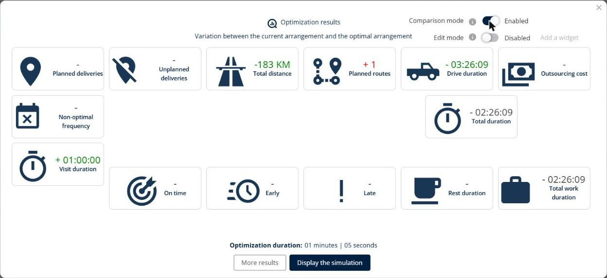
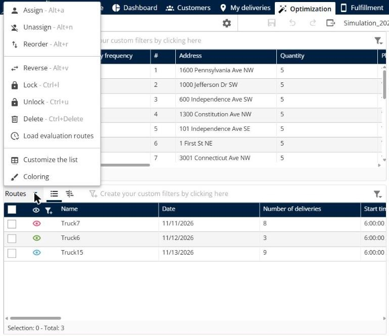
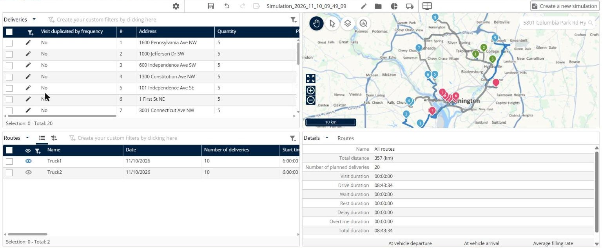

# Evaluate your Existing Routes

Import the routes that your drivers already followed, for example last week or last month, compare them with the routes that TourSolver optimizes, and measure the gain in kilometers and drive duration.

## Before you begin

* Sign in to **TourSolver**.
* Prepare an import file with your current routes: for each delivery, the resource that delivered it, the day of the delivery, and its position in the route. See [Import of Deliveries](../importanddatasetup/importanddatasetup-importofdeliveries.md).

## Feature overview

* **Evaluation mode**: Calculates your current routes as they are, so that you can compare them with the optimized routes.
* **Evaluation fields**: The three fields of the import file that describe your current routes.
* **Comparison mode**: Shows the variation between your current routes and the optimized routes in the optimization results.
* **Load evaluation routes**: Shows your current routes on the map and in the routes list.
* **Variable speeds according to the time**: A speed setting that can prevent the evaluation routes from loading.

## Map the evaluation fields at the import

1. Go to **My deliveries** and import your file.
2. In the field mapping, check that the three evaluation fields are mapped:
   * **Evaluation mode - Name of resource**: The resource that delivers the visit. Use exactly the same name as the resource in **My deliverers**, for example **Truck1**.
   * **Evaluation mode - Day of visit** (shown as **Evaluation mode - Day of delivery** in the mapping): The day of the route. Use one of the **Worked days** of the resource, for example **1** for the first day of the period. If the worked days of your resources are dates, use a date.
   * **Evaluation mode - Order number**: The position of the visit in the route, for example **1**, **2**, **3**. Each number must be unique for a resource on a given day.

<figure><figcaption></figcaption></figure>

3. Click **Next**, check the addresses, and then click **Create the tour plan**.


**All three fields are mandatory**: Fill in the three fields for every visit. If one of them is missing, the evaluation routes cannot be loaded.


## Optimize and compare the results

1. In **Define the scope of the optimization**, check the period and the team, and then click **Start optimization**.
2. In the **Optimization results**, turn on **Comparison mode**.
3. Read the variation between your current routes and the optimized routes, for example the **Total distance** and the **Drive duration**. A value in green is a gain.

<figure><figcaption></figcaption></figure>

<figure><figcaption></figcaption></figure>

### Result

You see the gain of the optimization. In the use case below, the optimized routes save 183 km and 3 hours 26 minutes of driving.

## Load the evaluation routes

1. Click **Display the simulation**.
2. Click the **Routes** menu, and then click **Load evaluation routes**.

<figure><figcaption></figcaption></figure>

### Result

TourSolver shows your current routes on the map and in the **Routes** list, with their distance and duration in **Details**.

<figure><figcaption></figcaption></figure>


**Go back to the optimized routes**: Click the **Undo** arrow, or leave the simulation without saving.


## Solve the problems with the evaluation routes

If **Load evaluation routes** is greyed out or gives wrong results:

1. Check that the three evaluation fields are mapped and filled in for every visit.
2. Check that each **Day of visit** is one of the **Worked days** of the resource, and that each **Order number** is unique for a resource on a given day.
3. Disable the variable speeds: go to **Configuration** > **Vehicles & optimization** > **Means of transportation**, turn off **Variable speeds according to the time**, and then refresh the page in your browser (**F5**).

<figure><figcaption></figcaption></figure>

4. Optimize again, and then load the evaluation routes.

## Use case: compare last week's routes with the optimized routes

Download the sample file [UseCase\_EvaluationMode.xlsx](../.gitbook/assets/UseCase_EvaluationMode.xlsx). It contains 20 deliveries around Washington, DC, delivered by **Truck1** and **Truck2** on day **1**, in a random order.

1. Import the file in **My deliveries**. The evaluation fields are mapped automatically.
2. Optimize the deliveries with the team of **Truck1** and **Truck2**.
3. Turn on **Comparison mode**, and then load the evaluation routes.

In this use case:

* The current routes of **Truck1** and **Truck2** drive **357 km** in **8 hours 43 minutes**.
* The optimized routes drive **175 km** in **5 hours 7 minutes**.
* **Comparison mode** shows a gain of **183 km** and **3 hours 26 minutes** of driving.

## Tips


**Locked routes**: If some routes are locked, the message "Impossible to load evaluation routes as some routes are locked." appears. Unlock the routes, and then load the evaluation routes again.



**Use real data**: Import the routes of a full week or month to get a reliable comparison.


## Related topics

* [Import of Deliveries](../importanddatasetup/importanddatasetup-importofdeliveries.md)
* [Optimize your Deliveries](operationsandroutemanagement-optimizeyourdeliveries.md)
* [Lock and unlock routes](../simulation/simulation-routes-lock-unlock.md)
