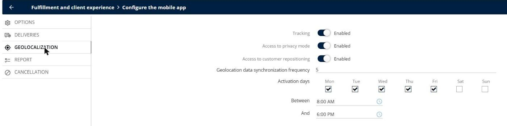
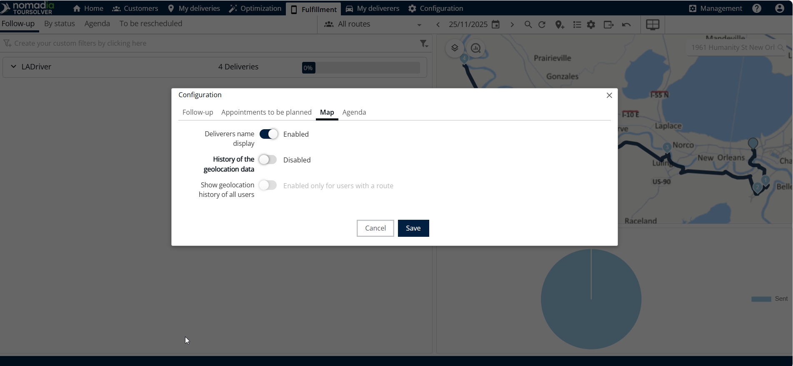

# How do I Geolocate my Delivery People

Configure the geolocation of the mobile app, follow your delivery people on the map of the **Fulfillment** tab, and find out why a position is missing.

## Before you begin

* Sign in to **TourSolver** with a user profile that has access to the **Configuration** page.
* Create your delivery people and their routes, and share the routes with the mobile app. See [Share a Tour with the Mobile App](operationsandroutemanagement-shareatourwiththemobileapp.md).
* Give your delivery people **Mobile access**. See [Create and Modify a User](../importanddatasetup/importanddatasetup-createandmodifyauser.md).

## Feature overview

* **Tracking**: Sends the position of the delivery people from the mobile app to TourSolver.
* **Access to privacy mode**: Allows the delivery people to turn off the tracking in the app, for example during a break. This complies with the GDPR.
* **Activation days and hours**: The days and the hours when the tracking is active.
* **Geolocation data synchronization frequency**: How often the app sends the position.
* **Fulfillment map**: Shows the position and the geolocation history of the delivery people.

## Configure the geolocation

1. Go to **Configuration** > **Fulfillment and client experience** > **Configure the mobile app**.
2. Click **GEOLOCALIZATION**.
3. Turn on **Tracking**.
4. Choose whether the delivery people can use the privacy mode (**Access to privacy mode**) and reposition a customer (**Access to customer repositioning**).
5. Set the **Geolocation data synchronization frequency**.
6. Select the **Activation days**, for example **Mon** to **Fri**, and the hours **Between** and **And**, for example **8:00 AM** to **6:00 PM**.

<figure><figcaption></figcaption></figure>

7. On the **OPTIONS** tab, check the **Number of days reachable in the agenda** and the **Automatic synchronization frequency**.

## View the geolocation in the Fulfillment tab

1. Click the **Fulfillment** tab.
2. Select the date of the route that you want to follow.

>)

3. Click **Settings** to choose what the page shows: **Available fields**, **Display fields**, **Appointments to be planned**, **Map**, and **Agenda**.

<figure><figcaption></figcaption></figure>

4. Click the map to show the geolocation history.

<figure><figcaption></figcaption></figure>

## Solve a missing position

If a delivery person does not appear on the map, check these points:

* **Tracking settings**: **Tracking** is turned on, and the current day and time are within the **Activation days** and the hours **Between** and **And**.
* **Phone permissions**: On the phone, the TourSolver app has the location permission **Allow all the time** (Android) or **Always** (iOS), so that it can send the position in the background. The battery saver must not stop the app.
* **Privacy mode**: The delivery person has not turned on the privacy mode in the app.
* **Current day only**: The position is visible for the current day only. To see past positions, use the coordinates of the end of the visits.
* **App closed**: When the app is closed on the phone, the position is no longer sent and is lost. The delivery person must keep the app open in the background.

## Use the coordinates of the end of the visits

For the past days, the export of the **Fulfillment** tab gives the position of each visit when it was started and ended: **Start longitude**, **Start latitude**, **End longitude**, and **End latitude**. Add these fields to the displayed fields of the export to compare the real position with the address of the customer.

## Tips


**Keep the synchronization frequent**: If real-time tracking is critical, use a short synchronization frequency. The positions are then updated more often.



**Respect the privacy**: Tell your delivery people when the tracking is active, and give them access to the privacy mode outside their working time.


## Related topics

* [Share a Tour with the Mobile App](operationsandroutemanagement-shareatourwiththemobileapp.md)
* [Create and Modify a User](../importanddatasetup/importanddatasetup-createandmodifyauser.md)
* [Why is my Excel export empty, incomplete, or failed?](../faq/why-is-my-excel-export-empty-incomplete-or-failed.md)
