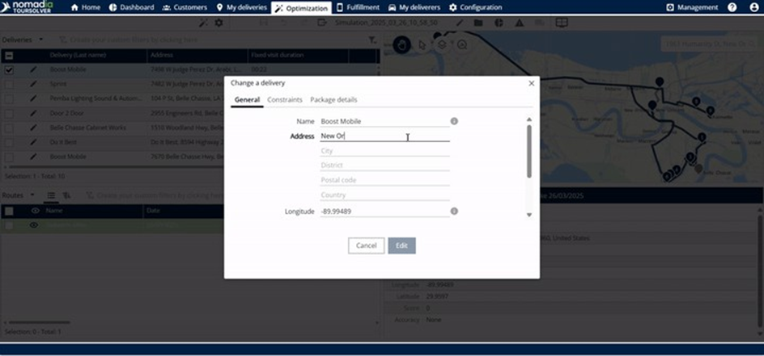
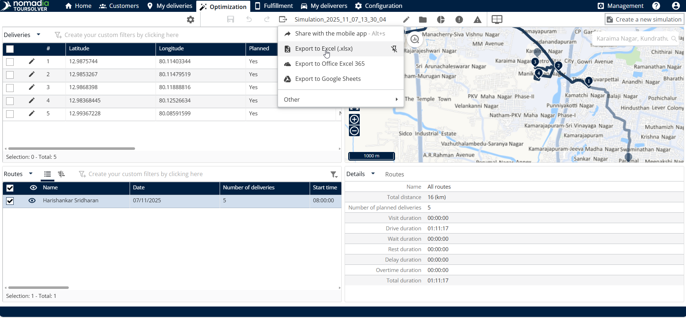
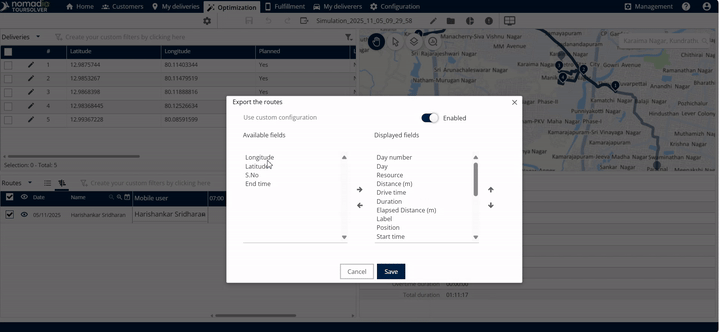
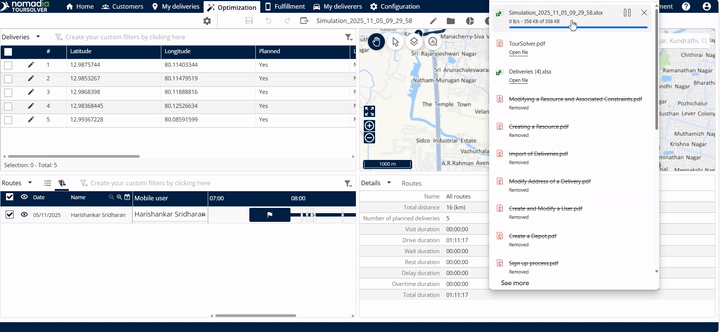
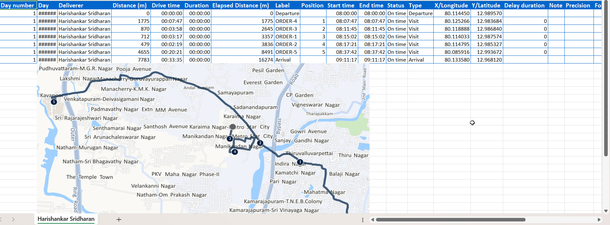

# Export my Routes

Select, customize, and export your completed routes, for example to Excel or to a calendar.

## Before you begin

* Sign in to **TourSolver**.
* Optimize your deliveries so that you have a completed route to export. See [Optimize your Deliveries](operationsandroutemanagement-optimizeyourdeliveries.md).
* From the home page, open **Optimization**.

## Feature overview

The route export is flexible, so you can share data in formats suited to different people. Click the **export option** and select **other** to see all the export types.

| Export feature | Benefit |
| -------------- | ------- |
| **Export to Excel** | Detailed data analysis, calculations, and structured reporting. |
| **Export to PowerPoint / Office 365 PowerPoint / Google Slides** | Quickly generate presentations or summaries for meetings. |
| **Export to Calendar (Office Outlook / Google)** | Integrate route schedules and timings directly into personal or team calendars. |
| **Export a summary of routes sent by email** | Share a high-level overview of the route plan with recipients. |
| **Export to Masternaut .GPX / Extended .GPX** | Use with specific GPS navigation systems or advanced mapping software. |
| **Export to KML format Google etc.** | Standard format to view geospatial data, such as routes, in mapping tools like Google Earth. |
| **Export to Webhook** | Automated data transfer to other operational systems. |

## Customize the Excel export

When you export to Excel, you can adjust the resulting file.

### Select the sheet layout

1. Choose how the route data is organized:
   * **One sheet for all deliverers**: a consolidated view.
   * **One sheet per deliverer**: detailed reports for individual team members.

<figure><figcaption></figcaption></figure>


These configurations apply only to the Excel export. Other formats, such as PowerPoint or Calendar, use their standard output settings.


### Select the custom fields (columns)

1. Click **other** in the configuration window.
2. A list of **available fields** and **display fields** is displayed.

<figure><figcaption></figcaption></figure>

3. If needed, enable the **custom configuration**. The export file then contains both **standard and mapped columns**.
4. Click **Save** when you are done customizing the fields.

## Export a route to Excel

1. From the **home page**, click **Optimization**.
2. Click the **route** that you want to export.

<figure><figcaption></figcaption></figure>

3. Click **export to Excel**.

<figure><figcaption></figcaption></figure>

4. Review and adjust the configuration settings (sheet layout, timings, and data integrity).

<figure><figcaption></figcaption></figure>

5. If you customized the fields, make sure that you clicked **Save**.

<figure><figcaption></figcaption></figure>

6. Click the **downloaded file** to open it.

<figure><figcaption></figcaption></figure>

### Result

The Excel file is downloaded with your route data.

<figure><figcaption></figcaption></figure>

## Tips


**Customize the columns**: If you only need two or three data points, use the **other** option in the configuration menu to remove the unnecessary fields. The export file then contains only the standard and mapped columns that matter most.



**Use the calendar export for scheduling**: Use **export to calendar** (Office Outlook or Google) to give deliverers their final shift timings and route appointments.



**Save the configuration**: After you set the sheet layout and the fields, for example **one sheet per deliverer** or the **shift timings**, click **Save**. You can then run the export again without selecting every option.


## Related topics

* [Optimize your Deliveries](operationsandroutemanagement-optimizeyourdeliveries.md)
* [Share a Tour with the Mobile App](operationsandroutemanagement-shareatourwiththemobileapp.md)
