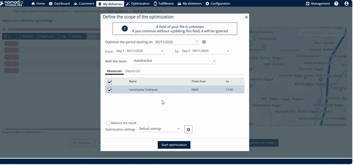
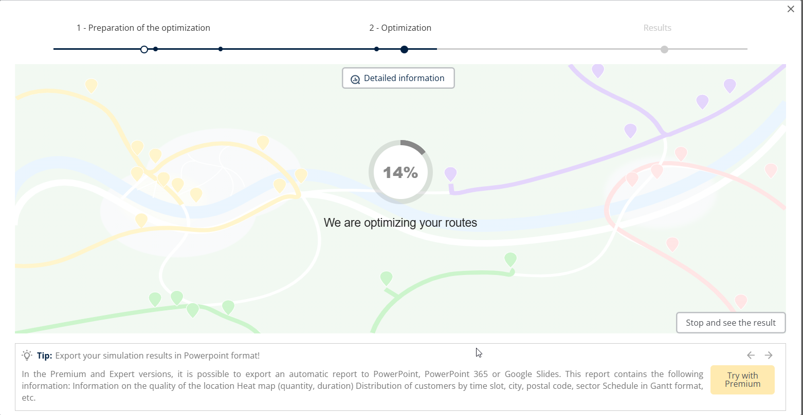
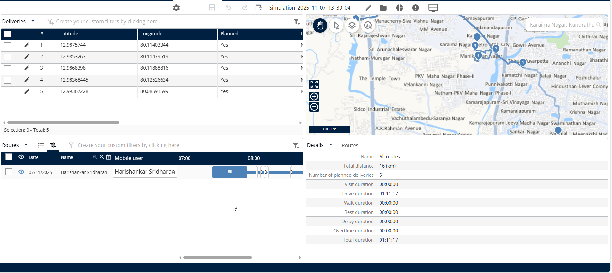
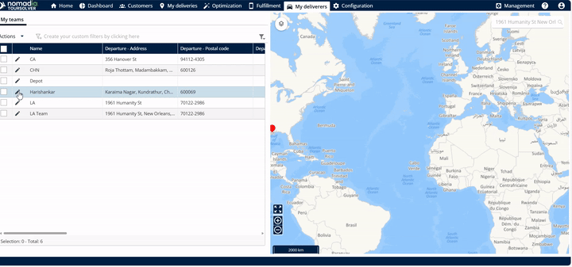
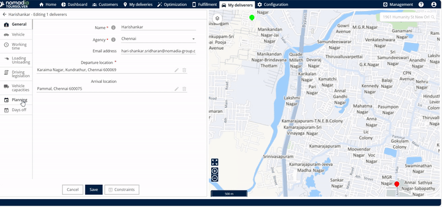
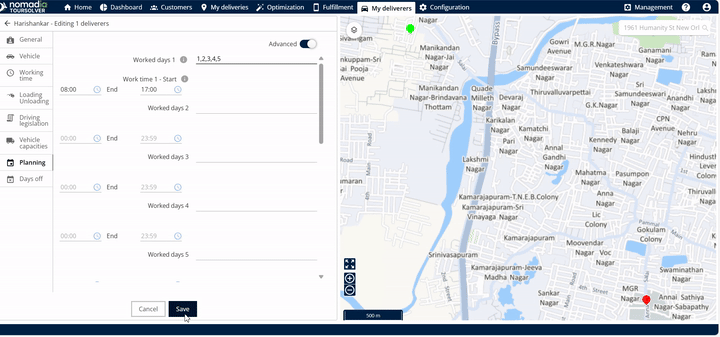

# Optimize your Deliveries

Set your optimization preferences and start the route planning that calculates the best delivery sequence and routes.

## Before you begin

* Sign in to **TourSolver**.
* Import your delivery data. See [Import of Deliveries](../importanddatasetup/importanddatasetup-importofdeliveries.md).
* Go to **My Deliveries**, check that the deliveries are imported, and click **Next**.
* Click **Optimize My Routes**.

## Feature overview

* **Route Optimization**: Takes all your imported deliveries and calculates the most efficient route schedule, so that time and resources are used efficiently.
* **Editable Optimization Dates**: Sets when the optimized routes begin to run, by entering or editing the start date and the end date.
* **Editable Planning Days**: Adjusts the number of days that the system plans for, which is useful when your operational needs change.

## Start the route optimization

1. On the optimization screen, enter or edit the **start date** and the **end date** of the optimized routes.
2. Optional: Adjust the **number of planning days** on this screen.

<figure><figcaption></figcaption></figure>

3. Click **Start Optimization**.

<figure><figcaption></figcaption></figure>

## View the optimization results

1. Click **Start Optimization**.

<figure><figcaption></figcaption></figure>

2. While the optimization is running, monitor the results. The optimization result summary is displayed.

<figure><figcaption></figcaption></figure>

3. Click **Display the Simulation**.

<figure><figcaption></figcaption></figure>

### Result

The deliveries are optimized successfully.

<figure><figcaption></figcaption></figure>

## Adjust the planning period (number of days)

To change the number of days that the system plans routes for, use **My Deliverers**.

1. Go to **My Deliverers**.
2. Find the resource associated with the delivery.

<figure><figcaption></figcaption></figure>

3. Click **Planning**.

<figure><figcaption></figcaption></figure>

4. Change the **number of days** to the value that you want to use for planning.
5. Click **Save**.

<figure><figcaption></figcaption></figure>

## Tips


**Be patient with large jobs**: If many deliveries need optimization, the process can take longer than expected. This is normal because the system performs complex calculations. To speed it up, see [Why is my optimization slow, stuck, or interrupted?](../faq/why-is-my-optimization-slow-stuck-or-interrupted.md).



**Check results early**: You do not have to wait for the entire process to finish. To get a preliminary result quickly, click **Stop and see the result** at any time during the calculation.



**Success confirmation**: When the system confirms "The deliveries have been optimized successfully," your new routes are ready to implement.


## Related topics

* [Import of Deliveries](../importanddatasetup/importanddatasetup-importofdeliveries.md)
* [Export my Routes](operationsandroutemanagement-exportmyroutes.md)
* [Share a Tour with the Mobile App](operationsandroutemanagement-shareatourwiththemobileapp.md)
* [Optimize deliveries](../simulation/simulation-deliveries-optimize.md)
* [Why is my optimization slow, stuck, or interrupted?](../faq/why-is-my-optimization-slow-stuck-or-interrupted.md)
