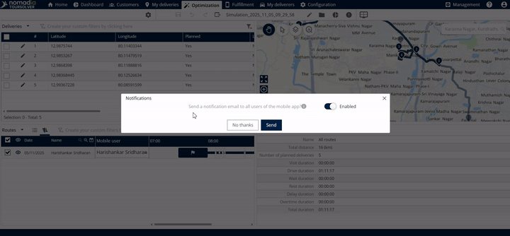
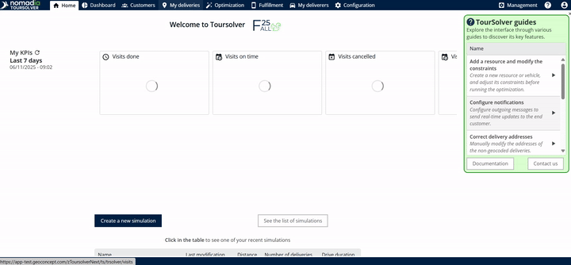
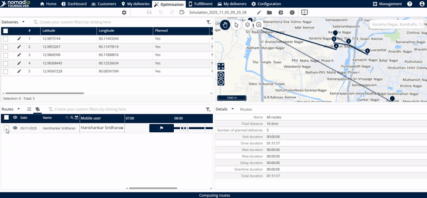
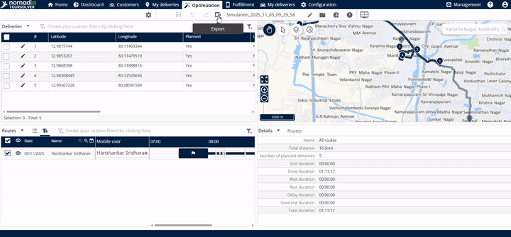
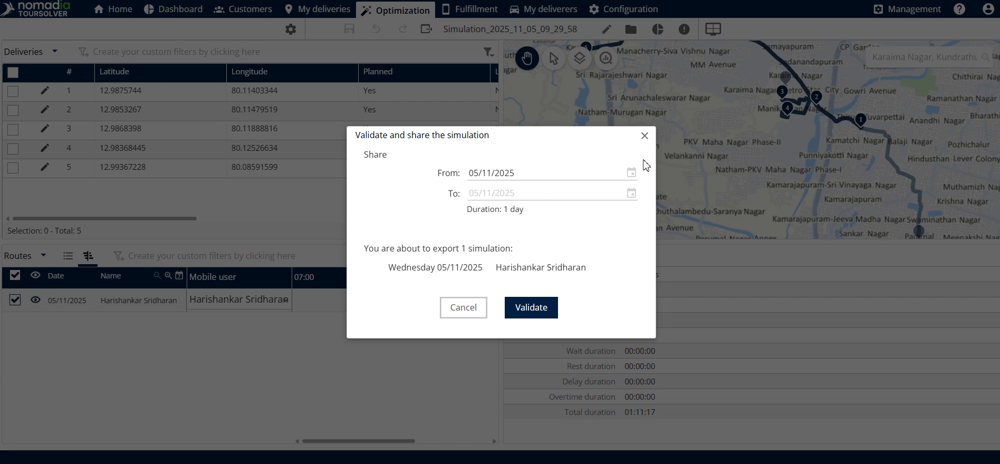
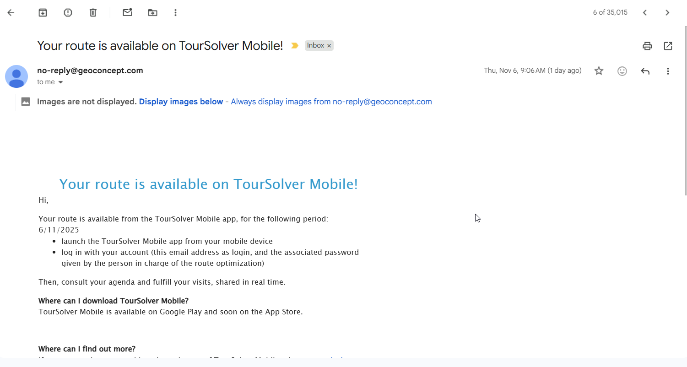

# Share a Tour with the Mobile App

Export a planned route to the mobile application of your field team, so that mobile users receive a notification with the shared tour and its deliveries.

## Before you begin

* Sign in to **TourSolver**.
* Optimize your deliveries so that you have a completed route. See [Optimize your Deliveries](operationsandroutemanagement-optimizeyourdeliveries.md).
* Open the **Optimization** section.

## Feature overview

* **Seamless route transfer**: Transfers an optimized route (tour) directly to the mobile device where it is needed.
* **Date-specific sharing**: Controls the date range for which the tour is active and accessible in the mobile app. Sharing a tour for a specific date range, for example 1 day, confirms which deliveries to perform on the selected dates.
* **Confirmation feedback**: Shows how many deliveries are shared and how many notifications are sent to mobile users.

### Notifications

The notification that is sent depends on your account type.

| Account type | Notification sent | Content sent |
| ------------ | ----------------- | ------------ |
| **Trial Version** | SMS notification | Link to download the mobile application |
| **Subscribed Version** | Notification email | Notification to all selected mobile app users that the tour has been shared |

<figure><figcaption></figcaption></figure>

## Share an optimized tour

1. Click **Optimization**.

<figure><figcaption></figcaption></figure>

2. Choose the **route** from the list.

<figure><figcaption></figcaption></figure>

3. Click **Export**, then click **Share with the Mobile App**.

<figure><figcaption></figcaption></figure>

4. Enter the **From date**, the date from which you want the tour to be shared.
5. Choose the **desired starting date**.
6. Choose a **To date**.

<figure><figcaption></figcaption></figure>


**Duration**: The standard duration is 1 day. You can adjust the **To date** to create multi-day routes. The date selection shows **From Date**, **To Date**, and **Duration (1 day)**.


<figure><figcaption></figcaption></figure>

7. Read the confirmation notification that is displayed for your trial or subscribed version.
8. Click **Send**.

<figure><figcaption></figcaption></figure>

### Result

A final confirmation pop-up shows the details of the deliveries shared and the emails sent.

<figure><figcaption></figcaption></figure>

## Tips


**Verify the delivery counts**: Read the final notification that appears when you click **Send**. It confirms how many deliveries are included in the shared tour and how many emails are sent to your mobile users.


## Related topics

* [Optimize your Deliveries](operationsandroutemanagement-optimizeyourdeliveries.md)
* [Export my Routes](operationsandroutemanagement-exportmyroutes.md)
* [How do I Geolocate my Delivery People](how-do-i-geolocate-my-delivery-people.md)
