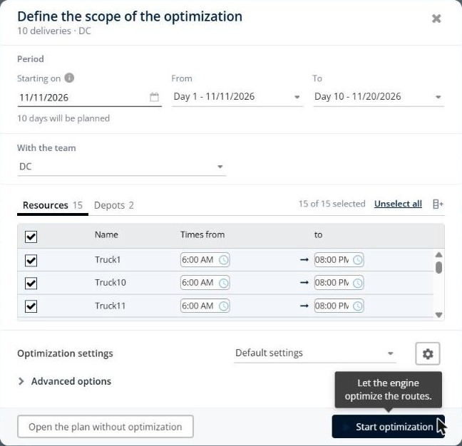
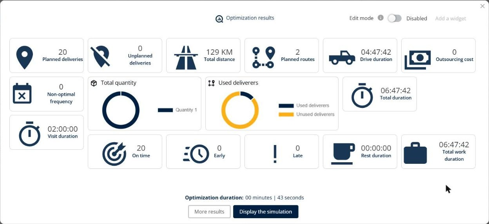
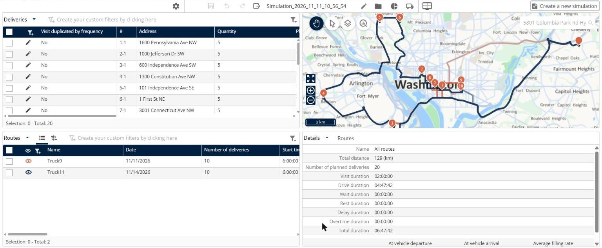

# Optimize over Several Weeks with Frequencies

Plan visits that must be performed several times over a period, for example twice in 20 days, and optimize your routes over several weeks or months.

## Before you begin

* Sign in to **TourSolver**.
* Set the **Worked days** of your resources. See [Modifying a Resource and Associated Constraints](../resource-and-vehicle-management/modifying-a-resource-and-associated-constraints.md).

## Feature overview

* **Visit frequency**: The number of visits over a number of days, for example **2/20** for two visits in 20 days.
* **Opening day**: The days on which the visit can be performed. A range, for example **1-30**, sets the period of the optimization.
* **Worked days**: The days on which the resources work. The frequency is spread over these days.
* **Visit duplicated by frequency**: The column of the deliveries list that shows the visits created by the frequency, numbered **1-1**, **1-2**, and so on.
* **Non-optimal frequency**: The number of visits that do not fall within the optimum visiting period.

## Prepare the import file

1. In the **Opening day** column, enter the visit days as a range that covers the whole period, for example **1-30** for 30 days, or a date interval such as **14/05/2026 => 12/06/2026**.
2. In the **Visit frequency** column, enter the number of visits and the number of days, separated by a slash, for example:
   * **1/5**: One visit every 5 days.
   * **2/20**: Two visits in 20 days.
3. Import the file in **My deliveries**. The **Opening day** and **Visit frequency** columns are mapped automatically.


**Worked days are required**: When you use a visit frequency, the **Worked days** of the resources must be filled in.


## Optimize over the period

1. In **Define the scope of the optimization**, check the **From** and **To** days. The opening day range of your file sets the period, for example **Day 1** to **Day 10**.
2. Click **Start optimization**.

<figure><figcaption></figcaption></figure>

3. In the **Optimization results**, check the **Non-optimal frequency**. A value of **0** means that all the visits respect their frequency.

<figure><figcaption></figcaption></figure>

4. Click **Display the simulation**. The **#** column shows each occurrence of a visit, for example **1-1** and **1-2**, with its **Planned day**.

<figure><figcaption></figcaption></figure>

## Check the interaction with the other constraints

* **Worked days**: The frequency is spread over the days that the resources work, not over all the days of the period. If the resources work days 1 to 5, a frequency of **2/10** cannot be planned, and TourSolver shows "The frequency denominator is bigger than the number of days".
* **Maximum visits per day**: A low **Maximum visits per day** on the **Route** tab of the resources can prevent the repeated visits from fitting in the period.
* **Nights out**: With nights out, a resource can stay away for several days. Check that the frequency and the **Max consecutive nights out** fit together. See [Plan Reloads, Multi-Depot and Overnight Routes](plan-reloads-multi-depot-and-overnight-routes.md#plan-overnight-routes).
* **Non-worked half days**: To plan a half day off, use two worked day slots on the **Planning** tab of the resource, for example **Worked days 1** from 8:00 AM to 5:00 PM on days 1-4, and **Worked days 2** from 8:00 AM to 12:00 PM on day 5.
* **Different quantities**: All the occurrences of a frequency have the same quantity. To deliver different quantities, create two visits. See [Plan Reloads, Multi-Depot and Overnight Routes](plan-reloads-multi-depot-and-overnight-routes.md#plan-different-quantities-for-a-visit-with-a-frequency).

## Use case: plan two visits per customer

Download the sample file [UseCase\_Frequencies.xlsx](../.gitbook/assets/UseCase_Frequencies.xlsx). It contains 10 customers around Washington, DC, with an **Opening day** of **1-10** and a **Visit frequency** of **2/10**. The resources of the team work days 1 to 5.

1. Import the file and optimize it. No visit is planned: each customer shows "The frequency denominator is bigger than the number of days", because the resources work only 5 of the 10 days.
2. In the file, change the **Visit frequency** to **2/5** and the **Opening day** to **1-5**, and then import and optimize it again.
3. The 20 visits are planned on two routes, on day 1 and day 4, with a **Non-optimal frequency** of **0**.

## Tips


**Choose a period that is a multiple of the frequency**: When the number of days of the period is not a multiple of the frequency denominator, TourSolver warns that the last period is incomplete.



**Use the RBS search strategy**: For datasets with visit frequencies, the **Advanced: Search strategy** **RBS** in **Calculation options** can give better results.


## Related topics

* [Diagnose Unplanned Visits and Inconsistent Routes](diagnose-unplanned-visits-and-inconsistent-routes.md)
* [Plan Reloads, Multi-Depot and Overnight Routes](plan-reloads-multi-depot-and-overnight-routes.md)
* [Optimize your Deliveries](operationsandroutemanagement-optimizeyourdeliveries.md)
