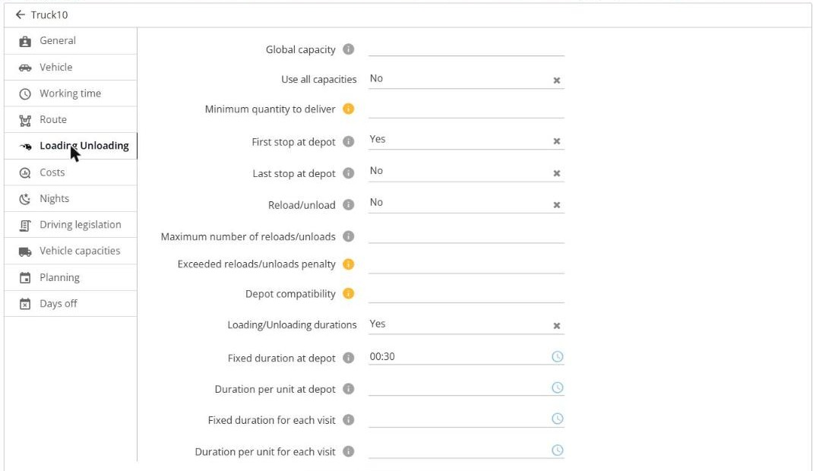
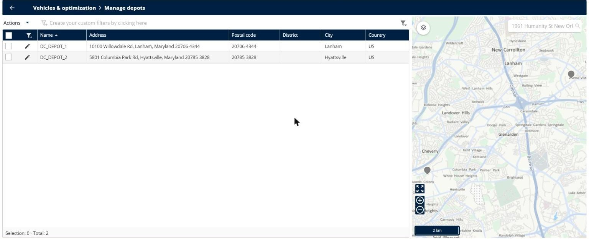
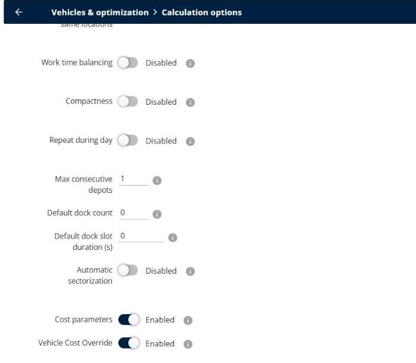
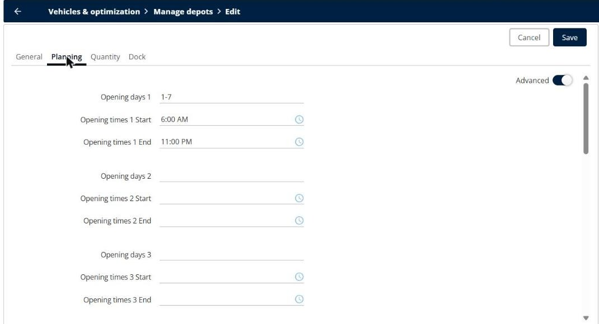
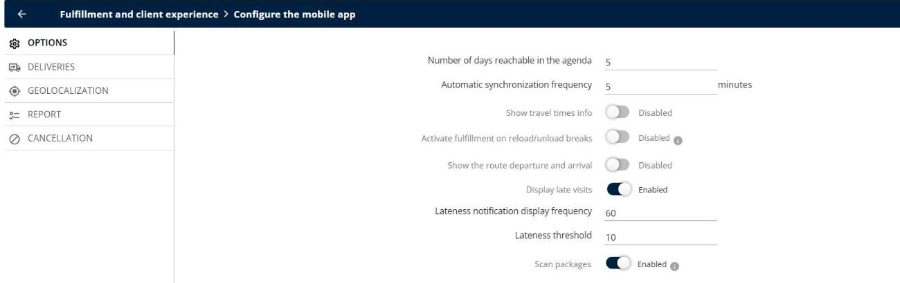
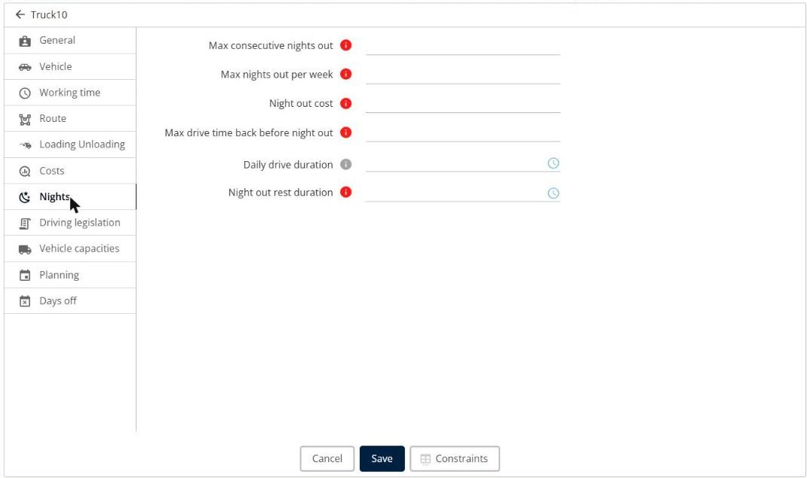

# Plan Reloads, Multi-Depot and Overnight Routes

Let your resources reload or unload at your depots during the route, pass through several depots, follow the reloads in the mobile app, and plan routes over several days with nights out.

## Before you begin

* Sign in to **TourSolver** with a user profile that has access to the **Configuration** page.
* Create your depots. See [Create a Depot](../importanddatasetup/importanddatasetup-createadepot.md).
* Set the **Vehicle capacities** of your resources. See [Modifying a Resource and Associated Constraints](../resource-and-vehicle-management/modifying-a-resource-and-associated-constraints.md).

## Feature overview

* **Reload/unload**: Allows a resource to go back to a depot during the route to reload or unload, when its capacity is reached.
* **Max consecutive depots**: The number of depots that a resource can visit one after the other in the same route.
* **Activate fulfillment on reload/unload breaks**: Shows the reloads and unloads in the mobile app as visits that the driver starts and ends.
* **Opening days and opening times of a depot**: The days and the hours when the resources can reload or unload at the depot.
* **Nights out**: Lets a resource stay away from its base for several days.

## Allow a resource to reload or unload

1. Go to **My deliverers**, and then click the **Edit** icon of the resource.
2. Click the **Loading Unloading** tab.
3. Set **Reload/unload** to **Yes**. The resource can then visit all its customers, even if the total quantity is larger than its capacity: it reloads at a depot during the route.
4. Optionally, enter the **Maximum number of reloads/unloads** per day, and the **Exceeded reloads/unloads penalty**.
5. Check the durations: **Fixed duration at depot**, **Duration per unit at depot**, **Fixed duration for each visit**, and **Duration per unit for each visit**, in the **HH:MM** format.
6. Click **Save**.

<figure><figcaption></figcaption></figure>


**First and last stop at depot**: If **First stop at depot** and **Last stop at depot** are both used, the resource never reloads during the route. It loads only at the start, at the end, or both.


## Use several depots in the same route

1. Go to **Configuration** > **Vehicles & optimization** > **Manage depots**, and check your depots.

<figure><figcaption></figcaption></figure>

2. Go to **Configuration** > **Vehicles & optimization** > **Calculation options**.
3. Under **Advanced parameters**, enter the **Max consecutive depots**, for example **2** if your vehicles load different goods at two depots.

<figure><figcaption></figcaption></figure>


**Keep the value low**: A value of **2** works. A value of **3** or more does not give results, and each additional depot significantly increases the optimization time.



**Depot compatibility**: The **Depot compatibility** constraint of a resource sends it only to the depots that have the required products, for example **gardening**. This constraint is currently not supported by the standard engine.


## Set the opening times of a depot

1. In **Manage depots**, click the **Edit** icon of the depot.
2. Click the **Planning** tab.
3. Enter the **Opening days**, for example **1-7**, and the **Opening times Start** and **End**.
4. Click **Save**.

<figure><figcaption></figcaption></figure>

For a depot or a visit that is open across midnight, enter the end time after 24:00 in your import file, for example **23:00** to **26:00**. A time window that ends before it starts is not valid. See [Diagnose Unplanned Visits and Inconsistent Routes](diagnose-unplanned-visits-and-inconsistent-routes.md#fix-the-time-windows).

## Follow the reloads in the mobile app

By default, the reloads and unloads are not shown as stops to validate in the mobile app.

1. Go to **Configuration** > **Fulfillment and client experience** > **Configure the mobile app**.
2. On the **OPTIONS** tab, turn on **Activate fulfillment on reload/unload breaks**.

<figure><figcaption></figcaption></figure>

### Result

The reloads and unloads are handled like visits in the mobile app: the driver starts and ends them, and the real duration is available in **Fulfillment**.

## Plan overnight routes

1. Go to **My deliverers**, and then click the **Edit** icon of the resource.
2. On the **Planning** tab, enter the **Worked days**, for example **1-5**.
3. On the **Nights** tab, enter the **Max consecutive nights out**, for example **4** for a route from Monday to Friday without going back to the base, or **2** to limit the route to two nights away.
4. Fill in the other fields if needed: **Max nights out per week**, **Night out cost**, **Max drive time back before night out**, and **Night out rest duration**.
5. Click **Save**.

<figure><figcaption></figcaption></figure>


**Incompatible constraints**: **Max consecutive nights out** cannot be used with **First stop at depot**, **Last stop at depot**, **Briefing duration**, **Debriefing duration**, **Start at first visit**, or **End at last visit**.


## Plan different quantities for a visit with a frequency

A visit with a frequency, for example **2/5**, is repeated with the same quantity each time. You cannot set a different quantity for each occurrence.

To deliver different quantities, create two visits in your import file, for example one visit with the quantity of the first delivery and one visit with the quantity of the second delivery, each with its own opening day.

## Tips


**Reloads count as stops**: A reload is planned like a visit at the depot, with its own duration. Check the loading and unloading durations to get realistic routes.


## Related topics

* [Create a Depot](../importanddatasetup/importanddatasetup-createadepot.md)
* [Diagnose Unplanned Visits and Inconsistent Routes](diagnose-unplanned-visits-and-inconsistent-routes.md)
* [Optimize your Deliveries](operationsandroutemanagement-optimizeyourdeliveries.md)
* [Modifying a Resource and Associated Constraints](../resource-and-vehicle-management/modifying-a-resource-and-associated-constraints.md)
