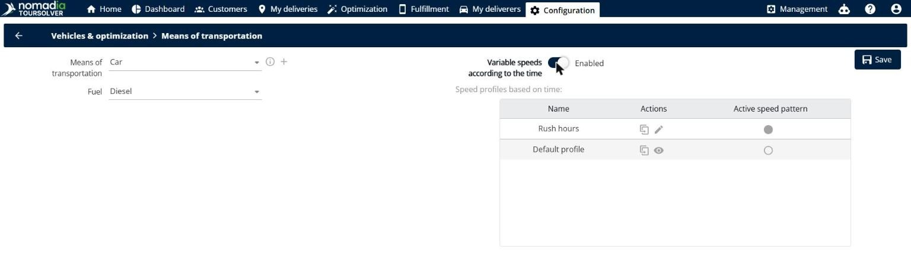
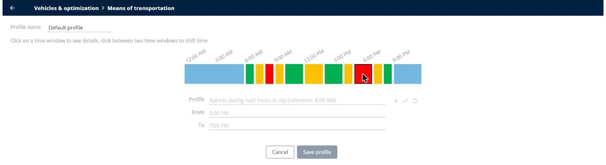
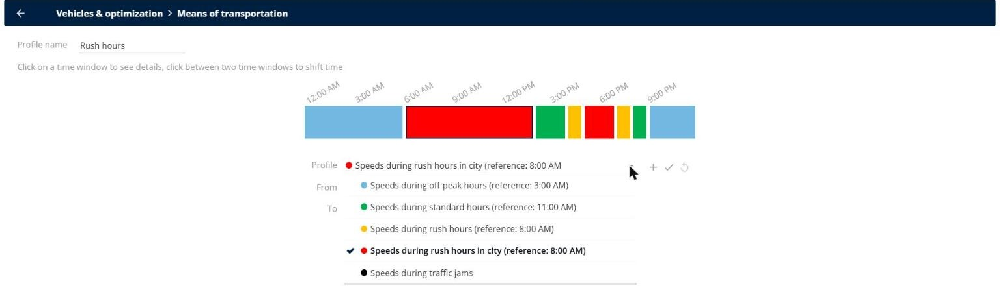
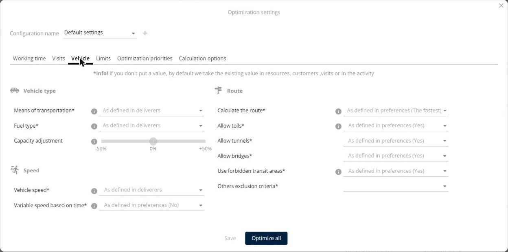

# Configure Variable Speeds

Make the travel times of your routes more realistic by applying different speeds according to the time of day, for example slower speeds during rush hours or in city traffic jams.

## Before you begin

* Sign in to **TourSolver** with a user profile that has access to the **Configuration** page.
* Check that your subscription includes the speed profiles. Variable speeds are available only with the **PREMIUM** version.

## Feature overview

* **Means of transportation**: The vehicle profile that TourSolver uses to calculate the routes, for example **Car** or **Truck**. Each profile has its own speeds.
* **Variable speeds according to the time**: Applies a speed pattern that changes the speeds with the time of day, instead of using the same speeds all day.
* **Speed pattern**: A day divided into time frames. Each time frame uses one speed profile. TourSolver applies the pattern based on the start time of each calculated route.
* **Speed profiles**: The speeds applied in a time frame:
  * **Speeds during off-peak hours** (blue): The fastest speeds, for example at night.
  * **Speeds during standard hours** (green): The usual speeds during the day.
  * **Speeds during rush hours** (yellow): Slower speeds at the busy hours.
  * **Speeds during rush hours in city** (red): The slowest speeds in city centers at the busy hours.
  * **Speeds during traffic jams** (black): The speeds in a traffic jam.
* **Default profile**: The speed pattern provided by TourSolver. You can view it and duplicate it, but not change it.

## Turn on variable speeds

1. Go to **Configuration**.
2. Under **Vehicles & optimization**, click **Means of transportation**.
3. Turn on **Variable speeds according to the time**. The **Speed profiles based on time** list appears.
4. In the **Active speed pattern** column, select the pattern to use.
5. Click **Save**.

<figure><figcaption></figcaption></figure>

### Result

The next optimizations use the speeds of the active pattern, based on the start time of each route.

## View the time frames of a speed pattern

1. In the **Speed profiles based on time** list, click the **eye** icon of the **Default profile**.
2. Click a time frame of the bar to see its **Profile**, its start time (**From**), and its end time (**To**). For example, the red time frame from **5:00 PM** to **7:00 PM** uses the **Speeds during rush hours in city**.

<figure><figcaption></figcaption></figure>

3. Click **Cancel** to go back to the list.

## Create your own speed pattern

1. In the **Speed profiles based on time** list, click the **Duplicate** icon of an existing pattern.
2. Enter a **Profile name**, for example **Rush hours**.
3. Click a time frame, and then select the speed **Profile** to apply to it.

<figure><figcaption></figcaption></figure>

4. To change the limits of the time frames, click between two time frames, and then shift the time. To add a time frame, click **+**.
5. Click **Save profile**.
6. Select the new pattern in the **Active speed pattern** column, and then click **Save**.

### Result

Your routes use your own time frames. For example, if your drivers are slowed down in the city every morning, give the morning the **Speeds during rush hours in city**.

## Use variable speeds in one optimization

You can also turn the variable speeds on or off for one optimization only.

1. In your simulation, open the **Optimization settings**.
2. Click the **Vehicle** tab.
3. Under **Speed**, set **Variable speed based on time** to **Yes** or **No**.

<figure><figcaption></figcaption></figure>

4. Click **Optimize all**.

## Tips


**Traffic patterns, not real-time traffic**: TourSolver is a planning tool. It applies the usual traffic of each time of day (historical patterns), so that you plan realistic routes in advance. Google Maps uses the real-time traffic at the moment of your search, so its times can differ.



**Evaluation mode**: Variable speeds can prevent the evaluation routes from loading. See [Evaluate your Existing Routes](../operationsandroutemanagement/evaluate-your-existing-routes.md).



**One resource slower or faster**: To make one resource drive slower or faster than the others all day, use the **Speed weighting** on the **Vehicle** tab of the resource instead. See [Why are distances and travel times different from Google Maps?](../faq/why-are-distances-and-travel-times-different-from-google-maps.md#adjust-the-speed-of-a-resource).


## Related topics

* [Why are distances and travel times different from Google Maps?](../faq/why-are-distances-and-travel-times-different-from-google-maps.md)
* [Creating a Resource](creating-a-resource.md)
* [Configure the optimization settings](../simulation/simulation-optimization-settings.md)
