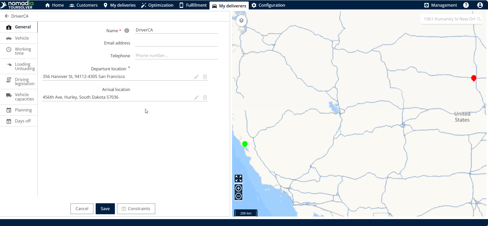
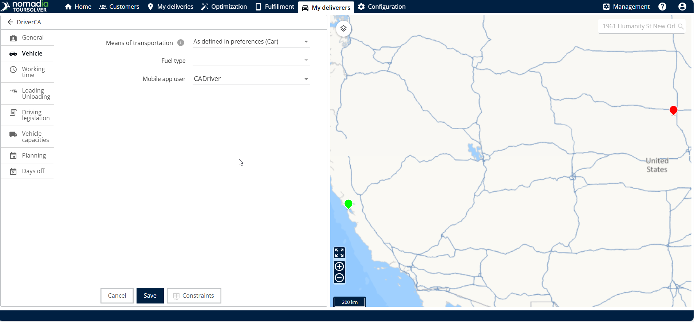
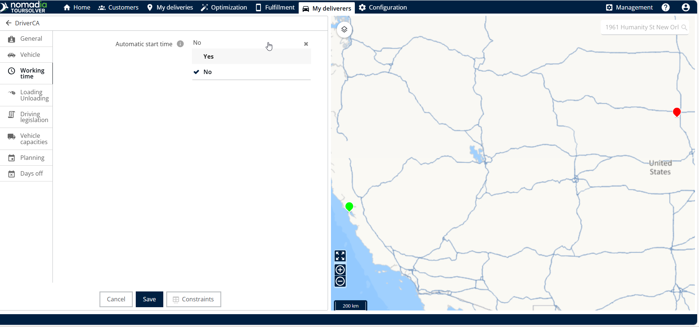
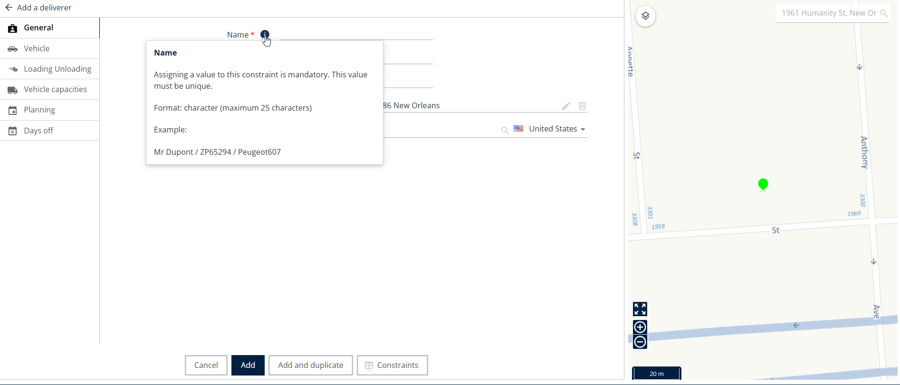

# Creating a Resource

Define a resource, such as a deliverer, with their departure location, vehicle, capacities, work schedule, and days off.

## Before you begin

* Sign in to **TourSolver**.
* Open the **Resource** page.

## Feature overview

Creating a resource involves filling out several tabs that define how the deliverer operates, travels, and when they are available.

* **Resource Details (General Info)**: Identifies the deliverer by name and sets their starting point, known as the departure location.
* **Vehicles tab**: Defines the primary way the deliverer travels, by selecting the means of transportation.
* **Vehicles Capacities tab**: Defines what the resource, or their assigned vehicle, can carry. You can add vehicle capacities so that constraints are met during planning.
* **Working Time and Planning tabs**: Define the availability of the deliverer. You select whether the automatic start time feature is active, define work slots, and schedule lunch breaks.
* **Days Off tab**: Schedules the dates when the resource is unavailable.

## Start a new resource

1. Go to the **Resource** page.
2. Click **Add** in the **Actions** menu.

<figure><figcaption></figcaption></figure>

## Create the resource

1. Enter the **full resource name**.
2. Enter the **departure location**, where the resource starts their shift.

<figure><figcaption></figcaption></figure>

3. Go to the **Vehicles** tab.
4. Select the **means of transportation**, for example car, bike, or truck.

<figure><figcaption></figcaption></figure>

5. Go to the **Working time** tab.
6. Select whether the automatic start time feature is active (yes or no).

<figure><figcaption></figcaption></figure>

## Set the vehicle capacities

If your resource transports goods, define its capacity limits.

1. Go to the **Vehicles Capacities** tab.
2. Click the **plus (+)** symbol at the bottom corner.
3. Add the necessary vehicle capacities in the available fields.

<figure><figcaption></figcaption></figure>

To delete a capacity slot, click the **delete** icon on the right side.

## Manage the work schedule

The **Planning** tab defines the work slots and the breaks of the resource.

### Add or edit work slots

1. Go to the **Planning** tab.
2. Click the **work slot**.
3. Click the **edit slot** button.
4. Add the work timings, then click **Edit**.

<figure><figcaption></figcaption></figure>

### Manage lunch breaks

1. To edit the existing lunch break work slot, click **edit lunch break**.
2. Add the **lunch break timings**.
3. Click **Edit** to save the changes to the lunch break work slot.
4. To delete a lunch break slot, click **delete lunch break**.

<figure><figcaption></figcaption></figure>

## Add days off

Use the **Days Off** tab to schedule planned time off.

1. Go to the **Days Off** tab.
2. Click the **plus (+)** icon on the right side to add an entry.
3. Add the **from date** and the **to date** of the time off.
4. Click the **add** icon to save the entry.

<figure><figcaption></figcaption></figure>


**Dates**: Make sure that the **To date** (the end date) is later than the **From date** (the start date).


## Finish the resource creation

1. After you fill in the details in all the tabs, click **Add**.

### Result

The resource is created successfully.

<figure><figcaption></figcaption></figure>

## Tips


**Understand constraints**: If you are unsure about a field or a constraint, hover over the tool tip icons for a short explanation of what it controls.


<figure><figcaption></figcaption></figure>


**Duplicate work slots quickly**: If a resource has several identical work slots, click the duplicate work slot option, then click **Duplicate** to add a copy.


<figure><figcaption></figcaption></figure>


**Manage capacity**: You can delete an unwanted vehicle capacity with the delete icon on the right side of the entry.


## Related topics

* [Modifying a Resource and Associated Constraints](modifying-a-resource-and-associated-constraints.md)
* [Rename a Quantity of a Vehicle](rename-a-quantity-of-a-vehicle.md)
* [Create and Modify a User](../importanddatasetup/importanddatasetup-createandmodifyauser.md)
