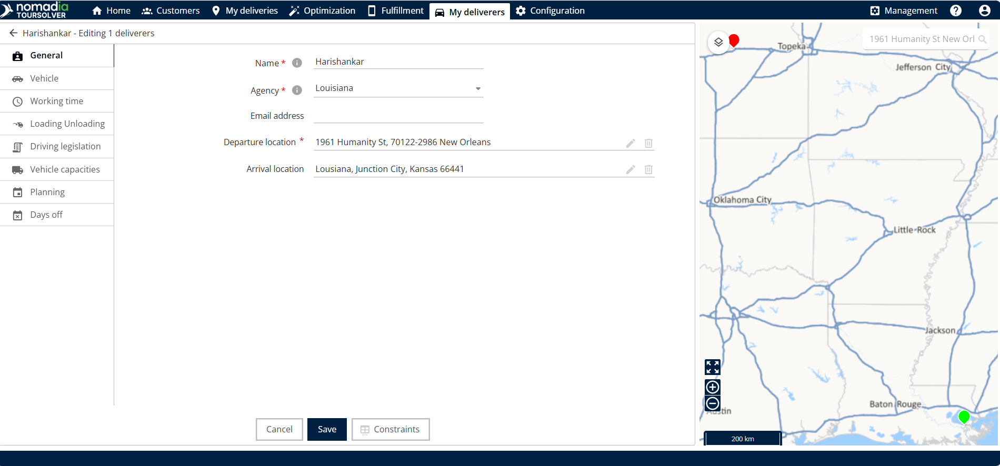
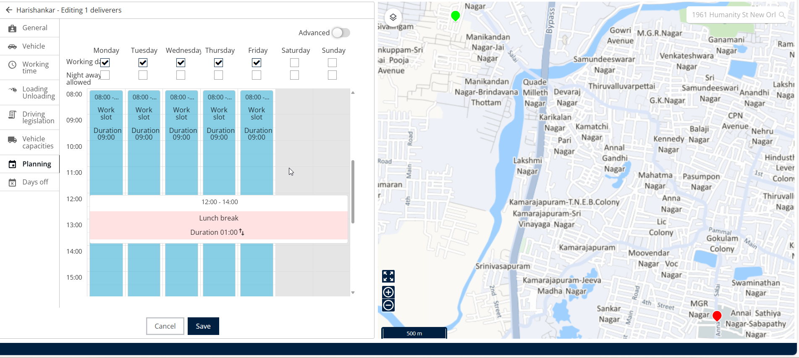
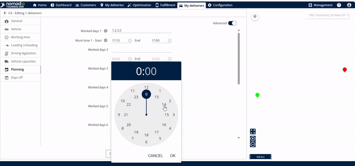
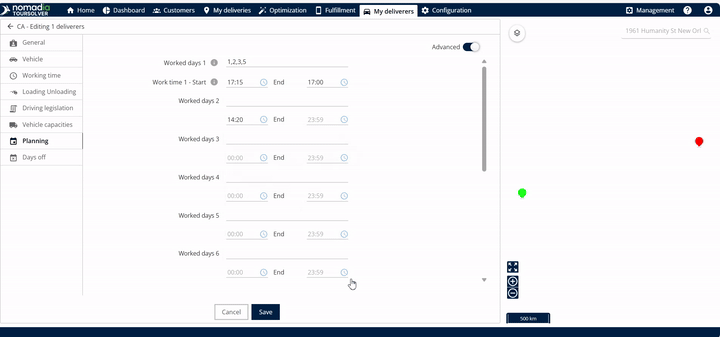

# Modifying a Resource and Associated Constraints

Change the scheduling, the locations, and the capacities of your resources, and the constraints that govern them.

## Before you begin

* Sign in to **TourSolver**.
* Open **My Deliverers** from the homepage.

<figure><figcaption></figcaption></figure>

## Feature overview

Constraints are the rules that govern when, where, and how a resource operates. The commonly used constraints are:

* **Departure and Arrival Location**: Defines the start and end point of the resource's day. Modify these locations when the typical starting or ending address of a resource changes, for example if they work from a different depot or return home.
* **Vehicle Capacities**: Sets limits on the capacity of the vehicle, typically measured by weight, so that a delivery vehicle is never overloaded. You can set the weight in kilograms (kg) or grams (g).
* **Planning (Work Slots)**: Determines the working availability of the resource. You manage the exact start and end times, and the days of the week when the resource is available.

To learn about other constraints, see the constraint documentation.

## Open the constraints of a resource

You can modify a resource team-wise, which affects a group, or individually.

1. In **My Deliverers**, click the **edit** (pencil) icon next to the name.

<figure><figcaption></figcaption></figure>

2. Modify the associated constraints.

<figure><figcaption></figcaption></figure>

## Modify the departure and arrival locations

If the start or end point of a resource changes, update it here.

1. Find the **Departure Location** or the **Arrival Location** section.
2. Modify the departure and the arrival address as needed.

<figure><figcaption></figcaption></figure>

### Result

The map shows the differences. The departure and the arrival locations use different colors, for example green or red.

## Update the vehicle capacities (weight)

1. Find the maximum weight that the vehicle of the resource can carry.
2. Modify the value of the weight. You can enter it in kilograms or in grams.

<figure><figcaption></figcaption></figure>

## Modify the work times

The **Planning** section controls when the resource is available to work. There are two methods: **Simple View** and **Advanced View**.

### Simple View: the same schedule every day

Use **Simple View** if the work hours are the same on all working days.

1. Click **Planning**.
2. In **Simple View**, click the time slot.
3. Click **Edit Workslot**.
4. Modify the start time and the end time.
5. Click **Edit**.

<figure><figcaption></figcaption></figure>

### Advanced View: different schedules for different days

Use **Advanced View** if you need unique start and end times for specific work days.

1. Click **Planning**.
2. In **Advanced View**, select the work days, for example work day 1, work day 2, and so on. You can enter a range, such as 1 to 5, which represents Monday to Friday, or specific days such as 1, 2, 3, 4, 5.
3. Make your adjustments in the clock image that is displayed.
4. Click **OK** to confirm the timing.

<figure><figcaption></figcaption></figure>

## Save all the modifications

After you complete the changes for the departure, the arrival, the capacity, and the planning, the changes are displayed.

### Result

The modifications are saved and displayed successfully.

<figure><figcaption></figcaption></figure>

## Tips


**Edit times efficiently**: Use the clock icon next to the time to bring up the clock image and make precise time adjustments.



**Delete a capacity quickly**: To remove a vehicle capacity value, click the delete icon on the right side of the weight entry.


## Related topics

* [Creating a Resource](creating-a-resource.md)
* [Rename a Quantity of a Vehicle](rename-a-quantity-of-a-vehicle.md)
