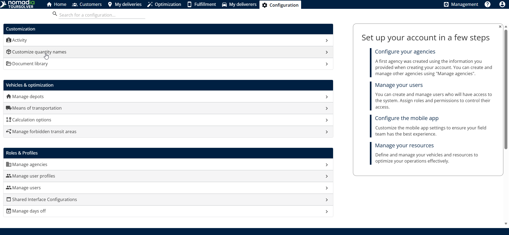
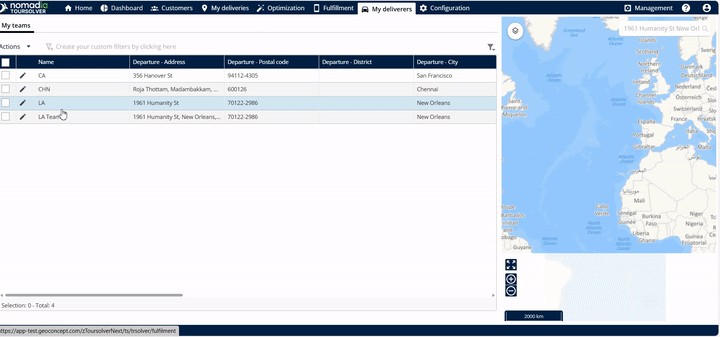
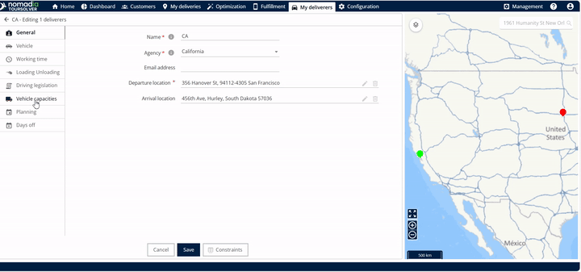
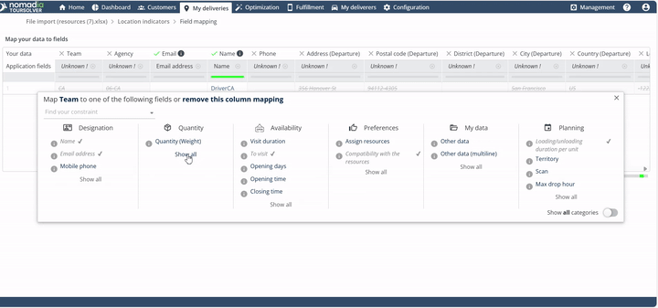

# Rename a Quantity of a Vehicle

Personalize the names of the vehicle quantities, so that your terminology is clear and consistent.

## Before you begin

* Sign in to **TourSolver**.
* Have access to **Configuration**.

## Feature overview

Customizing the quantity names displays your own names in two places:

* **Vehicle Capacity view**: After the renaming, the new names are visible in the capacity details of a vehicle. You can quickly check the capacity limits assigned to your fleet.
* **Delivery Import screen**: The new names are displayed when you import deliveries. They appear when you select **Show All** under the quantity section during the import, which ensures a correct data mapping.

## Rename a vehicle quantity

1. Go to **Configuration**.
2. Open **Customize Quantity Names**.

<figure><figcaption></figcaption></figure>

3. Rename the quantity.
4. Save your changes.

<figure><figcaption></figcaption></figure>

## Verify the new names in the vehicle capacities

1. Go to **My Deliverers**.
2. Edit a vehicle.

<figure><figcaption></figcaption></figure>

3. View the vehicle capacities.
4. Confirm the new name.

<figure><figcaption></figcaption></figure>

## Verify the new names during the delivery import

1. Go to **My Deliveries**.
2. Start the import.
3. Address the unknown fields.
4. Select **Show All** in the quantities.
5. Confirm the new name.

<figure><figcaption></figcaption></figure>

## Tips


**Verify immediately**: After you save the renamed quantity, check the change in the vehicle capacities and in a pending delivery import. This ensures that the change is applied across the system.



**Keep it simple**: Use clear, concise names that are easy for everyone on your team to understand. The new name is displayed in several places, so accessible language prevents confusion.



**Before you save**: Update all the necessary fields before you click **Save**, to avoid returning to the customization menu several times.


## Related topics

* [Creating a Resource](creating-a-resource.md)
* [Modifying a Resource and Associated Constraints](modifying-a-resource-and-associated-constraints.md)
* [Import of Deliveries](../importanddatasetup/importanddatasetup-importofdeliveries.md)
