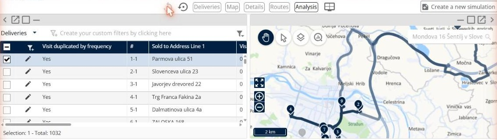

# Analyser les résultats

Cette page explique comment utiliser le panneau **Analyse** pour accéder aux graphiques d’analyse et mieux comprendre les résultats.

## Avant de commencer

* Ouvrez une simulation. Voir [Simulation](simulation.md).

## Étapes

1. Accédez à **Simulation**.
2. Cliquez sur **Modifier l’affichage des panneaux**. La barre d’outils affiche les panneaux que vous pouvez placer : **Livraisons**, **Carte**, **Détails**, **Tournées** et **Analyse**.
3. Faites glisser **Analyse** sur la page.

4. Cliquez sur la flèche déroulante **Analyse**.
5. Cliquez sur un graphique. Les graphiques sont décrits dans [Graphiques d’analyse](simulation-analysis-charts.md).

## Fonctionnalités

* [Graphiques d’analyse](simulation-analysis-charts.md) : découvrez ce que montre chaque graphique.

## Résultat

Le panneau affiche le graphique que vous avez sélectionné.

## Conseils


**Revenir à votre disposition** : cliquez sur **Modifier l’affichage des panneaux**, puis sur **Annuler changement de mise en page** ou **Réinitialiser la mise en page** pour retirer le panneau.



**Changer de panneau** : lorsque vous ajoutez plusieurs panneaux au même endroit, cliquez sur le nom du panneau en haut à droite pour passer de l’un à l’autre.


## Rubriques connexes

* [Simulation](simulation.md)
* [Consulter les détails d’une tournée](simulation-details.md)
