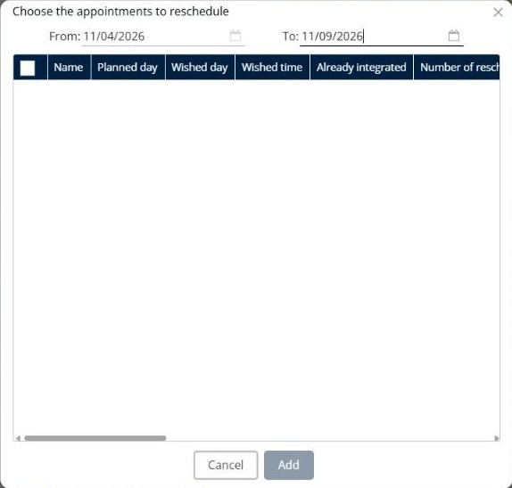

# Ajouter des rendez-vous à replanifier

Cette page explique comment ajouter à une simulation les rendez-vous qui doivent être replanifiés.

## Quand l’utiliser

Utilisez **Ajouter des rendez-vous à replanifier** pour planifier à nouveau les visites qui n’ont pas pu avoir lieu comme prévu, par exemple une visite reportée par le client.

## Avant de commencer

* Ouvrez une simulation. Voir [Simulation](simulation.md).

## Étapes

1. Accédez à **Simulation** > **Livraisons**.
2. Cliquez sur la flèche déroulante **Livraisons**, puis sur **Ajouter des rendez-vous à replanifier**.
3. Dans la fenêtre **Choisissez les rendez-vous à replanifier**, sélectionnez la période dans **Du** et **Au**, par exemple **11/04/2026** et **11/09/2026**.
4. Consultez la liste des rendez-vous. Les colonnes comprennent **Nom**, **Jour prévu**, **Jour souhaité**, **Créneau souhaité**, **Déjà intégré** et **Nombre de replanifications**, suivies des champs du client.
5. Cochez les cases des rendez-vous que vous souhaitez ajouter.
6. Cliquez sur **Ajouter**.

Cliquez sur **Annuler** pour fermer la fenêtre sans ajouter de rendez-vous.

## Résultat

Les rendez-vous sont ajoutés au panneau **Livraisons**. Planifiez-les avec [Optimiser les livraisons](simulation-deliveries-optimize.md) ou [Affecter des livraisons à une tournée](simulation-deliveries-assign.md).

## Conseils


**Déjà intégré** : utilisez cette colonne pour savoir si un rendez-vous figure déjà dans une simulation, afin de ne pas le planifier deux fois.


## Rubriques connexes

* [Gérer les livraisons](simulation-deliveries.md)
* [Optimiser les livraisons](simulation-deliveries-optimize.md)
