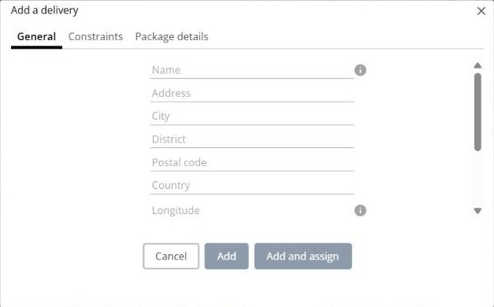
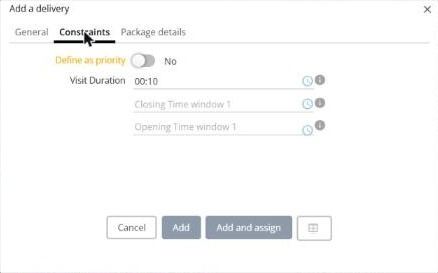

# Ajouter une livraison

Cette page explique comment créer une nouvelle livraison directement dans une simulation.

## Quand l’utiliser

Utilisez **Ajouter une livraison** lorsqu’un client demande une nouvelle livraison après l’optimisation de vos tournées. Vous ajoutez la livraison à la simulation, puis vous la planifiez avec les autres actions sur les livraisons.

## Avant de commencer

* Ouvrez une simulation. Voir [Simulation](simulation.md).

## Étapes

1. Accédez à **Simulation** > **Livraisons**.
2. Cliquez sur la flèche déroulante **Livraisons**, puis sur **Ajouter une livraison**. Vous pouvez aussi appuyer sur **Alt+a**.
3. Dans l’onglet **Général**, saisissez le **Nom**, l’**Adresse**, la **Ville/Commune**, le **District**, le **Code postal** et le **Pays** de la livraison. Vous pouvez aussi saisir sa **Longitude** et sa **Latitude**.
4. Facultatif : cochez **Ajouter comme client** pour enregistrer l’adresse de la livraison dans votre liste de clients.
5. Dans l’onglet **Contraintes**, définissez les contraintes de la livraison :
   * **Définir comme prioritaire** : activez l’interrupteur pour donner la priorité à la livraison.
   * **Visit Duration** : le temps à passer chez le client. La valeur par défaut est **00:10**.
   * **Opening Time window 1** et **Closing Time window 1** : le créneau pendant lequel la livraison peut avoir lieu.
6. Dans l’onglet **Détails des colis**, consultez les colis de la livraison, avec leur **Code**, leur **Commande** et leur **Description**. Cliquez sur **Ajouter un colis** pour en ajouter un.
7. Cliquez sur **Ajouter** pour ajouter la livraison, ou sur **Ajouter et affecter** pour l’ajouter puis l’affecter à une tournée.

Cliquez sur **Annuler** pour fermer la fenêtre sans ajouter de livraison.

## Résultat

La livraison est ajoutée au panneau **Livraisons**. Si vous avez cliqué sur **Ajouter et affecter**, la page **Affecter une livraison à une tournée** s’ouvre. Voir [Affecter des livraisons à une tournée](simulation-deliveries-assign.md).

## Rubriques connexes

* [Gérer les livraisons](simulation-deliveries.md)
* [Modifier une livraison](simulation-deliveries-change-delivery.md)
* [Affecter des livraisons à une tournée](simulation-deliveries-assign.md)
